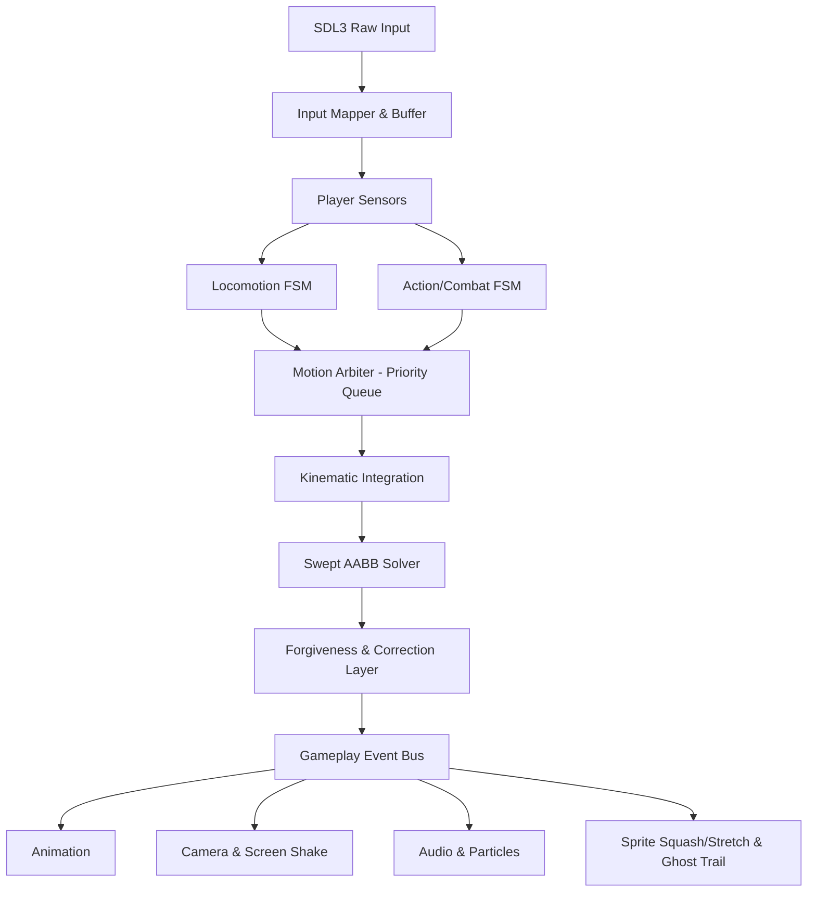

# Player System — Core Technical Specification
### High-Speed 2D Action Metroidvania Engine Architecture (C++20 / SDL3)

---

## 1. Core Architectural Boundaries

Hệ thống được xây dựng trên **4 ranh giới bất biến (Golden Boundaries)**:
1. **Input ≠ State:** Input là dữ liệu thô và buffer; không trực tiếp điều khiển vị trí hay logic.
2. **State ≠ Physics:** State máy trạng thái chỉ đưa ra *ý định (Intent)*; không tự gán tọa độ hay can thiệp thẳng vào transform.
3. **Gameplay ≠ Presentation:** Logic game chạy độc lập hoàn toàn với Sprite, Animation, Camera và Audio.
4. **Physics Correctness ≠ Player Forgiveness:** Thuật toán vật lý chuẩn xác (AABB) được tách riêng biệt với lớp "ăn gian vì trải nghiệm" (Forgiveness Layer).



---

## 2. Deterministic Runtime Pipeline

### Chu trình Fixed Timestep (`120 Hz` hoặc `60 Hz`):
- **Simulation Time:** Cố định (`dt = 1/120s` hoặc `1/60s`) để vật lý và chuyển động nhất quán 100%, không phụ thuộc FPS màn hình.
- **Render Interpolation:** Render ở mọi tần số quét màn hình (144Hz, 240Hz, V-Sync) bằng hệ số nội suy alpha giữa 2 frame vật lý (`alpha = accumulator / fixedDt`).
- **Thứ tự thực thi trong 1 Tick vật lý:**
  1. *Input Buffer Advance & Snapshots*
  2. *Sensor Suite Update* (đọc trạng thái tiếp xúc từ frame trước)
  3. *State Logic Update* (FSM Locomotion + Action FSM xác định hành vi)
  4. *Motion Assembly & Arbitration* (tổng hợp các vector chuyển động theo độ ưu tiên)
  5. *Kinematic Integration* (cập nhật vận tốc, gia tốc, trọng lực)
  6. *Swept AABB Collision Resolution* (giải quyết va chạm dạng quét hình hộp)
  7. *Post-Physics Forgiveness & Contact Update* (Floor snap, corner correction, pogo, ledge)
  8. *Event Dispatch* (bắn event qua Bus cho audio, FX, camera)

---

## 3. Input & Action Buffering System

Loại bỏ hoàn toàn cờ `bool jumpPressed` đơn giản. Hệ thống dùng **Circular Action Queue** có gắn dấu thời gian:

- **Sub-frame Capture:** Bắt sự kiện bàn phím/tay cầm và lưu timestamp chính xác.
- **Action Age & Expiration:** Mỗi hành động đưa vào buffer có tuổi thọ (TTL). Khi Player rơi vào trạng thái có thể thực thi, hành động hợp lệ trẻ nhất sẽ được kích hoạt ngay lập tức.
- **Input Windows tiêu chuẩn:**
  - `Jump Buffer`: **100 ms** (bấm nhảy trước khi chạm đất vẫn kích hoạt ngay khi chạm đất).
  - `Attack Buffer`: **100 ms** (bấm đánh khi đang dash sẽ ra đòn ngay frame đầu tiên hết dash).
  - `Dash Buffer`: **67 ms**.
  - `Wall Jump Buffer`: **67 ms**.
  - `Parry Buffer`: **30 – 40 ms**.
- **Chorded & Directional Mapping:** Tách riêng vector di chuyển (`Move Axis`), hướng ngắm (`Aim Axis`), và phím tổ hợp (ví dụ: `Down + Jump` để rơi xuyên sàn).

---

## 4. Dual-Track State Machine (HFSM)

Thay vì 1 state machine khổng lồ gây xung đột, Player sở hữu 2 luồng trạng thái hoạt động song song nhưng độc lập:

| Track | Các trạng thái thành phần | Trách nhiệm |
| :--- | :--- | :--- |
| **Locomotion Track** | `Grounded`, `Airborne`, `WallSlide`, `WallClimb`, `Dash`, `Slide`, `LedgeGrab` | Quản lý việc định vị, di chuyển ngang, nhảy, bám tường, lướt. |
| **Action / Combat Track** | `Neutral`, `AttackStartup`, `AttackActive`, `AttackRecovery`, `Parry`, `Hurt`, `Stunned` | Quản lý đòn đánh, phòng thủ, bị choáng, vung vũ khí. |

### Quy tắc phối hợp:
- Đòn đánh (`Attack`) trên Action Track **không hủy** trạng thái rơi (`Airborne`) của Locomotion Track, trừ khi đòn đánh đó có cờ yêu cầu dừng trọng lực (hover/stall).
- `Dash` có mức ưu tiên cao sẽ tạm thời khóa hoặc hủy `AttackRecovery` (Dash-canceling).
- Bị dính đòn nặng (`Hurt / Stunned`) sẽ ngắt cả 2 track về trạng thái trừng phạt.

---

## 5. Motion Arbiter & Priority System

Không để bất kỳ hàm nào tự tiện gán trực tiếp `velocity = ...`. Mọi yêu cầu dịch chuyển phải gửi phiếu `MotionRequest` về bộ phân xử **Motion Arbiter**.

### Phân cấp độ ưu tiên (Priority Tiers):
1. **Tier 100 (Hard Lock / Cutscene):** Chuyển động bắt buộc theo kịch bản.
2. **Tier 90 (Damage & Stun):** Lực đẩy văng (Knockback) khi dính sát thương.
3. **Tier 80 (Dash / Special Traversal):** Vector lướt tốc độ cao có kiểm soát.
4. **Tier 70 (Combat Kinetics / Recoil / Parry):** Lực đẩy lùi do giật vũ khí hoặc bật nảy (Pogo bounce).
5. **Tier 50 (Root Motion):** Chuyển dịch bước chân nhỏ đi kèm đòn đánh.
6. **Tier 30 (Locomotion):** Di chuyển chạy/nhảy do người chơi bấm phím.
7. **Tier 10 (Environment & Gravity):** Trọng lực tự nhiên, gió thổi, băng trượt.

### Chế độ hòa trộn (Blending Modes):
- `Override`: Đè bẹp hoàn toàn các chuyển động ở tier thấp hơn.
- `Additive`: Cộng dồn lực (ví dụ: vừa bị đẩy lùi vừa rơi tự do).
- `Constrain`: Giới hạn tốc độ tối đa của trục tương ứng.

---

## 6. Kinematic Body & Swept AABB Solver

Metroidvania tốc độ cao **tuyệt đối không dùng RigidBody vật lý thực (Box2D)** để tránh hiện tượng dính tường, rung lắc góc cạnh. Hệ thống dùng **Kinematic Body** kết hợp thuật toán **Swept AABB**:

### 1. Minkowski Expansion (Phóng to chướng ngại vật):
- Co nhân vật về một chất điểm (Ray), đồng thời mở rộng kích thước của từng Tile chướng ngại vật ra bằng đúng nửa kích thước nhân vật (`HalfExtents`).

### 2. Ray-AABB Slab Test:
- Bắn tia chuyển động từ vị trí cũ đến vị trí mới.
- Tính toán chính xác thời điểm va chạm `TOI` (Time of Impact từ `0.0` đến `1.0`) và pháp tuyến mặt tiếp xúc (`Normal`).

### 3. Multi-Pass Slide Resolution:
- Cho phép nhân vật trượt mượt dọc theo bờ tường/mặt đất trong 1 frame (hỗ trợ tối đa 4 – 6 lần phản xạ vector).
- Khử thành phần vận tốc đâm xuyên vào bề mặt (`V_remaining = V - Normal * Dot(V, Normal)`).

### 4. Sub-pixel Remainder Accumulation:
- Lưu lại phần dư thập phân của tọa độ sau mỗi frame để tránh lỗi mất pixel (pixel drift / jitter) khi di chuyển ở tốc độ cao trên độ phân giải pixel art.

---

## 7. Player Forgiveness Layer ("The Secret Sauce")

Đây là hệ thống tạo nên cảm giác điều khiển hoàn hảo của *Celeste*, *Hollow Knight* và *Dead Cells*:

```text
               ┌── Head-bump Corner Correction (Đẩy lướt qua góc trần)
               ├── Dash Ledge Pop (Tự nâng lên bậc khi lướt sát mép)
               ├── Coyote Time (Ground 100ms & Wall 80ms)
Forgiveness ───┼── Jump Buffering (100ms trước khi tiếp đất)
   Layer       ├── Variable Jump Height (Cắt vận tốc khi thả nút sớm)
               ├── Apex Gravity Float (Giảm trọng lực tại đỉnh nhảy)
               ├── Wall Jump Lockout (Khóa phím ngược chiều trong 100ms)
               └── Floor Snap & Slope Hysteresis (Chống hẫng chân trên dốc)
```

1. **Head-Bump Corner Correction:**
   - Khi nhảy lên mà đầu nhân vật va quẹt vào góc trần nhà trong phạm vi **4 – 6 pixel**, game tự động đẩy nhẹ nhân vật sang ngang để lách qua mép thay vì khựng lại rớt xuống.
2. **Dash Ledge Pop:**
   - Khi lướt ngang sát mặt đất mà vấp phải bậc thềm cao 2 – 5 pixel, tự động nâng nhân vật lên bề mặt mới mà không làm triệt tiêu quán tính lướt.
3. **Coyote Time (Ground & Wall):**
   - Cho phép người chơi nhảy trong vòng **80 – 100 ms** sau khi đã hoàn toàn rời khỏi mép vực hoặc mép tường.
4. **Variable Jump Height & Apex Float:**
   - Nhả nút nhảy sớm: Vận tốc thẳng đứng bị nhân hệ số triệt tiêu (`0.45×`), tạo cú nhảy ngắn chính xác.
   - Tại đỉnh parabol (khi vận tốc gần bằng 0): Trọng lực tự động giảm xuống (`0.5×`) trong khoảng vài chục ms, tạo cảm giác "lơ lửng bồng bềnh" dễ ngắm đòn.
5. **Wall Jump Lockout & Directional Separation:**
   - `Neutral Wall Jump`: Đạp tường nhảy thẳng lên cao, lệch nhẹ ra ngoài.
   - `Away Wall Kick`: Đạp mạnh ra xa, **khóa phím điều khiển ngược chiều lại trong 100 ms** để tránh việc người chơi vô tình bấm ngược làm rơi tuột xuống lại.
6. **Floor Snap & Slope Hysteresis:**
   - Khi chạy xuống dốc hoặc bước qua gờ nhỏ, hệ thống bắn tia dò xuống dưới **3 – 4 pixel** để ép chân nhân vật dính sát sàn, tránh bị chuyển nhầm sang trạng thái rơi tự do (`Airborne`).

---

## 8. Môi trường & Địa hình Nâng cao

### 1. Dốc (Slopes 22.5° / 45°):
- Chiếu vector di chuyển tiếp tuyến với mặt phẳng dốc (`Tangent Vector`).
- Tự động bù trừ trọng lực để tốc độ leo dốc và xuống dốc ổn định, không giật cục.

### 2. Nền di động (Moving Platforms):
- Nhân vật gắn neo tọa độ theo delta của sàn (`Player.pos += Platform.delta`).
- Khi nhảy rời khỏi sàn di động: Kế thừa 100% vector vận tốc của sàn tại thời điểm đó (Momentum Inheritance).

### 3. Nền một chiều (One-Way / Drop-Through Platforms):
- Chỉ kích hoạt va chạm khi chân nhân vật đi từ trên xuống dưới và đã vượt qua mặt sàn ở frame trước.
- Kích hoạt rơi xuyên sàn bằng tổ hợp `Down + Jump` với bộ lọc loại trừ va chạm cho đến khi toàn bộ thân nhân vật vượt hẳn qua đáy sàn.

---

## 9. Combat Kinetics & Reaction System

### 1. Pogo Bounce (Chém nảy kiểu Hollow Knight):
- Khi chém xuống (`Down-Slash`) trúng quái vật, gai nhọn hoặc vật thể tương tác:
  - Bật nảy nhân vật lên với vận tốc thẳng đứng cực mạnh.
  - Hồi lại toàn bộ số lần `Air Dash` và `Double Jump`.
  - Khởi tạo hiệu ứng Hitstop và bụi chấn động.
  - Ưu tiên xử lý va chạm Pogo trước va chạm nhận sát thương từ gai nhọn trong cùng 1 frame.

### 2. Hitstop & Freeze Frames (Độ khựng đòn đánh):
- Không dừng toàn bộ game; tách theo các kênh độc lập:
  - *Attacker Freeze:* Dừng frame hoạt ảnh người chơi trong **50 – 80 ms**.
  - *Defender Freeze:* Dừng kẻ địch bị trúng đòn.
  - *World Time:* Hệ thống hạt, camera và UI vẫn hoạt động mượt mà bình thường.

### 3. Phản lực & Lực đẩy lùi (Recoil & Knockback):
- Sử dụng mô hình suy giảm vector theo thời gian thực (Exponential / Linear Damping), không dùng phép nhân `vel *= 0.9` vốn bị phụ thuộc FPS.
- Đòn bắn/chém nặng tạo phản lực đẩy lùi người chơi về phía sau.
- Bị đánh trúng: Nhận lực Knockback kèm trạng thái Hitstun và vô địch tạm thời (`i-Frames`).

### 4. Swept Hitbox (Chống lọt khung hình):
- Đòn chém tốc độ cao nối liền vùng Hitbox giữa frame cũ và frame mới, ngăn chặn việc vũ khí chém xuyên qua quái vật do FPS cao hoặc mục tiêu nhỏ.

---

## 10. Game Juice & Visual Feedback

Tách biệt hoàn toàn khỏi logic vật lý nhưng được kích hoạt thông qua **Event Bus**:

1. **Procedural Spring-Damper Squash & Stretch:**
   - Biến dạng co giãn Sprite dựa trên lò xo vật lý (`Stiffness`, `Damping`):
     - *Bật nhảy:* Kéo dài theo trục dọc, thon trục ngang.
     - *Tiếp đất mạnh:* Ép dẹp theo trục dọc, bè trục ngang.
     - *Dash:* Dãn dài theo hướng vector lướt.
2. **Directional Camera System:**
   - *Dual-Zone Deadzone:* Vùng chết camera mềm giúp nhân vật di chuyển nhẹ không làm rung hình.
   - *Lookahead:* Camera tự động lia đón đầu hướng nhìn và vận tốc của nhân vật.
   - *Spring-Damper Screen Shake:* Rung lắc màn hình có hướng (dọc theo vector đòn đánh hoặc nổ) triệt tiêu bằng lò xo mượt, không dùng hàm ngẫu nhiên vô hướng (`rand()`).
3. **Ghost Trail (Bóng ma sau ảnh):**
   - Bộ đệm đối tượng tái sử dụng (Object Pool) sinh ra các bóng mờ mờ dần khi di chuyển vượt ngưỡng tốc độ cao (Dash, Wall kick).

---

## 11. Bảng Thông số Cấu hình Mẫu (Benchmark Metrics)

| Thông số | Giá trị khởi điểm | Đơn vị | Mục đích |
| :--- | :--- | :--- | :--- |
| **Max Run Speed** | `180.0` | px/s | Tốc độ chạy ổn định tối đa |
| **Ground Acceleration** | `1600.0` | px/s² | Độ nhạy khi tăng tốc từ đứng yên |
| **Ground Deceleration** | `2200.0` | px/s² | Độ ăn phanh khi nhả phím |
| **Turn Acceleration** | `3000.0` | px/s² | Tốc độ quay đầu tức thì, không trơn trượt |
| **Gravity** | `1200.0` | px/s² | Trọng lực tự nhiên khi rơi |
| **Jump Height** | `58.0` | px | Độ cao đỉnh nhảy tối đa |
| **Variable Jump Cut** | `0.45` | hệ số | Giảm vận tốc khi nhả nút nhảy sớm |
| **Apex Gravity Mult** | `0.55` | hệ số | Trọng lực tại đỉnh nhảy (Apex float) |
| **Fast Fall Mult** | `1.45` | hệ số | Trọng lực khi giữ phím Down lúc rơi |
| **Terminal Velocity** | `950.0` | px/s | Vận tốc rơi tối đa |
| **Coyote Time** | `0.100` | giây (100ms) | Thời gian ân hạn nhảy khi rời mép vực |
| **Jump Buffer Time** | `0.100` | giây (100ms) | Thời gian ghi nhớ lệnh nhảy trước khi chạm sàn |
| **Corner Correction** | `4 – 6` | pixel | Biên độ tự lách qua góc tường trần nhà |
| **Wall Slide Max Speed** | `150.0` | px/s | Tốc độ trượt bám tường |
| **Wall Jump Force (X/Y)**| `320.0 / -360.0` | px/s | Lực đẩy ngang và dọc khi đạp tường |
| **Wall Jump Lockout** | `0.100` | giây (100ms) | Khóa phím ngược chiều sau khi đạp tường |
| **Dash Speed / Time** | `720.0 / 0.120` | px/s / giây | Tốc độ và thời lượng 1 cú lướt |
| **Pogo Bounce Speed** | `430.0` | px/s | Lực nảy ngược lên khi chém xuống trúng mục tiêu |
| **Light / Heavy Hitstop**| `0.050 / 0.083` | giây | Thời gian khựng hình khi chém trúng |

---

## 12. Tóm tắt Kiến trúc Tổng thể

```text
       Input Layer (Sub-frame & Buffer)
                      ↓
       Sensor Suite (Ground, Wall, Ledge, Head)
                      ↓
   Dual-Track FSM (Locomotion FSM || Combat FSM)
                      ↓
       Motion Arbiter (Priority-based Request Blend)
                      ↓
   Kinematic Body (Integration & Swept AABB Solver)
                      ↓
       Player Forgiveness (Coyote, Buffer, Snap, Nudge)
                      ↓
       Event Bus (Audio, Camera Shake, FX, Animation)
```

Tài liệu này là kim chỉ nam kỹ thuật chuẩn xác, không phụ thuộc vào mã nguồn cụ thể, sẵn sàng để hiện thực hóa từng module vào dự án C++20 / SDL3.