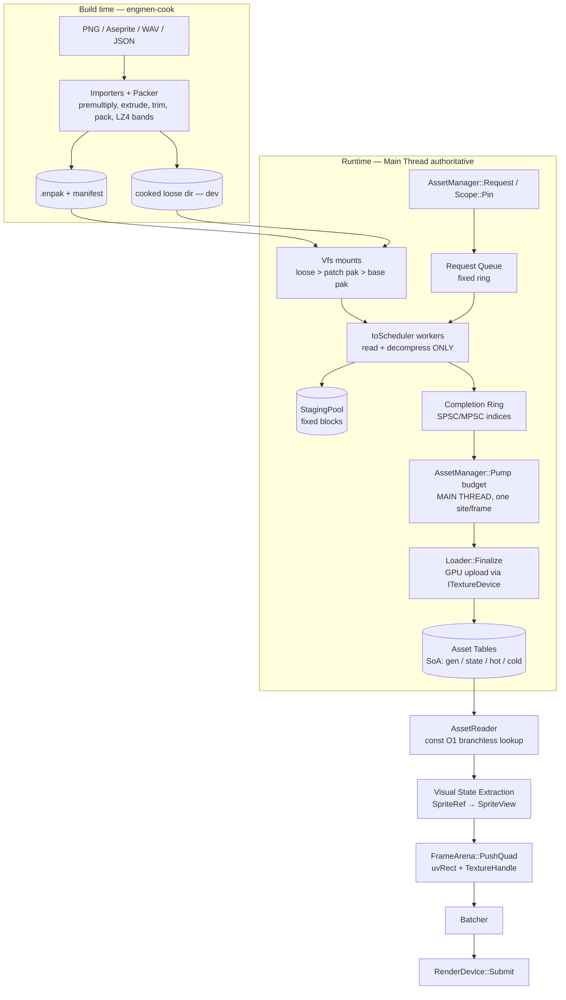

# EngineN — Milestone 04: Asset Subsystem — Architecture Proposal & Component Spec

> **Status:** Proposal for review. **Scope:** `AssetHandle`, `AssetManager`, `Texture`, Atlas/SpriteSheet, VFS/pack, cooked formats, async loading, hot-reload, extensibility (audio/font/data).
> **Inputs:** `PLATFORM_CONTEXT.md`, `RENDERER_CONTEXT.md`. All golden rules from both documents are preserved.

---

## 0. TL;DR — Decisions

| # | Decision | One-line rationale |
|---|---|---|
| D1 | **Two-tier identity:** `AssetId` (64-bit path-hash, stable, used in data/cook/lookup) + `AssetHandle<T>` (32-bit generational, runtime/hot path) | UUID cost is paid once at the boundary; hot path is an array index + 1 compare |
| D2 | **Handle = 20-bit index + 12-bit generation; slot 0 is a permanent *fallback asset*** | Null/stale/not-ready handles resolve **branchlessly** to a placeholder — no `if (ready)` anywhere in gameplay or render extraction |
| D3 | **"Hot slot holds fallback until Ready"** | `Resolve()` needs no state check; loading/failed/reloading assets are automatically safe |
| D4 | **Handles are plain values, NOT ref-counted.** Lifetime = **Scopes** (room / boss / UI / persistent) with plain-integer pin counts | No atomics, no RAII in components, no hidden destruction order — fits Metroidvania room streaming |
| D5 | **Hybrid DOD layout:** SoA tables per asset kind; hot record is small POD; cold metadata in parallel array; *AoS where fields are always read together* (16-byte `FrameHot`) | SoA by **access pattern**, not dogma |
| D6 | **Cook-first pipeline:** offline `enginen-cook` produces premultiplied-RGBA8, band-compressed (LZ4) `.entx`/`.enat` payloads inside an `.enpak`; loose cooked dir for dev | Runtime does **zero** decode math/conversion; premultiplied-alpha contract enforced at cook time |
| D7 | **Image codecs:** runtime = LZ4 bands (default) · dev raw import = `stb_image` (PNG/TGA/JPG) · optional QOI as zero-dependency fallback · BCn/ASTC/Basis **reserved but not used** (SDL_Renderer has no compressed-texture path) | Choose by actual constraint (load time, dependency weight), not fashion |
| D8 | **Async = worker threads do *pure* work only** (read + decompress into pooled staging). **All state mutation, GPU upload, and handle publication happen on the main thread in one `Pump()` call at a fixed frame point** | Deterministic boundary: sim can never observe completion timing |
| D9 | **Residency classes:** `Sim` (must be Ready before scope enters; blocking gate) vs `Presentation` (may arrive late; fallback shown) | Simulation determinism is guaranteed by *construction*, not by hoping loads finish |
| D10 | **VFS with mount overlay** (loose-dir > pack patches > base pack), TOC sorted by `AssetId`, content hash (xxh3-128) per entry | Dev iteration, patch/mod readiness, dedup, integrity, replay verification |
| D11 | **Typed loaders via `LoaderVTable`** with split `Decode` (worker-safe, pure) / `Finalize` (main thread) / `Destroy` | New asset kinds = one table + one vtable; no manager changes |
| D12 | **Asset ↔ Renderer seam:** Asset subsystem is the *sole creator/destroyer* of GPU textures through `ITextureDevice` (implemented by `RenderDevice` and `NullBackend`); renderer only ever sees `TextureHandle` | Keeps `RenderDevice::Submit` the only draw/present point; headless tests stay possible |

---

## 1. Assumptions & Seams (please confirm)

The two context documents define the renderer seam as `TextureHandle { u16 slot; u16 generation; }` consumed by `QuadInstance` / `RenderDevice`. They do **not** define how a texture is created. This proposal assumes:

- **A1.** `RenderDevice` owns the `TextureHandle → SDL_Texture*` slot table (it must dereference it inside `Submit`). The Asset subsystem owns the *lifetime decision* and is the **only client** that calls Create/Upload/Destroy, through a narrow interface `ITextureDevice` (§13.6). Gameplay sees neither `TextureHandle` internals nor `SDL_Texture*`.
  *Alternative:* move the slot table into the Asset subsystem and hand `RenderDevice` a read-only view. Rejected: it inverts a dependency (renderer → assets) for no gain.
- **A2.** Texture creation/upload must occur on the **main thread** (SDL_Renderer constraint). Hence the Finalize split (D8).
- **A3.** `Result<T, EngineError>` is the only error channel (zero exceptions). Assets add `MakeAssetError(code, msg)`.
- **A4.** The platform doc states "no background worker threads" for **Platform/Input**. The Asset subsystem introduces the engine's first worker threads. They are confined to pure functions (§8) and can be disabled (`workers = 0` ⇒ fully synchronous, byte-identical results) — this is also the unit-test mode.
- **A5.** Paths: the app/pref base paths come from `Platform::Paths()`. The Asset subsystem never touches the OS filesystem except through `Vfs` mounts rooted there.

---

## 2. Research Notes → Decisions

### 2.1 Identity: generational handle vs UUID vs pointer

| Scheme | Lookup | Stale safety | Size | Verdict |
|---|---|---|---|---|
| Raw pointer / `shared_ptr` | 1 load | None / atomic RC | 8–16 B | ❌ violates "gameplay holds values only", RC hidden cost |
| UUID/GUID (128-bit) | hash lookup | N/A (never dangles *conceptually*) | 16 B | ❌ hot-path hash per sprite is wasteful; great for *authoring* |
| Path-hash `AssetId` (64-bit) | hash lookup | N/A | 8 B | ✅ **boundary only**: data files, manifests, `Request()` |
| Generational index | 1 load + 1 cmp | ✅ detects reuse | 4 B | ✅ **runtime hot path** |

64-bit FNV-1a (already used by `NullBackend`) over a normalized virtual path gives ~10⁻⁹ collision odds at 10k assets; collisions are **detected at cook time** and fail the build. Rename-stability is handled by a cook-emitted *redirect table* in the manifest (old `AssetId` → new), not by sidecar GUIDs — this is a small-team 2D engine, GUID sidecar churn is not worth it.

**Gen exhaustion:** 12 bits ⇒ 4096 reuses/slot. When a slot's generation would wrap, the slot is **retired permanently** (never re-issued). With ≤ 1M slots and room-scale churn this is unreachable in practice but makes ABA impossible by construction.

### 2.2 Memory layout (DOD)

- Hot reads during render extraction: `gen[idx]` → `hot[idx]`. Both are dense, 1–16 B per entry, contiguous ⇒ prefetch-friendly.
- Cold data (path, source hash, mtime, deps, byte sizes, debug names) lives in a **parallel cold array** never touched per-frame.
- Sprite frames: `{uv[4], w, h, pivotX, pivotY}` = **16 B, always read together** ⇒ AoS record. Names (hash → index) are a separate sorted cold array. *This is the DOD lesson: split by access pattern.*
- Fixed capacities from `AssetManagerConfig` allocated **once at boot** (consistent with `FrameArenaSlot`). No growth after boot.

### 2.3 Image formats (2026 reality check for **this** engine)

| Format | Where it helps | Where it doesn't | Use here |
|---|---|---|---|
| **PNG** (stb_image / spng) | Universal authoring format | Slow inflate, no streaming | **Import only** (dev + cooker) |
| **QOI** | ~300-line decoder, lossless, alpha, decode ≫ PNG | No GPU-compressed path, weaker than LZ4+bands for streaming | Optional zero-dep codec id |
| **WebP / AVIF / JXL** | Web delivery, lossy photos | Lossy artifacts hurt pixel art; heavy deps | ❌ not for sprites |
| **Basis Universal / KTX2 / BCn / ASTC** | VRAM + bandwidth on 3D/large content | **SDL_Renderer has no compressed texture upload** (SDL_GPU does); pixel art compresses poorly with BC | Reserve enum values only (future SDL_GPU backend) |
| **Cooked RGBA8 + LZ4 row-bands** | Multi-GB/s decode, **band-granular streaming**, premultiplied at cook | Larger on disk than PNG | ✅ **Default runtime format** |

Key insight: for a 2D Metroidvania the constraint is **load/streaming latency and determinism**, not VRAM. A 2048² RGBA8 atlas is 16 MiB; at LZ4 speeds that decodes in a few ms. Row-band compression (e.g., 64 rows/band) lets us decode + upload **incrementally under a per-frame budget** with a ~1 MiB staging block instead of a 16 MiB one.

### 2.4 Streaming / async

State-of-the-art engines separate **I/O**, **decode** (parallel, pure) and **commit** (single-threaded, deterministic). We adopt exactly that, with commit pinned to one call site per frame (§8).

### 2.5 Content addressing & packfiles

- Pack TOC sorted by `AssetId` ⇒ binary search (or perfect hash at cook time later). `contentHash` (xxh3-128) per entry gives: dedup of identical payloads at cook, integrity check, cook-cache keys, change detection for hot reload, and a **sim-data digest** stored in saves/replays.
- **Identity stays path-based; storage is hash-verified.** Full CAS-by-hash lookup at runtime is rejected (extra indirection, no benefit without networked patching).

---

## 3. Architecture Overview



### Frame placement (determinism anchor)

```
Platform::Pump  →  assets.Pump(budget)  →  [ 120Hz tick loop ]  →  Extract(AssetReader)  →  Batcher  →  RenderDevice::Submit
                      ▲ only mutation point                          ▲ read-only, zero alloc
```

The asset tables are **immutable for the whole tick loop + extraction** of a frame. The sim and presentation always see one consistent snapshot.

### Layering (dependency direction ↓)

```
gameplay / animation / UI        (store AssetHandle<T>, SpriteRef, AssetId — values only)
        ↓
AssetReader (hot, header-only)   AssetManager (control plane, main thread)
        ↓                                 ↓
AssetTable<T>  ·  Scopes  ·  Loaders  ·  IoScheduler  ·  Vfs
        ↓
ITextureDevice  (RenderDevice | NullBackend)        Platform::Paths()
```

Gameplay may include **only** `AssetTypes.h` (+ `SpriteRef`). `AssetManager.h` is for the app/state layer.

---

## 4. Identity & Handles

```
AssetHandle<T>  (u32)
 31            20 19                0
 ┌──────────────┬───────────────────┐
 │ generation 12│     index 20      │      raw == 0  ⇒ null ⇒ resolves to slot 0 (fallback)
 └──────────────┴───────────────────┘
```

- **Slot 0 = fallback** per asset kind: always `Ready`, generation fixed at 0, so `{raw = 0}` (null) and any stale/foreign handle resolve to the placeholder with **no branch** (`idx = ok ? idx : 0` compiles to `cmov`).
- Typed (`AssetHandle<Texture>` ≠ `AssetHandle<Atlas>`) at compile time; `AssetHandleAny { kind, raw }` for erased tooling/debug.
- Trivially copyable, 4 bytes, safe to embed in ECS components, save-state structs, and `InterpolationBuffer` entries.
- `AssetId` literal: `constexpr AssetId id = "textures/player/hero"_aid;` (normalized lowercase `/`, FNV-1a-64).

---

## 5. Storage Layout (Data-Oriented)

Per asset kind `T`, one `AssetTable<T>`; **capacities fixed at boot**:

| Array | Type | Access | Notes |
|---|---|---|---|
| `gen[]` | `u16` (12 used) | **hot** | slot generation; slot 0 fixed |
| `hot[]` | `T::Hot` (POD, ≤ 16–32 B) | **hot** | what render/sim reads; **equals fallback's hot while not Ready** |
| `state[]` | `u8` | warm | `Free→Queued→Reading→Decoding→AwaitFinalize→Ready` · `Failed` · `Reloading` · `Retiring` |
| `pins[]` | `u16` | warm | scope pin count (main thread, plain int) |
| `version[]` | `u32` | warm | bumped on hot-reload; consumers caching derived data compare it |
| `lastUse[]` | `u32` | warm | frame idx stamped at scope-touch (LRU eviction) |
| `cold[]` | `T::Cold` | **cold** | `AssetId`, `contentHash`, byte sizes, dep span, debug name |

- **Free list:** index stack (pre-sized). **Lookup `AssetId → slot`:** open-addressing hash, load ≤ 0.5, pre-sized. `Request()` is idempotent ⇒ **deduplication is inherent**.
- Fixed-capacity side pools (boot-allocated): `FrameStore` (atlas frame records), `GlyphStore`, `BlobStore`, `DepPool`, `ScopeEntryPool`, `JobPool`, `StagingPool`.
- **Capacity exceeded** ⇒ `Request` returns the **null handle** (→ fallback) + `AssetStats::DroppedRequests` telemetry — mirrors the renderer's drop policy. Never reallocates.

### Default budgets (`AssetManagerConfig`, tunable)

| Pool | Default | Memory |
|---|---|---|
| Textures / Atlases / Audio / Fonts / Data | 512 / 256 / 1024 / 16 / 1024 | ~tens of KiB (tables only) |
| Frame records | 65,536 × 16 B | 1 MiB |
| Staging | 4 × 1 MiB blocks | 4 MiB |
| Job pool / completion ring | 256 / 256 | negligible |
| `gpuBudgetBytes` | e.g. 256 MiB | drives eviction |

---

## 6. The Hot Path (zero alloc, branchless)

```cpp
// AssetReader.h — header-only, inlineable, const, noexcept
template <AssetType T>
[[nodiscard]] inline const typename T::Hot& AssetReader::Hot(AssetHandle<T> h) const noexcept {
    const auto& t = Table<T>();
    const u32 i  = h.Index();
    const u32 ok = (t.gen[i] == h.Generation());      // stale/null ⇒ gen mismatch (null matches slot 0)
    return t.hot[ok ? i : 0];                          // cmov; slot 0 = fallback
}
```

- **Cost:** 1 load + 1 compare + 1 cmov + 1 load. No state check (D3), no hashing, no allocation, no locks.
- **Sprite resolution** (done in *visual state extraction*, not in the sim):

```cpp
SpriteView v = reader.Sprite(spriteRef);   // atlas hot → frame clamp → FrameHot copy → TextureHandle
quad.uvRect = {v.uv[0], v.uv[1], v.uv[2], v.uv[3]};   // already unorm16, matches QuadInstance
quad.size   = {v.w, v.h};                              // pivot offsets applied to center
batchKey.texture = v.texture.slot;                     // SortKey texture(16b) = TextureHandle slot
```

- `Sprite()` chain: `AssetHandle<Atlas>` → `AtlasHot{ AssetHandle<Texture> tex; u32 frameCount; const FrameHot* frames }` → `frames[min(frame, frameCount-1)]` → `TextureHot.gpu`. All dense arrays, ≤ 3 dependent loads.
- **Debug builds:** stale-handle hits log once per `AssetId`/handle and increment `StaleHandleHits`; release builds only count.
- **Optional optimization:** extraction can cache `SpriteView` per entity keyed by `(atlas.raw, version)` — only if profiling shows need.

---

## 7. Lifetime: Scopes, Not Reference Counts

Metroidvania content is **room/biome/boss-shaped**, not arbitrary-graph-shaped. Per-handle refcounting is the wrong abstraction here (atomic traffic, hidden destruction, copy cost in components).

```
Scope: Persistent (player, HUD, common FX)   — lives for the process
       Region/Biome (tileset, parallax, enemies)
       Room (props, local music)
       Overlay (menu, map, dialogue)
```

- `BeginScope(name) → ScopeId`; `Pin(scope, AssetId, ResidencyClass)` or `LoadManifest(scope, manifestId)` (manifest is a cooked data asset listing ids + classes — authored per room by tooling).
- Each pinned asset gets `pins++` (plain `u16`, main thread). `EndScope` ⇒ `pins--`; at 0 the asset becomes an **eviction candidate** with a grace window (`evictGraceFrames`, avoids thrash when backtracking between rooms).
- **Eviction policy:** only when `gpuBytes > gpuBudgetBytes`: LRU over `pins == 0`. Evicted ⇒ generation++ (all outstanding handles become stale ⇒ fallback), `Destroy()` queued on the **retire queue** (§11).
- **Room transition pattern:** `next = BeginScope(room)` → `LoadManifest` → show transition/hitstop/door animation while `Progress(next)` advances → `BlockUntilReady(next, Sim)` gate → swap sim state → `EndScope(prev)`. Shared assets (tileset) stay resident automatically through pin counts.
- **Auto-dependencies:** atlas → texture etc. are resolved from the cooked dependency list; dependency pins are managed by the manager, never by gameplay.

---

## 8. Loading Pipeline & Deterministic Boundaries

### 8.1 Stages

```
Request ─► Queued ─► Reading (worker) ─► Decoding (worker) ─► AwaitFinalize ─► Ready
                       VFS read             LZ4 → staging       main thread:     publish hot[],
                                                                 Upload budget    gen stable
```

**Workers may only:** read bytes via `Vfs`, decompress/decode into `StagingPool` blocks, validate headers/hashes, write a completion record. They **must not**: touch tables, call `ITextureDevice`, log through non-thread-safe sinks, or read engine state. (Enforced by the `DecodeContext` they receive — it exposes nothing else.)

**Main thread (`Pump`):** drains completions → `Finalize` (create GPU texture, upload bands within budget, fill `hot[]`, fix up deps) → state `Ready` → emit `AssetEvent`.

### 8.2 The determinism contract

1. **Single mutation site.** Tables change only inside `AssetManager::Pump()`, called once per frame after `Platform::Pump` and before the tick loop. Completion *order* from workers is irrelevant: `Pump` processes completions **sorted by request sequence number**, so the final table state is independent of thread scheduling.
2. **Residency classes.**
   - `Sim` — drives gameplay-visible behavior: hitboxes, frame data, animation timing, room/collision data, tables. **Must be `Ready` before its scope is committed** (`BlockUntilReady`, inline synchronous I/O allowed on the main thread). Immutable after load. The sim asserts (debug) if it touches a non-Ready `Sim` asset.
   - `Presentation` — textures, atlases, audio, fonts. May become Ready mid-room; until then the **fallback** is drawn/played. Late arrival can change *pixels*, never *simulation*.
3. **Replay/save hygiene.** `Digest(scope, Sim)` = xxh3 over the `contentHash`es of all `Sim` assets (sorted by `AssetId`); stored in replay/save headers. Mismatch ⇒ refuse or warn.
4. **Hot-reload of `Sim` data** is dev-only, applied at the same `Pump` site, and marks the session `ReplayTainted`.
5. **`workers = 0`** ⇒ the same pipeline executed inline: bit-identical final state. CI runs both and compares the table hash.

### 8.3 Budgets (no hitches)

`PumpBudget { u32 maxFinalizeJobs; u32 maxUploadBytes; u32 maxMicros; }`. Large textures upload **band by band** (`SDL_UpdateTexture` sub-rect) across frames; the asset stays on fallback until the last band lands, then `hot[]` flips atomically (from the sim's perspective: between frames).

### 8.4 Zero-alloc accounting

| Phase | Allocation policy |
|---|---|
| Boot | All tables/pools allocated once |
| `Request`/`Pin`/`Pump`/`Resolve` | **None** (fixed pools; overflow ⇒ drop + telemetry) |
| Worker decode | Staging blocks from pool (blocks recycled after upload) |
| Dev-only (watcher, raw PNG import, cook-on-demand) | May allocate; compiled out of shipping |

---

## 9. VFS, Cooked Formats & Packs

### 9.1 Virtual paths

`asset://textures/player/hero.atlas` ↔ `AssetId`. Normalization: lowercase, `/` separators, no `..`. The **cooker** emits a debug `names` section (id → string) for tooling and logs; shipping builds can strip it.

### 9.2 Mount stack (highest priority first)

```
1. loose cooked dir   (dev; hot reload; also usable for user mods)
2. patch pack(s)      (DLC / hotfix)
3. base pack          (shipping)
```

`Vfs::Locate(AssetId) → ResolvedEntry { mount, offset, storedSize, rawSize, codec, contentHash, type }` — one binary search per mount (or hash probe for loose index). Resolved **once at `Request`**, not per frame.

### 9.3 `.enpak` layout (little-endian, 64-byte-aligned payloads)

```
PackHeader   { magic 'ENPK', u16 version, u16 flags, u32 entryCount, u64 tocOffset, u64 namesOffset, u128 tocHash }
Payloads…    each 64B-aligned (mmap/DirectIO ready)
TOC          entryCount × { u64 id, u64 offset, u32 storedSize, u32 rawSize, u8 type, u8 codec, u16 flags, u128 contentHash }   // sorted by id
Names        optional (dev)
```

### 9.4 Cooked texture (`ENTX`)

```
Header { magic 'ENTX', u16 version, u16 width, u16 height, u8 format, u8 flags, u8 codec, u8 bandRows,
         u16 bandCount, u16 pad, u32 rawSize }
Flags  : Premultiplied(always set by cooker), NearestFilter, NoMips, KeepCpuCopy(rare)
Bands  : bandCount × { u32 storedSize } + LZ4 blocks   // each band = bandRows rows of RGBA8
```

- `format`: `RGBA8_Premul` (used), reserved: `R8`, `BC7`, `ASTC4x4`, `KTX2_Basis` (future SDL_GPU backend).
- Cooker responsibilities (offline, free to allocate): **premultiply**, optional edge **extrusion/padding** (1–2 px to kill bleeding), trim transparent borders (baked into frame pivot/size), pack rectangles, dedupe identical payloads by hash, cook-cache keyed by `hash(source, importerVersion, settings)`.

### 9.5 Cooked atlas (`ENAT`)

```
Header { magic, version, frameCount, u32 textureDepIndex(AssetId), nameCount, flags }
Frames : frameCount × FrameHot (16 B)        // runtime-ready; copied verbatim into FrameStore
Names  : nameCount × { u32 nameHash, u16 frameIndex }  sorted by hash   // cold; used by tools/loaders, not per-frame
NineSlice (optional) : u16 frameIndex, u8 l,t,r,b
```

Gameplay/animation data store **frame indices** baked at cook time (`SpriteRef { atlas, frame }`). String/hash lookups (`FindFrame(atlas, nameHash)`) exist for tools and one-time binding, never per frame.

---

## 10. Texture & Atlas (the Renderer Seam)

- `Texture::Hot { TextureHandle gpu; u16 width, height; }` (8 B). `Texture::Cold { AssetId, hash, u32 gpuBytes, TextureDesc }`.
- **Creation flow (main thread, in Finalize):**
  `ITextureDevice::Create(desc)` → `TextureHandle` → bands uploaded via `Upload(handle, rect, pixels, pitch)` as budget allows → `hot[idx].gpu = handle`.
  Until complete, `hot[idx]` still equals the fallback (a procedurally generated 8×8 magenta/black checker created at boot — **can never fail to load**).
- **UV contract:** `FrameHot.uv` is `unorm16 {u0, v0, u1, v1}` computed by the cooker with **half-texel inset** for nearest sampling, exactly the `QuadInstance::uvRect` representation ⇒ extraction is a 8-byte copy, **no float math at runtime**.
- **Premultiplied alpha:** guaranteed by cook (`Premultiplied` flag asserted by loader; non-premultiplied cooked input is rejected). This satisfies the renderer's "straight alpha must be converted before entering the arena" rule *for textures*; vertex/quad colors remain the renderer's responsibility via `Color::ToPremultipliedRGBA8()`.
- **Sort key:** `SortKey.texture(16b)` = `TextureHandle.slot`. Coalescing (`textureSlot_A == textureSlot_B`) works because an atlas = one texture ⇒ long batches. The cooker's packer should group by **layer/blend affinity** (e.g., one atlas per biome) to maximize coalescing — an authoring-side win that costs nothing at runtime.
- **Atlas ↔ Texture dependency:** `AtlasHot.texture` is an `AssetHandle<Texture>` (dependency pinned automatically). Hot-reloading the texture alone (repaint) leaves frame tables valid; reloading the atlas rebinds.

---

## 11. Hot-Reload Readiness (dev builds)

```
AssetWatcher (dev thread, polls/ReadDirectoryChangesW) → "changed: AssetId" → ring
   → main thread Pump: (optional) invoke cooker for the source → re-Request payload
   → decode on worker → Finalize on main thread:
        new GPU texture created, hot[idx] swapped, version[idx]++ , old texture → RetireQueue
```

- **Handle stays valid** (generation is **not** bumped on reload — identity unchanged). Consumers needing derived data watch `version[]` or poll `AssetEvent{Reloaded}`.
- **RetireQueue / deferred destroy:** `FrameArena` is double-buffered; a `FramePacket` already recorded may still reference the old `TextureHandle`. Old textures are destroyed after `kFramesInFlight (=2) + 1` frames ⇒ no flicker, no use-after-free. (The renderer's generational check is the safety net, the retire delay is the quality guarantee.)
- Failure during reload ⇒ keep the **previous** payload, emit `AssetEvent{ReloadFailed}`, log — never regress to fallback mid-session.
- Events are **polled** (`std::span<const AssetEvent> Events()` valid until next `Pump`), not callbacks ⇒ no re-entrancy surprises, no allocation.

---

## 12. Extensibility — Audio, Fonts, Data Tables

Adding a kind = `struct X { using Hot=…; using Cold=…; static constexpr AssetKind kKind; }` + one `LoaderVTable` + one table registration. No manager code changes.

| Kind | Hot record | Cooked form | Notes |
|---|---|---|---|
| **AudioClip (SFX)** | `{ const i16* pcm; u32 frames; u8 channels; u16 rate }` | PCM16 (or ADPCM) in `BlobStore` | Fully resident; SDL3 `SDL_AudioStream` fed by the audio mixer (outside this milestone) |
| **AudioStream (music)** | `{ StreamId src; u32 loopStart, loopEnd }` | Opus/Ogg chunked, **ring-fed by IoScheduler** | Streaming source reuses IO workers; the *decode ring* never mutates asset tables |
| **Font (MSDF)** | `{ AssetHandle<Texture> atlas; const GlyphRec* glyphs; u32 glyphCount; f32 pxRange, lineHeight }` | `ENFT`: glyphs sorted by codepoint `{cp, advance, bearing, FrameHot-like uv}` | MSDF atlas is cooked offline (msdf-atlas-gen); reuses the Atlas/Texture seam; runtime TTF rasterization = optional dev-only loader |
| **DataTable / Blob** | `{ const std::byte* base; u32 size; u32 schemaHash }` | **Relocatable POD**: offset-based `RelSpan<T>` fixed up in place (zero-parse, mmap-friendly) | JSON/TOML sources parsed **only in cooker**; `Sim` class by default (hitboxes, frame data, drop tables, room graphs) |
| **Manifest** | `{ span<AssetRef> entries }` | `ENMF` | Drives `LoadManifest` for scopes |
| **AnimationClip** *(next milestone)* | `{ FrameRange, durations… }` | `ENAN`, from Aseprite tags/slices | Aseprite import (frames, tags → clips, slices → hitbox/pivot) is the highest-leverage importer for this genre |

---

## 13. Component Specification

> Namespaces: `en::assets`. Sizes/types use engine aliases (`u8/u16/u32/u64/f32`). Error type: `Result<T, EngineError>`.

### 13.1 `AssetTypes.h` — identity & handles

```cpp
#pragma once
#include "core/Types.h"
#include "core/Result.h"
#include "renderer/RendererTypes.h"   // TextureHandle

namespace en::assets {

// ── Stable identity ─────────────────────────────────────────────────────────
struct AssetId {
    u64 value{0};
    constexpr bool Valid() const noexcept { return value != 0; }
    friend constexpr bool operator==(AssetId, AssetId) = default;
};
[[nodiscard]] constexpr AssetId MakeAssetId(std::string_view normalizedPath) noexcept; // FNV-1a-64
consteval AssetId operator""_aid(const char* s, std::size_t n) { return MakeAssetId({s, n}); }

enum class AssetKind : u8 { Texture, Atlas, Audio, Font, Data, Manifest, Count };   // ≤ 32
enum class ResidencyClass : u8 { Presentation, Sim };
enum class LoadPriority  : u8 { Background, Normal, Urgent };
enum class AssetState    : u8 { Free, Queued, Reading, Decoding, AwaitFinalize, Ready, Failed, Reloading, Retiring };

// ── Runtime handle (value type, 4 bytes, not ref-counted) ───────────────────
template <class T>
struct AssetHandle {
    static constexpr u32 kIndexBits = 20;
    static constexpr u32 kGenBits   = 12;
    static constexpr u32 kIndexMask = (1u << kIndexBits) - 1u;

    u32 raw{0};                                   // 0 == null → resolves to fallback slot 0

    constexpr u32  Index()      const noexcept { return raw & kIndexMask; }
    constexpr u32  Generation() const noexcept { return raw >> kIndexBits; }
    constexpr bool IsNull()     const noexcept { return raw == 0; }
    constexpr explicit operator bool() const noexcept { return raw != 0; }
    static constexpr AssetHandle Make(u32 index, u32 gen) noexcept { return {(gen << kIndexBits) | index}; }
    friend constexpr bool operator==(AssetHandle, AssetHandle) = default;
};
static_assert(sizeof(AssetHandle<struct Texture>) == 4);

struct AssetHandleAny { AssetKind kind{}; u32 raw{0}; };

// ── Sprite reference stored by gameplay / animation / UI ────────────────────
struct SpriteRef {
    AssetHandle<struct Atlas> atlas{};
    u16 frame{0};
    u16 reserved{0};
};                                               // 8 bytes, trivially copyable

// ── Resolved view used by render extraction ─────────────────────────────────
struct SpriteView {
    TextureHandle texture{};
    u16 uv[4]{};              // unorm16 u0,v0,u1,v1  == QuadInstance::uvRect
    u16 w{0}, h{0};           // pixels (trimmed)
    i16 pivotX{0}, pivotY{0}; // pixels, relative to trimmed rect
};

// ── Concept for pluggable kinds ─────────────────────────────────────────────
template <class T>
concept AssetType = requires {
    typename T::Hot;  typename T::Cold;
    requires std::is_trivially_copyable_v<typename T::Hot>;
    { T::kKind } -> std::convertible_to<AssetKind>;
};

// ── Events (polled, per frame) ──────────────────────────────────────────────
enum class AssetEventType : u8 { Ready, Failed, Reloaded, ReloadFailed, Evicted };
struct AssetEvent { AssetEventType type; AssetHandleAny handle; AssetId id; u32 version; };

} // namespace en::assets
```

### 13.2 `AssetTable.h` — fixed-capacity generational SoA table

```cpp
template <AssetType T>
class AssetTable {
public:
    struct Config { u32 capacity; };
    [[nodiscard]] static Result<AssetTable, EngineError> Create(Config, const typename T::Hot& fallback);

    // main thread only
    [[nodiscard]] AssetHandle<T> Allocate(AssetId id) noexcept;     // null on exhaustion (telemetry++)
    void Release(AssetHandle<T> h) noexcept;                        // gen++, retire slot on gen overflow
    [[nodiscard]] bool IsLive(AssetHandle<T> h) const noexcept;

    // hot, const, branchless (see §6)
    [[nodiscard]] const typename T::Hot& Resolve(AssetHandle<T> h) const noexcept;

    // accessors for the manager / loaders
    typename T::Hot&  HotMut(u32 index) noexcept;
    typename T::Cold& Cold(u32 index) noexcept;
    AssetState&       State(u32 index) noexcept;
    u16&              Pins(u32 index) noexcept;
    u32&              Version(u32 index) noexcept;

private:
    u32 m_capacity{};
    std::unique_ptr<u16[]> m_gen;                    // hot
    std::unique_ptr<typename T::Hot[]>  m_hot;       // hot
    std::unique_ptr<AssetState[]> m_state;           // warm
    std::unique_ptr<u16[]> m_pins;                   // warm
    std::unique_ptr<u32[]> m_version, m_lastUse;     // warm
    std::unique_ptr<typename T::Cold[]> m_cold;      // cold
    std::unique_ptr<u32[]> m_freeStack; u32 m_freeTop{};
    // slot 0 = fallback: gen 0, Ready, never freed
};
```

### 13.3 `Texture.h` / `Atlas.h` — kinds

```cpp
enum class PixelFormat : u8 { RGBA8_Premul, R8, BC7, ASTC4x4, KTX2_Basis /*reserved*/ };
enum class TextureFilter : u8 { Nearest, Linear };

struct TextureDesc {
    u16 width{}, height{};
    PixelFormat format{PixelFormat::RGBA8_Premul};
    TextureFilter filter{TextureFilter::Nearest};
    bool keepCpuCopy{false};
};

struct Texture {
    static constexpr AssetKind kKind = AssetKind::Texture;
    struct Hot  { TextureHandle gpu; u16 width, height; };                       // 8 B
    struct Cold { AssetId id; u128 contentHash; u32 gpuBytes; TextureDesc desc; };
};

struct FrameHot {                      // 16 B, always read together → AoS
    u16 uv[4];                         // unorm16 u0,v0,u1,v1 (half-texel inset baked)
    u16 w, h;                          // trimmed size, px
    i16 pivotX, pivotY;                // px, relative to trimmed rect
};
static_assert(sizeof(FrameHot) == 16);

struct Atlas {
    static constexpr AssetKind kKind = AssetKind::Atlas;
    struct Hot  { AssetHandle<Texture> texture; u32 frameCount; const FrameHot* frames; };  // frames → FrameStore
    struct Cold { AssetId id; u128 contentHash; u32 nameCount; const NameEntry* names; };
};
```

### 13.4 `AssetReader.h` — hot-path, read-only façade

```cpp
class AssetReader {
public:
    template <AssetType T>
    [[nodiscard]] const typename T::Hot& Hot(AssetHandle<T> h) const noexcept;

    [[nodiscard]] TextureHandle GpuTexture(AssetHandle<Texture> h) const noexcept;
    [[nodiscard]] SpriteView    Sprite(SpriteRef s) const noexcept;                 // O(1), zero-alloc
    [[nodiscard]] u32           Version(AssetHandleAny h) const noexcept;
    [[nodiscard]] bool          IsReady(AssetHandleAny h) const noexcept;           // for loading UIs only
    // tools / one-time binding (NOT per-frame): sorted-hash binary search
    [[nodiscard]] u16           FindFrame(AssetHandle<Atlas> a, u32 nameHash) const noexcept; // 0xFFFF if absent
};
```

### 13.5 `AssetManager.h` — control plane (main thread)

```cpp
struct AssetManagerConfig {
    u32 capacity[(size_t)AssetKind::Count]{512, 256, 1024, 16, 1024, 64};
    u32 maxFrames{65'536};
    u32 stagingBlocks{4}, stagingBlockBytes{1u << 20};
    u32 workerThreads{1};                 // 0 = fully synchronous (tests, determinism audit)
    u64 gpuBudgetBytes{256ull << 20};
    u32 evictGraceFrames{600};            // ~5 s @120 Hz
    u32 maxScopes{32}, maxScopeEntries{16'384};
};

struct PumpBudget { u32 maxFinalizeJobs{8}; u32 maxUploadBytes{8u << 20}; u32 maxMicros{1500}; };

struct AssetStats {
    u32 live[(size_t)AssetKind::Count]; u64 gpuBytes; u32 queued, inFlight;
    u32 droppedRequests, staleHandleHits, failedLoads, reloads, evictions;
};

struct ScopeId { u16 value{0}; };
struct ScopeProgress { u32 total, ready, failed; bool simReady; };

class AssetManager {
public:
    [[nodiscard]] static Result<AssetManager, EngineError>
    Create(const AssetManagerConfig&, Vfs&, ITextureDevice&, Paths&);
    ~AssetManager();
    AssetManager(const AssetManager&) = delete;  AssetManager& operator=(const AssetManager&) = delete;

    // ── Frame sync point (the ONLY mutation site; call after Platform::Pump, before ticks)
    void Pump(const PumpBudget& budget = {}) noexcept;
    void AdvanceFrame(u64 frameIndex) noexcept;                       // retire queue + LRU clock

    // ── Requests (idempotent: same AssetId ⇒ same handle ⇒ dedup)
    template <AssetType T>
    [[nodiscard]] AssetHandle<T> Request(AssetId id,
                                         ResidencyClass cls = ResidencyClass::Presentation,
                                         LoadPriority  pri = LoadPriority::Normal) noexcept;
    template <AssetType T>
    [[nodiscard]] AssetHandle<T> Find(AssetId id) const noexcept;     // no load; null if unknown

    // ── Scopes (lifetime)
    [[nodiscard]] ScopeId BeginScope(std::string_view debugName) noexcept;
    void Pin(ScopeId, AssetId, AssetKind, ResidencyClass = ResidencyClass::Presentation) noexcept;
    void LoadManifest(ScopeId, AssetId manifest) noexcept;
    [[nodiscard]] ScopeProgress Progress(ScopeId) const noexcept;
    [[nodiscard]] Result<void, EngineError> BlockUntilReady(ScopeId, ResidencyClass upTo) noexcept; // inline sync I/O
    void EndScope(ScopeId) noexcept;
    [[nodiscard]] u128 Digest(ScopeId, ResidencyClass cls = ResidencyClass::Sim) const noexcept;

    // ── Read side
    [[nodiscard]] AssetReader Reader() const noexcept;                // cheap, copyable view
    [[nodiscard]] std::span<const AssetEvent> Events() const noexcept;// valid until next Pump
    [[nodiscard]] const AssetStats& Stats() const noexcept;

    // ── Extensibility
    template <AssetType T> Result<void, EngineError>
    RegisterKind(u32 capacity, const typename T::Hot& fallback, const LoaderVTable& vt);

    // ── Dev only (compiled out when !ENGINEN_ASSET_DEV)
    void EnableHotReload(bool) noexcept;
    void Reload(AssetId) noexcept;
};
```

### 13.6 Loaders, IO and the renderer seam

```cpp
// ── Renderer seam (implemented by RenderDevice and NullBackend) ─────────────
class ITextureDevice {
public:
    virtual ~ITextureDevice() = default;
    [[nodiscard]] virtual Result<TextureHandle, EngineError> Create(const TextureDesc&) noexcept = 0;
    [[nodiscard]] virtual Result<void, EngineError> Upload(TextureHandle, URect rect,
                                                           std::span<const std::byte> px, u32 pitch) noexcept = 0;
    virtual void Destroy(TextureHandle) noexcept = 0;                 // called after retire delay
};

// ── Pooled staging memory (no heap at runtime) ──────────────────────────────
struct StagingBlock { std::byte* data; u32 capacity; u32 size; u32 id; };

// ── Worker-visible context: deliberately exposes nothing mutable ────────────
struct DecodeContext {
    const ResolvedEntry& entry;               // from Vfs
    std::span<const std::byte> stored;        // bytes read by IoScheduler
    StagingBlock& staging;
};
struct StagedResult { u32 bandsDecoded; u32 bytes; bool complete; };

// ── Main-thread context ─────────────────────────────────────────────────────
struct FinalizeContext {
    ITextureDevice& textures;
    AssetManager&   manager;                  // for dependency lookup
    u32 uploadBytesLeft;                      // per-frame budget
};

struct LoaderVTable {
    AssetKind kind;
    // WORKER-SAFE, PURE: no globals, no table access, no GPU, no logging except via return value
    Result<StagedResult, EngineError> (*decode)(const DecodeContext&) noexcept;
    // MAIN THREAD: create/upload GPU, fill Hot, resolve deps. May be called repeatedly until complete (banded upload)
    Result<bool /*done*/, EngineError> (*finalize)(FinalizeContext&, u32 slot, StagingBlock&) noexcept;
    // MAIN THREAD: release GPU/CPU resources (deferred via retire queue)
    void (*destroy)(FinalizeContext&, u32 slot) noexcept;
};

// ── IO ──────────────────────────────────────────────────────────────────────
class IoScheduler {
public:
    static Result<IoScheduler, EngineError> Create(u32 workers, u32 jobCapacity, StagingPool&, Vfs&);
    bool Submit(const IoJob&) noexcept;                               // false if ring full
    bool PopCompleted(IoResult& out) noexcept;                        // main thread; ordered by seq in Pump
    void RunInline(const IoJob&, IoResult& out) noexcept;             // workers==0 and BlockUntilReady
};

// ── VFS ─────────────────────────────────────────────────────────────────────
struct ResolvedEntry { u16 mount; u64 offset; u32 storedSize, rawSize; AssetKind kind; u8 codec; u128 contentHash; };
enum class MountKind : u8 { LooseDir, Pack };
struct MountDesc { MountKind kind; std::string_view path; i32 priority; };

class Vfs {
public:
    Result<void, EngineError> Mount(const MountDesc&) noexcept;      // boot / dev only
    [[nodiscard]] bool Locate(AssetId, ResolvedEntry& out) const noexcept;
    [[nodiscard]] Result<u32, EngineError> ReadAt(u16 mount, u64 off, std::span<std::byte> dst) const noexcept; // worker-safe
};
```

---

## 14. Asset-Layer Golden Rules (additions to the engine's list)

1. **Single mutation site:** asset tables are mutated only in `AssetManager::Pump()`; single GPU create/upload/destroy client is the Asset subsystem via `ITextureDevice`.
2. **Handles are values:** gameplay stores `AssetHandle<T>` / `SpriteRef` / `AssetId`; never pointers, never `TextureHandle` (renderer-internal), never paths.
3. **Never branch on readiness in hot code:** fallback-until-ready makes `Resolve` total. Only loading UIs call `IsReady`.
4. **Sim data is `Sim`-class and gated:** simulation never depends on async completion timing.
5. **Workers are pure:** read + decode into pooled staging; no table/GPU/engine-state access.
6. **Zero heap after boot** in `Request/Pin/Pump/Resolve`; overflow ⇒ drop + telemetry.
7. **Cook-time work stays offline:** premultiply, UV math, trimming, packing, hashing, schema validation.
8. **Reload keeps identity:** handle stable, `version` bumps, old GPU object retired after frames-in-flight.

---

## 15. Test Plan (`tests/test_assets.cpp`, headless via `NullTextureDevice`)

| Test | Asserts |
|---|---|
| Handle/gen | Stale handle after `Release` ⇒ fallback; null ⇒ fallback; gen overflow retires slot; no ABA |
| Dedup | 1000× `Request("x"_aid)` ⇒ one slot, one load |
| Fallback-until-ready | Handle returned from `Request` resolves to fallback; after `Pump` resolves to real; no state checks needed |
| Capacity | Exceed table ⇒ null handle + `droppedRequests`; no allocation |
| **Zero-alloc** | Global `operator new/delete` + `malloc` counting hook: 10⁶ `Sprite()` calls and a full `Pump` cycle ⇒ 0 allocations |
| **Determinism** | Same request script with `workers ∈ {0,1,4}` **and randomized completion order** ⇒ identical table hash, `Digest`, event sequence |
| Scopes | Shared asset survives `EndScope(prev)` when pinned by `next`; LRU eviction only past budget & grace |
| Sim gate | `BlockUntilReady(Sim)` returns only when all `Sim` assets Ready; sim touching non-ready `Sim` asserts in debug |
| Banded upload | 4096² texture uploads across ≥ N frames under budget; flips to real only after last band |
| Atlas | `uvRect` bit-exact vs golden; `NullBackend` packet hash stable for a reference sprite scene |
| Hot reload | Handle stable, `version++`, old texture destroyed exactly `frames-in-flight + 1` frames later, failed reload keeps old payload |
| Pack/VFS | Mount priority overlay; corrupted `contentHash` ⇒ `Failed` + fallback; TOC binary search edge cases |
| Cook round-trip | PNG → cook → load → pixel-exact (premultiplied) vs reference |

---

## 16. Roadmap (each sub-milestone has a hard exit gate)

| Step | Deliverable | Exit gate |
|---|---|---|
| **04.1** | `AssetTypes.h`, `AssetTable`, handle tests, fallback slot, `_aid` literal | Handle/gen/capacity tests green; zero-alloc hook test green |
| **04.2** | `Vfs` (loose dir), `ITextureDevice` + `NullTextureDevice`, **sync** texture load (raw `ENTX`), `AssetReader::GpuTexture` | Texture loads headless; renderer draws a cooked texture via `RenderDevice` |
| **04.3** | `Atlas`, `FrameStore`, `SpriteView`, extraction integration | Golden NullBackend hash for atlas scene; `uvRect` bit-exact |
| **04.4** | `IoScheduler`, `StagingPool`, `Pump` ordering, banded upload, budgets | Determinism test with `workers ∈ {0,1,4}` identical |
| **04.5** | Scopes, manifests, residency classes, eviction, `Digest` | Room-transition simulation test passes |
| **04.6** | `enginen-cook` (PNG → ENTX, rect pack → ENAT, `.enpak`), pack mount | Cook round-trip + corrupted-pack tests |
| **04.7** | Hot-reload watcher, retire queue, events | Reload tests; no flicker under 2-frame overlap |
| **04.8** | Stubs: `AudioClip`, `Font`, `DataTable` loaders + `LoaderVTable` registration docs | A new dummy kind added without touching `AssetManager` |

**Out of scope for 04** (designed-for, not built): Aseprite importer & `AnimationClip`, audio mixer, SDL_GPU compressed formats, networked patching.

---

## 17. Risks & Open Questions

| # | Item | Impact / Mitigation |
|---|---|---|
| Q1 | Confirm assumption **A1** (`RenderDevice` exposes Create/Upload/Destroy for `TextureHandle`) | If it doesn't yet, add `ITextureDevice` to `RenderDevice` in 04.2 (small) |
| Q2 | Confirm **A4** (worker threads allowed for Assets only) | If not, ship `workers = 0`; architecture is unchanged, only streaming smoothness drops |
| Q3 | `SDL_UpdateTexture` sub-rect uploads on `SDL_Renderer` may stall the GPU queue for large rects | Mitigated by banding + budget; measure in 04.4 |
| Q4 | LZ4 vs zstd vs QOI as default codec | LZ4 chosen for decode speed + 1-file vendoring; `codec` byte allows switching per asset without format change |
| Q5 | 12-bit generation | Slot retirement makes it safe; widen to 64-bit handle only if >1M slots needed (not foreseeable) |
| Q6 | Premultiplied textures + `SDL_Renderer` blend modes | Renderer must use a premultiplied compose blend (`SDL_ComposeCustomBlendMode`); verify in 04.2 visual test |
| Q7 | Cook-on-demand during dev can race with watcher | Watcher debounces (e.g., 100 ms) and cooker writes via temp-file + atomic rename |
