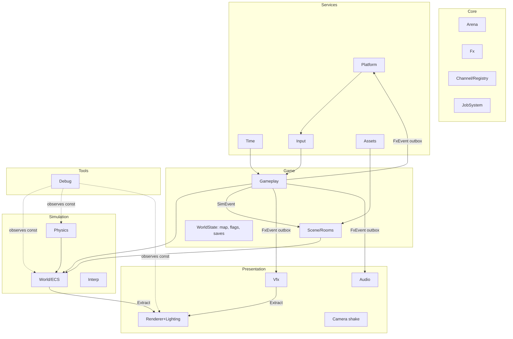

# EngineN — Critical Architecture Audit & v2 Redesign

**Input reviewed:** `ENGINE_ARCHITECTURE.md` (226 lines, prose + diagrams only — **no source code was provided**).
**Date of research:** 2026-10-31. References are listed in §9.

**Evidence tags used in the audit**
- **[C]** Confirmed directly by the text of the document (line number `L#` given).
- **[I]** Inferred from the described design; must be verified against the source before acting. I do not claim these are bugs, only that the design as described is exposed to them.

**Severity**
- **S1** — breaks determinism, correctness, or makes a stated requirement unreachable.
- **S2** — architectural coupling / scaling risk; fix before building more on top.
- **S3** — polish / efficiency.

---

## 0. Verdict (read this first)

The document is a **good skeleton with a sound instinct** (DOD, arenas, fixed tick, typed events, stage-based scheduling). It is not yet an engine you can trust to be deterministic, because three foundational contracts are missing and everything else leans on them:

1. **No numeric contract.** "Deterministic" (L5, L12) is asserted, but nothing says *what arithmetic* the sim uses. Float AABB + analytical heightmaps + `-O2` + FMA contraction = per-compiler divergence. Celeste/TowerFall solved this a decade ago with integer positions + sub-pixel remainders; I recommend the same family (§2.2).
2. **No side-effect contract.** Cosmetic outputs (audio, rumble, VFX) execute *inside* the 0..N-per-frame fixed tick (L119–L124). That makes the sim non-replayable, non-headless, and tick-split-variant (§1, F-02).
3. **The renderer decision (SDL_Renderer + blend-mode "multiply") contradicts the feature list** you want (instancing, normal-mapped lights, post stack). SDL 3.4 changed the landscape; the rationale in L215–L217 is stale (§1, F-08).

Everything else — event bus shape, GameplaySystem god-object, single command-tape flush, main-thread audio mixing, asset runtime decoders — is fixable without rewriting the core idea.

**What I keep from the document unchanged:** generational handles, paged sparse-set pools (§2.7 refines), arena-per-subsystem, 120 Hz tick with interpolation, 5 named pipeline phases, ActionBuffer/sub-frame tap latching, SOCD, atomic `.tmp` saves, cooked-blob dual-path for levels (refined), Cytomic SVF occlusion, 4-stem music.

---

## 1. Deliverable 1 — Critical Architecture Audit

### 1.1 Findings

| ID | Sev | Tag | Where | Finding | Fix (section) |
|---|---|---|---|---|---|
| F-01 | S1 | C/I | L5, L12, L75, L213 | "Deterministic" with no numeric model. Float swept-AABB + analytical heightmap sampled at `footX` are compiler/ISA/flag-sensitive (FMA contraction, x87/SSE, `-ffast-math`, libm `sin/cos`). No state-hash defined, so nothing can *prove* determinism. | Q16.16 sim state, integer pixel collision, state-hash harness (§2.2, §8) |
| F-02 | S1 | C | L119–L124, L145 | Cosmetic consumers run **inside the fixed tick**: `VfxSystem::ConsumeEvents`, `Platform::ConsumeEvents` (rumble), `StepAudio`. With 0..N ticks per frame, cue handling scales with N, headless/replay runs need an audio device + gamepad, and tick-split invariance (1 tick/frame vs 3+0+2) breaks. | Split `SimEvent` vs `FxEvent` + presentation outbox (§2.4) |
| F-03 | S1 | C | L112–L114, L119–L123, L177, L189 | `CameraTraumaEvent` is a declared channel and drawn in the diagram, but **absent from the consumer list**. Camera is stepped in `StepPostPhysics` (L113–L114) *before* the drain block. Either Gameplay consumes its own events (hidden self-coupling) or trauma lags a tick / is dropped. | Explicit producer/consumer table with epoch rule (§2.4) |
| F-04 | S1 | C | L102–L103, L11, L33 | `WorldSystems::StepVelocities` (generic velocity integration) runs **before** `GameplaySystem::StepPrePhysics` which "solves CharacterController2D velocity". Either dead work for characters or double-applied gravity/accel. Also `World` is declared "pure data registry" (L11) yet owns movement stepping. | Single velocity owner per body; `World` has no systems (§2.7, §3.7) |
| F-05 | S1 | C | L126, L201 | One command-tape flush at `World::EndTick`. A projectile/hitbox spawned in PrePhysics or PostPhysics is invisible to Physics until the next tick → **8.33 ms attack-to-hitbox latency**, and ordering hazards for anything that expects "spawn → collide same tick". | Declared sync points between stages (§2.1) |
| F-06 | S1 | C | L225 | "Exceeding capacity drops excess events." Silent drop in a deterministic engine is a divergence source (different `Capacity` → different history) and a gameplay bug for must-deliver events (`RoomTransitionEvent`, `HitstopEvent`). | Loud-fail policy + must-deliver channel class (§2.4) |
| F-07 | S1 | C | L94, L204 | Room "preload" only CRC-verifies `TileMapHeader`/`CookedPrefabHeader` off-thread. The real hitch sources — GPU texture upload, PSO/pipeline use, audio stream open, prefab instantiation — are not covered, and Load phase does a blocking `WaitAsync()` on the main thread. | Staged preload pipeline with budgeted finalize (§3.10) |
| F-08 | S1 | C | L72, L215–L217, L226 | `SDL_RenderGeometryRaw` builds 4 verts/quad on CPU: **no GPU instancing**, no MRT, no per-pixel normal-map lighting (L226 admits it). The stated reason ("zero-shader-compiler portability") is outdated: SDL_GPU + offline shader cross-compilation exists; SDL 3.4 even exposes fragment shaders to its 2D renderer (`SDL_GPURenderState`), but only for the GPU renderer backend and with limited control. Your own requirement list (instancing, normal maps, post stack) is unreachable on this path. | SDL_GPU backend with own batcher (§3.13) |
| F-09 | S1 | C | L77, L145 | Lock-free SPSC command ring exists, yet `AudioSystem::Pump(1)` **mixes 256-frame blocks on the main thread**. A SPSC ring between two threads that are the same thread is dead weight; any frame hitch (room load, GC-like arena rollback, shader compile) = audible underrun. | Mix in SDL audio-stream callback thread (§3.12) |
| F-10 | S1 | I | L73, L200 | Sparse-set dense order depends on insertion/removal history. A snapshot restore (rewind, flight-recorder replay) that rebuilds pools in a canonical order changes **system iteration order**, which changes contact ordering/who-moves-first → divergence from the live run. | Verbatim pool image for rewind; order-independent sim rules (§2.7) |
| F-11 | S2 | C | L10, L189, L209–L211 | `EventBus` is a **closed set of 7 hard-wired channels** in `core/EventBus.h`: Core must know `AudioTrigger`, `VfxBurstEvent`, `RoomTransitionEvent`… (dependency inversion). Adding a game event edits Core. Epoch semantics (same-stage read-your-write?) undefined. | Contract-layer event types + type-indexed registry (§2.4, §3.3) |
| F-12 | S2 | C | L35, L76 | `GameplaySystem` bundles locomotion, FSM/timelines, combat, portals, camera rig, **WorldMap2D fog-of-war**, and persistence. Fog-of-war is progression/UI state; camera is a presentation-coupled rig; persistence is save-system territory. | Split into 5 modules (§3.9, §3.10) |
| F-13 | S2 | C | L100, L126 | `World::BeginTick` snapshots `PrevWorldSnapshot2D` of the whole world each tick; World is tick-aware. Interpolation history is a *presentation* concern and a full copy is O(N) per tick even for static entities. | `PrevTransform` stored only for `Interpolated` entities, owned by an `InterpBuffer` (§3.7) |
| F-14 | S2 | C | L227 | Combat is pairwise O(n²) over `CombatBox2D`; the doc itself says it should use the grid. No hit-group / re-hit rules mentioned → multi-hit bugs per swing. | Layered combat queries + hit groups (§3.9) |
| F-15 | S2 | C/I | L213, L224 | Slopes sampled at a **single foot-center X**; no sloped ceilings (L224). One sample means standing on a ledge/edge behaves differently from sprite extents; wide bodies at slope↔flat seams need ad-hoc "seam suppression" (L213). Velocity projection *and* downhill snapping are both used (two competing models of "stay on slope"). | Two-sensor floor probe + mirrored ceiling heightmaps; pick one slope speed policy (§3.8) |
| F-16 | S2 | C | L71 | Runtime **PNG/BMP decoders** and a runtime zero-alloc **LDtk JSON importer**. Both are dev-time/cooker work; shipping them runtime = attack surface + maintenance. "16 reference-counted scopes" = refcounts + scopes + generations: three lifetime mechanisms. | Cooked-only runtime; scope = bitset of AssetIds (§3.6) |
| F-17 | S2 | C/I | L67 | FNV-1a `StringId` (width unstated; if 32-bit, collisions are plausible at thousands of ids) and Robin Hood `HashMap` (iteration order is insertion-history dependent). | 64-bit ids with cooker collision check; ban hash-map iteration in sim (§3.2) |
| F-18 | S2 | I | L12, L68 | "VSync harmonic snapping" to a 1440 Hz grid + "time-scale ramps": (a) snapping error must be carried as residual or the sim drifts vs wall clock at refresh rates that are not divisors of 1440 (e.g. 165 Hz); (b) slow-mo must change *real-time duration of a tick*, never the sim `dt`, or determinism dies. | Tick credit model (§3.4) |
| F-19 | S2 | C | L149 | Systems register with `i16 order`: dependencies are implicit numbers; no declared read/write sets, so anti-responsibilities (e.g. "Physics never writes Health") are unenforceable. | `SystemDesc` with access masks + debug access guard (§2.1) |
| F-20 | S2 | C | L199 | `EntityId` = 16-bit idx + 16-bit gen: a slot recycled every tick wraps its generation in 65 536 ticks ≈ **9.1 min** at 120 Hz → ABA. No persistent identity distinct from runtime id. | Retire-on-wrap + separate `Guid64` (§3.7) |
| F-21 | S2 | C | L74, L124 | VFX stepped inside the sim tick; `ParallelFor` fork/join per tick (×N ticks/frame); swap-back compaction makes particle **draw order depend on expiry history** (alpha-blend flicker); "O(1)" is per-removal, not per-frame. | Frame-domain VFX, per-emitter ring pools or GPU sim (§3.11) |
| F-22 | S2 | C | L124, L67 | Job usage pattern is per-tick fork/join. At 120 Hz with small arrays, wake/sleep latency of worker threads dominates the work. | Frame-level task graph, parallelize only where measured (§3.2) |
| F-23 | S2 | I | L76, L204 | "Spatial GUID mutation" persistence: if the GUID is derived from position, moving an entity in LDtk silently orphans its saved state. LDtk provides a stable per-entity `iid`. | Key mutations by cooked `iid` hash (§3.10) |
| F-24 | S2 | C | L196 | Per-subsystem arenas sized from `*Config`; no **budget enforcement**: no high-water mark reporting, no allocation trap proving "zero post-init heap allocation". | Alloc trap + high-water gates (§2.5, §8) |
| F-25 | S2 | C | L71 | Only LDtk is cooked. **No sprite-animation/hit-volume authoring path** (frame durations, tags, pivots, hitbox/hurtbox slices), yet `ActionTimeline2D`, `SweptWorldHitbox`, `SpriteAnimator2D` all need exactly this data. | Aseprite importer in cooker (§3.6) |
| F-26 | S3 | C | L72 | 64-bit `SortKey` includes `Texture`: with atlas pages as array textures, texture is no longer a sort dimension. | Sort by (pass, layer, depth, blend) (§3.13) |
| F-27 | S3 | C | L75 | Contact begin/end via per-tick sort-and-unique + merge: O(n log n); correct but replaceable by a pair cache with `lastSeenTick` stamps (needs deterministic pair emission order from the grid). | Optional (§3.8) |
| F-28 | S3 | C | L78 | Custom console/inspector/profiler UI is a maintenance sink; Tracy + Dear ImGui (SDL_GPU backend) are the 2026 default. 64-tick (0.53 s) "flight recorder" is too short to debug anything real. | §3.14 |
| F-29 | S3 | I | L69–L70 | Input is event-pumped before the frame wait. Late-latching (wait for swapchain/vsync, *then* pump events and cut ticks) removes up to ~1 frame of input latency. Input contract itself stays frozen. | §2.1 frame order |
| F-30 | S3 | C | L69 | Atomic save: `.tmp` writer is necessary but not sufficient (needs flush-before-rename, replace semantics, generation backup, CRC+version). | §3.1 |

### 1.2 Boundary leakage map

| Leak | Evidence | Why it hurts | Resolution |
|---|---|---|---|
| **World ↔ Time** | `World::BeginTick/EndTick` (L100, L126) | A data registry that knows about ticks cannot be unit-tested or snapshotted without the loop | `World` exposes `ApplyCommands()`; tick lifecycle owned by `Pipeline` |
| **World ↔ Gameplay** | `WorldSystems::StepVelocities`, `StepVisualsAndLifetimes` (L102, L116) | "Pure ECS" is not pure; systems named `World*` hide ownership | Systems live in their owning module; `World` has none |
| **Core ↔ every domain** | Closed `EventBus` (L10) | Core depends on audio/vfx/scene types | Event structs in `contracts/`, bus is generic |
| **Gameplay ↔ Presentation** | Camera, trauma, vignette, hitstop in one module (L35, L76, L112) | Gameplay change touches presentation; cannot run headless | Camera rig deterministic, shake cosmetic (§3.9) |
| **Gameplay ↔ Scene/Meta** | `WorldMap2D` in GameplaySystem (L35) | Fog-of-war/pins are save/UI state | `WorldState` module |
| **Sim ↔ Platform** | `Platform::ConsumeEvents` inside tick (L121) | Haptics called from sim | FxEvent outbox drained per frame |
| **Sim ↔ Audio** | `StepAudio` in tick (L123) | Headless sim needs audio | FxEvent outbox |
| **Physics ↔ Combat** | Hitboxes iterated pairwise outside grid (L227) | Two spatial truths | One broadphase, layer masks |
| **Assets ↔ Level format** | LdtkImporter in runtime assets (L71) | Authoring format leaks into runtime | Cooker-only; runtime sees cooked blobs |
| **Scene ↔ Assets ↔ Renderer** | Room swap rebinds collision/prefab; texture upload unspecified (L205) | Hitch & ownership ambiguity | Staged preload with explicit owners |
| **Pipeline ↔ SceneDirector** | `SceneDirector::TickStates/DrawStates` inside pipeline (L99, L136) | Scene stack callbacks run arbitrary game code inside deterministic stages | Scene states are *systems* with declared stage + access |

---

## 2. v2 Cross-Cutting Architecture

### 2.1 Layering, frame order, sync points, access declarations

**Layering (includes point downward only; sideways communication goes through `contracts/`):**

```
L5  Tools        Debug, Cooker CLI, Replay tools
L4  Presentation VFX, Audio, Renderer, Camera shake, UI
L3  Game         Gameplay (locomotion/combat), Scene/Rooms, WorldState (map, flags, saves)
L2  Simulation   World (ECS), Physics, Interp
L1  Services     Platform, Time, Input, Assets
L0  Core         Arena, containers, Fx math, Result, StringId64, JobSystem, Channel<T>
contracts/       POD event + component *types* shared across layers (no logic, no includes upward)
```

**Frame order v2** (late input latching; presentation drained once per frame):

```
Frame(dt):
  A. Pacing     WaitAndAcquireSwapchain()          // block here, not earlier
  B. Pump       Platform::Pump -> Input::Ingest    // events as late as possible
  C. Time       Time::BeginFrame -> N ticks (tick credit model, §3.4)
  D. Sim        for each tick:                      // deterministic, headless-capable
                  S0 PrePhysics   (intent, FSM, timelines, velocity requests)
                  --- Sync(Spawn) ---               // flush command tape #1
                  S1 Physics      (solids -> actors -> contacts)
                  S2 PostPhysics  (combat, damage, portals, camera rig, lifetimes)
                  --- Sync(Final) ---               // flush tape #2, hierarchy order, seal FxOutbox(tick)
  E. Drain      FxOutbox -> Audio cmds, VFX spawns, Rumble, CameraShake   // once per frame
  F. Extract    World/Vfx -> RenderPacket (immutable, alpha applied)       // Stage 3
  G. Overlay    UI, debug gizmos, profiler HUD -> RenderPacket             // Stage 4
  H. Submit     Renderer::Record + Submit; Audio thread runs independently
```

**Sync points.** `Sync(Spawn)` after PrePhysics (so spawned hitboxes/projectiles/portals are physical *this* tick, killing F-05's 8.33 ms lag) and `Sync(Final)` after PostPhysics. Structural commands are tagged `{stage, systemOrder, seq}`; the tape is **sorted by that key before apply**, so parallel producers cannot change outcome.

**System declaration (replaces `i16 order`, F-19):**

```cpp
enum class Stage : u8 { PrePhysics, Physics, PostPhysics, Extract, Overlay };

struct SystemDesc {
    StringId64     name;
    Stage          stage;
    i16            order;                 // tie-break only; real ordering = dependency graph
    ComponentMask  reads;                 // every component type read
    ComponentMask  writes;                // every component type written
    ChannelMask    publishes;             // event channels written
    ChannelMask    consumes;              // event channels drained
    void         (*run)(SystemCtx&);
};
// Init-time: topological sort by (writes -> reads) hazards; cycle = Init error.
// Debug builds: SparseSet<T>::Get<Write> asserts T ∈ currentSystem.writes.
```

This turns anti-responsibilities into assertions: "Physics never writes `Health2D`" is a one-line `writes` mask that the debug guard enforces on every access.

### 2.2 Numeric & determinism contract

| Layer | Arithmetic | Rationale |
|---|---|---|
| **Sim state** (positions, velocities, timers, RNG, health) | `Fx` = signed **Q16.16** (`i32`), `i64` intermediates; integer sqrt, sin/cos via 1024-entry LUT | Bit-identical across GCC/Clang/MSVC/ARM; no FMA/x87/libm dependence |
| **Collision queries** | **Pixel = `raw >> 16`** (arithmetic shift, floor) | Celeste/TowerFall model: integer pixel collision + sub-pixel remainder carry |
| **Presentation** (interp, camera shake, VFX, lights, audio DSP) | `float` | Not part of the hash; allowed to differ |
| **Build flags (even for float code)** | `-ffp-contract=off -fno-fast-math`, explicit SSE2/AVX target | Prevents accidental fused ops; Debug-vs-Release flag drift is a documented real-world divergence source |

Why not "just keep floats + flags": cross-platform float determinism needs flag discipline on every translation unit and every new commit; fixed-point removes the whole class. The cost in a 2D platformer is small (a handful of divides/sqrts per tick).

```cpp
struct Fx { i32 raw; };                       // Q16.16
constexpr i32  kFxOne = 1 << 16;
constexpr Fx   operator*(Fx a, Fx b) { return {(i32)(((i64)a.raw * b.raw) >> 16)}; }
constexpr i32  PixelOf(Fx v)          { return v.raw >> 16; }   // floor for negatives too
struct Vec2Fx { Fx x, y; };

// Celeste-style move: subpixel remainder stays in `pos`; collision uses PixelOf(pos).
// Rooms use room-local coordinates (<= 32 768 px) so Q16.16 never overflows.
```

**Determinism rules (enforced in review + CI):**
1. Sim code never iterates a hash map or pointer-keyed container; iterate dense arrays in a defined order.
2. Sim never reads wall-clock, thread id, or addresses. RNG is `Pcg32` state stored in the world, advanced only by sim systems.
3. Any parallel sim work writes disjoint ranges or merges via a deterministic reduction (sorted by stable key).
4. Order-sensitive resolution (contacts, push/carry) iterates by a stable key (`bodyIndex`), never by pool dense order.
5. **State hash** (`xxh3_64`) over a canonical layout of sim components + RNG + flags is computable at any tick (`Sim::Hash()`); it is the unit of truth for all tests (§8).

### 2.3 Memory model (zero post-init allocation, *provably*)

```cpp
struct Arena {                         // linear, no free
    u8* base; usize cap, used, highWater;
    void* Alloc(usize n, usize align);              // Result-free fast path; trap on overflow in Debug
    struct Mark { usize used; };
    Mark  Save() const;  void Restore(Mark);        // scratch usage
};
struct MemoryBudget { usize persistent, level, frame, scratch; };   // from one config, validated at Init
```

- **Allocation trap (test builds):** override global `operator new/delete`, route `malloc` family via linker wrap, and `SDL_SetMemoryFunctions` to counting shims. After `Engine::EndInit()` flip `g_allocTrap = true`; any allocation aborts with a backtrace. SDL's internal allocations are therefore visible, not assumed.
- **High-water gates:** every arena prints `highWater/cap` at shutdown; CI fails if any arena > 85 % in the soak scenario or if highWater differs between two identical replays.
- **Debug:** poison-on-restore (`0xDD`), guard pages optional for large pools.
- **Dev-only allocators** (Dear ImGui, Tracy, cooker, JSON) are allowed *outside* the trap domain via `ImGui::SetAllocatorFunctions` to a dev arena; they are compiled out of ship builds.

### 2.4 Event & output model (fixes F-02, F-03, F-06, F-11)

Two classes with different rules:

| Class | Examples | Consumed | Hashed | Capacity policy |
|---|---|---|---|---|
| **SimEvent** (affects sim state) | `Hitstop`, `RoomTransitionRequest`, `Damage`, `ContactBegin/End`, `Portal` | Inside sim, **next stage boundary after publish** (never same-stage read-your-write) | Publish counters hashed | **Must-deliver**: sized to worst case; overflow = `ENGINE_FATAL` in dev, saturating counter + error log in ship |
| **FxEvent** (cosmetic) | `AudioCue`, `VfxBurst`, `DashGhost`, `Rumble`, `CameraShake`, `Flash` | Presentation, **once per frame**, from `FxOutbox` stamped with `tickIndex` | Not hashed | Drop-oldest allowed but **counted and displayed in HUD** |

```cpp
// contracts/Channel.h — no domain types here; domain headers define their POD events.
template <class T> struct Channel {
    static constexpr u32 kTypeId = TypeId64<T>();       // constexpr hash of type name
    T*  buf[2];   u32 cap, n[2];  u32 epoch;            // double-buffered by epoch
    bool Publish(const T& e);                           // writes buf[epoch&1]
    std::span<const T> Drain() const;                   // reads buf[(epoch-1)&1]
};
struct ChannelRegistry {                                // type-indexed, arena-allocated at Init
    template <class T> Channel<T>& Get();
    void Register(u32 typeId, u32 capacity, ChannelClass cls);
    void AdvanceEpoch(ChannelClass cls);                // called at stage boundaries (Sim) / frame end (Fx)
};
```

- A system declares `publishes`/`consumes` in `SystemDesc`; the registry refuses to run a stage where a consumer is scheduled before its producer's epoch advance.
- Camera: the **camera rig** (target, confinement, lookahead) is deterministic sim state (it drives room culling and spawn activation); **shake/trauma** is an `FxEvent` applied as an additive offset at Extract. This resolves F-03 by construction.

### 2.5 Job system policy (F-22)

- Sim determinism does not depend on thread count (§2.2 rule 3). CI runs 1, 2, and 8 workers and compares hashes.
- Parallelism is **frame-level**: Extract chunks, animation sampling, particle sim, async asset decode, audio decode, shader/PSO warm-up. No `ParallelFor` inside the per-tick path unless a profile shows > 150 µs of work in one loop.
- Blocking waits on the main thread are banned in steady state; `WaitAsync` only at load screens (§3.10).

### 2.6 Dependency picture



---

## 3. Deliverable 2 — Subsystem-by-Subsystem Breakdown

Format per subsystem: **Role / Never**, **State & ownership**, **2026 feature set**, **Contracts** across the five stages (`PRE`=PrePhysics, `PHY`=Physics, `POST`=PostPhysics, `EXT`=Extract, `OVL`=Overlay), **Delta** vs. the current document.

---

### 3.1 Platform & Windowing Layer (L1)

**Role.** Owns the OS boundary: window, displays, DPI, event pump, storage, gamepad devices, clipboard/dialogs. Produces `RawEvent`s and device facts.
**Never.** Interpret input meaning (that is Input), run from inside a sim tick, block on file I/O on the main thread for saves > 1 frame, expose `SDL_*` types above L1.

**State & ownership**
```cpp
struct DisplayInfo   { u32 id; i32 x,y,w,h; f32 refreshHz; f32 contentScale; };
struct WindowState   { SDL_Window* win; i32 logicalW, logicalH, pixelW, pixelH; f32 pixelDensity, displayScale;
                       WindowMode mode; u32 displayId; bool focused, minimized; };
struct GamepadSlot   { SDL_JoystickID id; SDL_Gamepad* pad; GamepadFamily fam; u8 slot; bool connected; };
struct PlatformState { WindowState win; DisplayInfo displays[8]; u8 nDisplays;
                       GamepadSlot pads[8]; char prefPath[512]; char basePath[512];
                       RingBuffer<RawEvent, 1024> events; };       // arena-allocated at Init
```

**2026 feature set**
- SDL3 high-DPI: track `pixel density` and `display scale` separately; recompute swapchain/virtual-res scaler on `SDL_EVENT_WINDOW_PIXEL_SIZE_CHANGED` and display-scale-changed events, not on logical size alone.
- Modes: windowed, borderless-desktop, exclusive fullscreen; display-topology change handling (monitor unplug moves the window, re-queries refresh rate).
- Refresh-rate query per display → feeds Time's pacing estimator (§3.4).
- Gamepad lifecycle: added/removed/remapped events, slot assignment stable per device GUID, player-1 rebind on disconnect, rumble via `SDL_RumbleGamepad`; SDL 3.4 added broader controller coverage (8BitDo, FlyDigi, Steam Controller, wired Switch 2) so do **not** hand-roll device tables.
- **Storage service** (see below) with atomic, generation-safe saves.
- Focus loss → synthetic "release all" is emitted to Input (contract frozen: `Ingest / PublishFrameInput / CutTick / Coalesce`).
- Crash handler: write minidump + last flight-recorder dump to `prefPath/crash/`.

**Atomic save protocol (F-30):**
```
Write(slot, bytes):
  1. build header {magic, version, schemaHash, payloadCRC, generation++}
  2. write to  slot.tmp ; flush (FlushFileBuffers/fsync) ; close
  3. rotate    slot.sav -> slot.bak   (keep previous good generation)
  4. rename    slot.tmp -> slot.sav   (replace-existing; on Windows use MoveFileEx(REPLACE|WRITE_THROUGH) or ReplaceFile)
  5. fsync directory where supported
Load: try .sav (CRC ok & version migratable) else .bak else "no save".
```
Saves run on an I/O job; the sim only enqueues a `SaveRequest` and receives a `SaveResult` FxEvent.

**Contracts**
- PRE/PHY/POST: **none** (Platform is invisible to the sim). Sim emits `Rumble` as `FxEvent`.
- Frame step B: `Pump()` → `RawEvent` stream → Input (frozen contract), WindowState deltas → Renderer/Time.
- EXT/OVL: read-only `WindowState` (pixel size, density) for viewport scaler; Debug overlay can show display/pad info.

**Delta.** Remove `Platform::ConsumeEvents` from the tick (F-02); add late-latching order (F-29); harden saves (F-30).

---

### 3.2 Core, Memory & Job System (L0)

**Role.** Types, math, arenas, containers, ids, serialization primitives, job scheduler, channel registry.
**Never.** Know any domain type (audio, vfx, scene). Allocate after init. Expose iteration order that depends on hashing/history.

**State & ownership**
```cpp
// Containers (all arena-backed, fixed capacity, Result-returning on overflow)
template <class T> struct FixedVec   { T* p; u32 n, cap; };
template <class T> struct Ring       { T* p; u32 head, tail, cap; };           // SPSC variant is lock-free
template <class K, class V> struct OpenMap;     // for *lookup only*; iteration API deliberately absent in sim builds
struct StringId64 { u64 v; };                   // xxh3_64 of lowercase path/name; cooker emits collision report
struct Handle { u32 idx:20, gen:12; };          // generic; per-type wrappers add type safety
```

**Job system (2026 shape)**
```cpp
class JobSystem {
public:
    static Result<JobSystem*> Create(Arena&, u32 workers);             // workers = cores-2, pinned optional
    JobHandle  Submit(JobFn fn, void* ud, std::span<const JobHandle> deps = {});   // DAG edge = dependency
    void       ParallelFor(u32 count, u32 grain, void(*fn)(u32 begin,u32 end,void*), void* ud);
    void       Wait(JobHandle);                                        // helps run jobs while waiting
    void       FrameBarrier();                                         // end-of-frame join for frame-scoped jobs
};
```
- Work-stealing deques per worker (Chase-Lev) with a global injector for external submits; workers park on a futex/condvar after a bounded spin to avoid burning the sim thread's core on laptops.
- Frame-scoped job memory comes from a per-frame arena that resets at `FrameBarrier`.
- Priority lanes: `Realtime` (audio decode refill), `Frame` (extract, animation), `Background` (asset decode, preload, saves).

**2026 feature set**
- Task graph with explicit dependencies (enkiTS/Taskflow-style) instead of nested fork/join.
- Deterministic reductions helper: `ReduceOrdered(count, fn, combine)` – chunk results combined in index order.
- Tracy zones on every job when `ENGINE_PROFILE`.
- Containers: `FixedVec`, `Ring`, `BitSet`, `SparseSet` (paged), `SlotMap`, `OpenMap` (lookup-only), `SmallString<N>`; `Pcg32`.
- Serialization: versioned, schema-hashed binary (`Writer/Reader` with explicit field list, not `memcpy` of padded structs); xxh3 for integrity (CRC32 acceptable for blobs, but xxh3 is faster and used for the state hash anyway).

**Contracts**
- All stages: Core is called, never calls up. `ChannelRegistry::AdvanceEpoch` is invoked by `Pipeline` at Sync points and frame end.
- PRE/PHY/POST: job use only if a measured hot loop exceeds budget; otherwise single-threaded sim.
- EXT: `ParallelFor` over entity chunks writing into per-chunk slices of the `RenderPacket`, concatenated in chunk order (deterministic output ordering for render-list hash tests).

**Delta.** Replace per-tick fork/join with frame-level DAG (F-22); 64-bit ids (F-17); remove hash-map iteration from sim builds.

---

### 3.3 Event & Communication Bus (L0 + `contracts/`)

**Role.** Typed, bounded, allocation-free channels with explicit epoch semantics (§2.4).
**Never.** Contain domain types; allow same-stage read-your-write; drop must-deliver events silently; be used for per-entity high-frequency data (use components).

**State**
```cpp
enum class ChannelClass : u8 { Sim, Fx };
struct ChannelDesc { u64 typeId; u32 capacity; ChannelClass cls; OverflowPolicy policy; };   // from Init table

struct FxOutbox {                       // sealed per tick, drained per frame
    struct Entry { u32 tick; u64 typeId; u32 offset, size; };
    Entry* entries; u8* blob; u32 nEntries, blobUsed;               // append-only, reset after drain
};
```

**2026 feature set**
- Type-indexed registration at Init (`Register<AudioCue>(cap=512, Fx, DropOldest)`). Event structs are plain PODs declared in `contracts/` headers (no logic, no upward includes), so producers and consumers include them without depending on each other, and Core depends on none of them.
- Epoch rule: `Publish` in stage S is visible to `Drain` from stage S+1; Fx events from tick *t* are visible at frame step E.
- Overflow telemetry: per-channel `published/dropped/highWater`, shown in HUD, asserted zero for Sim class in tests.
- Fan-out allowed (multiple consumers), single-writer-per-channel **not** required in sim because publish order is `(stage, systemOrder, seq)`-stamped and merged.
- Replay: Sim-class channel counters feed the state hash; Fx-class never does.

**Producer/consumer table (v2, resolves F-03)**

| Event | Class | Producer stage | Consumer | Visible at |
|---|---|---|---|---|
| `ContactBegin/End/Trigger*` | Sim | PHY | Gameplay (POST) | POST |
| `Damage`, `Parry`, `Clash` | Sim | POST (combat) | Gameplay health/poise (POST, later order) | next boundary |
| `Hitstop` | Sim | POST | Time (frame step C, next frame) **and** sim channel mask next tick | next tick |
| `RoomTransitionRequest` | Sim | POST | Scene (`Sync(Final)`) | Sync(Final) |
| `CameraRigImpulse` | Sim | POST | Camera rig (next tick PRE) | next tick |
| `AudioCue`, `VfxBurst`, `DashGhost`, `Rumble`, `CameraShake`, `Flash` | Fx | any | Audio/Vfx/Platform/Camera-shake (frame step E) | frame step E |

---

### 3.4 Time & Frame Pacing (L1)

**Role.** Convert wall time into **an integer number of sim ticks** per frame, plus presentation `alpha`; own time channels and freeze counters.
**Never.** Scale sim `dt` (the tick is always `kTickNs`); read OS time anywhere but `Time::BeginFrame`; apply hitstop in ns.

**State**
```cpp
constexpr u64 kTickNs = 1'000'000'000ull / 120;          // 8 333 333 (remainder tracked, see below)
struct TimeChannel { u16 freezeTicks;          // hitstop counter in TICKS (integer)
                     u16 stepNum, stepDen;     // rational ticks-per-tick for slow-mo (e.g. 1/2): Bresenham-style skip
                     u32 stepAcc; bool paused; };
struct TickClock {
    u64  nowNs, lastNs;
    i64  accumNs;                 // real time owed to the sim
    u64  tickRemNs;               // carries 1e9/120 remainder so 120 ticks == exactly 1 s
    f64  periodEstNs;             // refresh period estimator (median of last 32 present deltas)
    u32  tickIndex;               // global sim tick counter
    f32  alpha;                   // [0,1) for Extract
    TimeChannel ch[4];            // World, Player, Enemy, Camera
    u16  dilationQ16;             // real-time duration scale of a tick (slow-mo/fast-forward), Q16
};
struct TickPlan { u32 nTicks; f32 alpha; bool phaseLocked; };
```

**Time dilation done right (F-18b).** Slow-mo changes **how much real time a tick consumes** (`accumNs -= kTickNs * dilation`), so the sim still advances in constant `dt`. Per-channel slow-mo (enemies slower than player) uses the rational skip `stepNum/stepDen`: a channel that "doesn't step" this tick simply isn't scheduled; entities in that channel keep their state. Hitstop = `freezeTicks` decremented once per sim tick (integer, hashed).

**Pacing (F-18a, F-29)**
1. **Refresh estimator** instead of snapping to a fixed 1440 Hz grid: median-filter present-to-present deltas, snap to the nearest of {display-reported period, estimator} within ε, and **carry the snap error into `accumNs`** so the sim never drifts against wall clock at 165/144/75 Hz.
2. **Phase-locked mode:** if refresh ∈ {120, 240, 360} (±0.5 %), run exactly `refresh/120` frames per tick, `alpha = 1` (or 0) → **zero interpolation latency**.
3. **Late latching:** frame step A blocks on the swapchain (see §3.13), then B pumps events, then C cuts ticks, so input age at submit is minimal.
4. Spiral guard: clamp `accumNs` to `maxCatchUpTicks` (e.g. 6); excess is *dropped and counted* (HUD), never simulated.
5. Sleep strategy: `SDL_DelayPrecise` + short spin for uncapped/limiter mode; vsync mode relies on present blocking.

**2026 feature set.** Multiple time channels; hitstop merge rules (max, not sum); pause/single-step/fast-forward for tools (just `dilation` and `nTicks` overrides); per-tick `tickIndex` as the universal timestamp (events, replays, audio scheduling).

**Contracts**
- PRE: reads `TickCtx{tickIndex, channelMask}`; systems in a frozen channel are skipped.
- PHY/POST: same; `Hitstop` SimEvent → `ch[x].freezeTicks`.
- EXT: `alpha` only. OVL: HUD (frame ms, dropped catch-up, estimator Hz).

---

### 3.5 Input System (L1) — contract frozen

**Role.** Turn `RawEvent`s into per-tick `TickInput` snapshots and actions; buffer them for gameplay.
**Never.** Know about gameplay states, hitstop, UI focus policy beyond "suppress presses, never suppress releases", or sample at render rate for sim decisions.

The existing contract (`Ingest → PublishFrameInput → CutTick → Coalesce`) is **kept as is**. Additions below are additive and do not change signatures.

**State**
```cpp
struct TickInput {                     // exactly what the sim sees, 1 per tick; hashed in replays
    u32 down, pressed, released;       // action bitmasks (<=32 actions; extend with a 2nd word if needed)
    i16 moveX, moveY;                  // Q1.15 after Schmitt hysteresis
    i16 aimX, aimY;
    u8  flags;                         // tap-latched bits, device switch marker
};
struct ActionBuffer { u8 head; u32 pressedAtTick[32]; u8 consumed[32]; };   // 64-tick ring, 1 per action
```
**2026 feature set**
- Action maps with layered contexts (Gameplay / Menu / Map / Debug), rebinding persisted in `WorldState`, glyph-set selection from last-used device family.
- Sub-frame tap latching (`down|pressed` in one tick even if released inside it).
- SOCD: left+right → *neutral* or *last-wins* (configurable per action pair), up+down → *up-priority* for jump-on-up setups; resolved **before** hysteresis.
- Coyote/jump buffer are **gameplay constants consumed through `ActionBuffer`**, not Input features: `buf.Consume(Action::Jump, windowTicks)` returns age in ticks or `-1`.
- Replay: input recording hooks at `TickInput` level (post-resolution), so replay bypasses SDL entirely.
- Late latch: events ingested after swapchain wait are timestamped with SDL event ns, mapped to ticks by `CutTick`.

**Contracts**
- Frame step B: `Ingest` (OS events) → step C: `CutTick(tickIndex)` produces `TickInput`.
- PRE: `Gameplay` reads `TickInput` + `ActionBuffer` (read), consumes buffered actions (write on `ActionBuffer` only).
- PHY/POST: none. EXT: UI reads frame snapshot (not tick). OVL: input debug (pressed bits timeline).

**Delta.** Only the late-latch ordering and the replay hook; nothing in the public contract changes.

---

### 3.6 Asset Pipeline & Cooker (L1 runtime + offline tool)

**Role.** Offline: turn authoring formats into cooked, validated, GPU-/mmap-ready blobs. Runtime: map cooked blobs, hand out generational handles, manage lifetime scopes, stream asynchronously.
**Never.** Parse authoring formats at runtime in ship builds (PNG/JSON/Aseprite), allocate after init, expose raw pointers to gameplay, block the main thread on I/O or decode.

**Cooker (CLI + in-process library for hot reload)**

| Input | Output | Notes |
|---|---|---|
| PNG/Aseprite images | **Atlas pages** (RGBA8 or BC7/ASTC), packed (MaxRects), **paired normal-map atlas**, premultiplied alpha, extrusion/padding | Uses SDL 3.4 native PNG or stb at *cook time only* |
| **Aseprite JSON/.ase** (F-25) | `AnimClip` (frames, durations, tags, loop mode), **slices → hurt/hit/grab volumes per frame**, pivots, event markers (footstep/audio cue) | Single authoring source for `ActionTimeline` volumes |
| **LDtk** `.ldtk` | `RoomBlob`: tile grids (Y-up, collision flags incl. slope ids), entity descriptors keyed by **`iid`→`Guid64`**, room bounds, portals, occluder edge loops for lighting | Importer allocates freely (offline) |
| Audio WAV/FLAC | PCM16/ADPCM (short SFX) or Opus/Vorbis (streams), loop points, per-stem metadata | |
| Shaders (HLSL/Slang) | SPIR-V + DXIL + MSL via **SDL_shadercross** (+ reflection) | Build step, deterministic outputs |
| Tuning (TOML/JSON) | `ConfigBlob` with schema hash | Hot-reloadable in dev |
| Everything | `AssetTable` + `Pak` with `StringId64` index, xxh3 per-asset, **collision report** | Build fails on id collisions |

**Runtime state**
```cpp
struct AssetId   { u64 v; };                                    // StringId64 of path
template <class Tag> struct AssetHandle { u32 idx:20, gen:12; };// per-kind wrappers: Texture/Sprite/Atlas/Clip/Audio/Room/Config
struct AssetSlot { AssetId id; u32 gen; AssetKind kind; AssetState state; u32 blobOff, blobSize; u32 gpuHandle; };
struct AssetTable { AssetSlot* slots; u32 n, cap; OpenMap<u64,u32> byId; };       // lookup only
struct ScopeSet   { BitSet<kMaxAssets> live; };                                    // scope = bitset of slots
struct AssetManager { AssetTable table; ScopeSet scopes[16]; Arena blobArena; IoQueue io; };
```

**Lifetime = bitset scopes, no per-asset refcounts (F-16).** An asset is alive iff its bit is set in **any** active scope. Room transition = `rooms.live = staging.live; staging.clear()` then `sweep()`: `alive = OR(scopes)`, evict `slots & ~alive` (O(assets/64)). Shared assets survive transitions with zero refcount churn; generations bump on eviction so stale handles fail validation.

**Async streaming**
- `Request(AssetId, ScopeId, Priority)` → IO job reads cooked blob into `blobArena`, verifies xxh3 → **Decode** job (only for streamed audio/optional compressed formats) → **Finalize** on main/render thread: GPU upload via a **copy command buffer** submitted with a fence; `state = Ready` only after the fence signals.
- Gameplay code never sees `Loading`: handles resolve to a **fallback asset** (1×1 magenta, silent clip) until ready; in dev builds a warning is logged once.
- Hot reload (dev): file watcher → cooker library on a Background job → swap blob under the same slot, bump `version` (not `gen`), renderer re-reads on next frame.

**Contracts**
- PRE/PHY/POST: sim reads only **cooked data handles** (`ConfigBlob`, `AnimClip` volumes, `RoomBlob` tile grids) via const views; no asset loading in the tick.
- EXT: Renderer resolves `AssetHandle → GpuTexture` through `AssetManager::Gpu(handle)` (O(1)).
- OVL: asset HUD (memory by kind, pending IO, fallback hits).

**Delta.** Runtime decoders and runtime LDtk removed from ship builds (F-16); Aseprite importer added (F-25); scopes become bitsets; preload covers GPU upload (F-07).

---

### 3.7 World & ECS Registry (L2)

**Role.** Entity lifetime, component storage, relationships, structural commands, snapshots. A **data store**.
**Never.** Own systems, know about ticks, interpolation, physics, rendering, or gameplay rules; store hot physics state (see below).

**State**
```cpp
struct EntityId { u32 idx:16, gen:16; };      // unchanged size; slot retired when gen == 0xFFFF (F-20)
struct Guid64   { u64 v; };                   // persistent identity (cooked from LDtk iid) — never reused across sessions
template <class T> struct SparseSet {         // paged: 64-entity pages, dense T[] + EntityId[] + pageTable
    u16* page[kMaxPages]; T* dense; EntityId* ids; u32 n;
    T*       TryGet(EntityId);   bool Has(EntityId) const;
    T&       Emplace(EntityId);  void Remove(EntityId);      // swap-back
};
struct World {
    EntityRecord* ent; u32 nEnt, freeHead;     // gen, componentMask, alive
    PoolBase*     pools[kMaxComponents];       // arena-allocated at Init by registration table
    CommandTape   tape;                        // flat byte tape (§ below)
    RelationStore rel;                         // parent links (§ below)
};
```

**Hot/cold split (key rebuttal).** Entity counts in a Metroidvania room are hundreds to low thousands; a general ECS is *not* a performance win there — it is an authoring/serialization win. Therefore:
- **Physics owns a dense SoA `BodyStore`** (§3.8). The ECS stores `BodyRef{u16 slot}` and `Guid64`. Physics never walks sparse sets.
- Gameplay-hot data (`CharState`, `Health`, `Timeline`) lives in ECS pools but systems iterate with **owning groups** for the 2–3 hottest joins (e.g. `CharState+BodyRef+Timeline`): groups keep those pools co-sorted, so joins are linear (EnTT-style grouping). Everything else is sparse and accessed by id.
- Modern ECS references worth copying (not adopting wholesale): Flecs 4.1 added **non-fragmenting hierarchy storage** and *DontFragment/sparse components* precisely because moving entities between archetypes on relationship/tag change hurts; EnTT keeps sparse sets with opt-in groups. Your SparseSet choice matches the right trade-off; archetypes would be a regression for frequently toggled flags like `Invulnerable`, `HitFlash`.

**Command tape (F-05).** Commands: `Spawn(prefabId, Guid64, pose)`, `Destroy(id)`, `Emplace<T>(id, ptr)`, `Remove<T>(id)`, `SetParent(child,parent)`. Each record carries `{stage, systemOrder, seq}`; `Apply()` **sorts by that key** (radix on 64-bit key) → same result for any producer interleaving. Applied at `Sync(Spawn)` and `Sync(Final)` only.

**Hierarchy (replace LCRS propagation order).** Keep LCRS *as the editing structure*, but propagation uses a **baked flat order**:
```cpp
struct HierarchyOrder { EntityId* order; u32 n; u32 version; };   // parents strictly before children
// rebuilt only when tape contained SetParent/Destroy of a parented entity (version bump)
void PropagateWorld(const HierarchyOrder&, TransformLocal*, TransformWorld*);  // linear pass, no pointer chasing
```
Only entities with a `ParentLink` participate; everything else has `world == local` and skips propagation.

**Interpolation (F-13).**
```cpp
struct Interpolated { u8 teleportEpoch; };               // tag
struct InterpBuffer { Vec2Fx* prev; Vec2Fx* curr; u8* epoch; u32 n; };  // dense, only Interpolated entities
// Extract: p = (epoch changed) ? curr : lerp(prev,curr,alpha)  (float, presentation-only)
```
Room transitions and teleports bump `teleportEpoch` → no streak across the screen.

**Snapshots (F-10).** Two modes:
- `SnapshotMode::Verbatim` — byte image of pools **including sparse tables, dense order, free list** (used for rewind/flight-recorder/hash tests; guarantees identical iteration order after restore).
- `SnapshotMode::Canonical` — logical state sorted by `Guid64` (used for save files; rooms are re-instantiated from cooked prefabs, so dense order is irrelevant).
Order-sensitive sim code additionally iterates by stable key (§2.2 rule 4), so even Canonical load does not change resolution order.

**2026 feature set.** Generational ids with retire-on-wrap; `Guid64` persistence; paged pools; owning groups; deferred sorted tape; baked hierarchy order; prefab instantiate from cooked `PrefabBlob` (component images + fixups); `World::Hash(HashCtx&)` canonical hashing; debug-time access guard (§2.1).

**Contracts**
- PRE/PHY/POST: systems get `View<Reads..., Writes...>`; structural changes only via `tape`.
- `Sync(Spawn)/Sync(Final)`: `Pipeline` calls `world.Apply(tape)`; `HierarchyOrder` rebuilt if dirty; `InterpBuffer::Commit()` (curr→prev for `Interpolated`).
- EXT: const `World&` + `InterpBuffer&`.

---

### 3.8 Physics & Collision Solver (L2)

**Role.** Move bodies and solids through tile terrain and dynamic geometry deterministically; report contacts.
**Never.** Know about health, damage, abilities, animation, input; write gameplay components; use floating point for state.

**Algorithm choice (rebuttal of "swept AABB + velocity projection").** Use the **Celeste/TowerFall axis-separated integer move with sub-pixel remainder carry**; it is exact, tunnel-free at any speed, and gives moving-platform carry/push/squish for free (Solids move first; riding actors are carried, overlapping actors are pushed). Then layer slopes on top with a *snap* model.

**State (SoA, dense, arena-allocated)**
```cpp
struct BodyStore {
    // hot: position/velocity in Q16.16, one array per field
    Fx* px; Fx* py; Fx* vx; Fx* vy;
    Fx* remX; Fx* remY;               // not needed if px/py keep the fraction; kept only for "Move(amount)" API
    i16* hw; i16* hh;                 // half extents in pixels
    u32* layerMask; u32* collidesWith;
    u8*  kind;                        // Actor, Solid, Trigger, Sensor
    u16* flagsGround;                 // Ground/Ceiling/WallL/WallR/OneWay/Slope bits
    EntityId* owner;  Guid64* guid;
    u32  n, cap;
};
struct TileSource {                   // abstraction over 1..2 active rooms (§3.10)
    u8 (*TileAt)(const TileSource&, i32 wx, i32 wy);   // world pixel -> tile flags
    RoomRuntime* rooms; u8 nRooms;
};
struct Broadphase { u16 cellPx; u16 cols, rows; u16* cellStart; u16* items; /* two-pass counting sort, dynamic only */ };
```
Static tiles are **not** in the grid: the tilemap *is* a grid (O(1) lookup). The grid holds only dynamic actors, solids, triggers, and hit/hurt volumes (layer-masked) — one broadphase serves physics **and** combat (F-14).

**Move primitives (Celeste model)**
```cpp
// returns collided; moves 1 pixel at a time in the integer domain, carrying subpixel in pos
bool MoveX(BodyStore&, u32 b, Fx amount, const TileSource&, const Broadphase&, ContactSink&);
bool MoveY(...);
void MoveSolid(BodyStore&, u32 s, Fx dx, Fx dy, ...);   // carry riders, push overlappers, squish callback (SimEvent Crushed)
// Order per tick: all Solids (stable by index) -> all Actors (stable by index) -> triggers/sensors
```

**Slopes (F-15)**
- Tile flags: `Slope45Up/Down`, `Slope22{Up,Down}{Lo,Hi}`, plus **mirrored ceiling slopes** (`CeilSlope*`) using the same height tables flipped vertically.
- Height tables in Q16 per tile column (LUT: `h45Up[x]=x`, `h22UpLo[x]=x/2`, `h22UpHi[x]=T/2 + x/2`).
- **Two-sensor floor probe** (`footL`, `footR`) + center; surface = **max height** under the body's footprint. This removes the single-`footX` ledge/seam hacks (F-15): standing/falling at flat↔slope seams is decided by the highest supporting sample, symmetric for left/right.
- **One slope speed policy**, selectable per move set: `PreserveHorizontal` (default; X speed unchanged, Y snapped to surface: Celeste/Hollow-Knight-style feel) or `PreserveAlongSurface` (Sonic-style `v_x = v·cosθ`). Do not combine projection with an independent snap rule.
- **Ground adhesion:** after `MoveX` while grounded last tick, if surface under new footprint is within `maxSnapPx` (≥ tile/2 for 45° at max speed) snap down; if the step up exceeds `maxStepPx`, treat as wall.
- **One-way platforms:** pass if `bodyBottomPrev <= platformTop` and `vy >= 0` and not `dropThrough` timer; evaluated in integer pixels (no epsilon).
- **Corner correction:** ceiling bump nudge ≤ N px and ledge nudge ≤ M px (data-driven), applied inside `MoveY/MoveX` before declaring collision.

**Contacts (F-27).** Emit `ContactBegin/End/Trigger*` by comparing this tick's pair list to last tick's. Both lists are generated in **grid-cell order then body index**, so a linear two-pointer diff is deterministic; no sort required.

**2026 feature set.** Integer deterministic movement; moving solids with carry/push/squish; slopes (floor+ceiling); one-way; trigger volumes & sensors; layer/mask matrix; raycast & shapecast API for gameplay/audio occlusion/AI (grid DDA over tiles + broadphase); continuous contact flags; **debug visualization hooks** (const view); "ghost-collision" regression tests on tile seams.

**Contracts**
- PRE: Gameplay writes **velocity requests** into `BodyCmd{vx, vy, flags}` (not positions). Physics reads them at PHY start.
- PHY: `Physics::Step(tick)` consumes `BodyCmd`, rebuilds broadphase, moves solids→actors, publishes `Contact*` SimEvents, writes ground/wall flags into `BodyStore`.
- POST: Gameplay reads flags + contact events; queries `Raycast/Overlap` (read-only, grid).
- EXT: read-only for `InterpBuffer` commit (positions).
- OVL: debug draw of grid cells, probes, normals, contact points.

**Delta.** Integer model; Solids-first carry/push; two-sensor slopes + ceilings; unified broadphase; single slope policy; no `StepVelocities` in World.

---

### 3.9 Gameplay & Combat Framework (L3)

**Role.** Turn intent into character behaviour: locomotion, abilities, state machines, action timelines, hit/hurt resolution, health/poise, camera rig targets.
**Never.** Touch SDL, GPU, audio devices, file I/O; mutate `BodyStore` positions directly; own world map/persistence; hold `EntityId` across rooms (use `Guid64`).

Split from the old `GameplaySystem` (F-12) into five modules:

| Module | Owns | Stage(s) |
|---|---|---|
| `Locomotion` | `CharState`, move sets (run/jump/dash/wall/…); produces `BodyCmd` | PRE |
| `ActionRuntime` | `StateMachine2D`, `ActionTimeline2D` playback, cancel windows, buffered-input consumption | PRE |
| `Combat` | hit/hurt resolution, parry/clash, poise, hit groups, knockback | POST |
| `CameraRig` | deterministic camera target/confinement/lookahead (shake is Fx) | POST |
| `RoomLogic` | portal triggers, checkpoints → `RoomTransitionRequest` | POST |

**State**
```cpp
struct CharState   { u16 state; u16 stateTick; u8 airJumps, dashCharges; u8 coyoteTicks; u8 flags; /* grounded, facing */ };
struct ActionDef   { StringId64 id; u16 totalTicks; u16 nEvents; ActionEvent* events;      // from cooked AnimClip + tuning
                     CancelWindow* cancels; u16 nCancels; HitVolumeKey* hitKeys; };       // keyframes pointing at slices
struct ActionEvent { u16 tick; u8 type; u8 arg0; u16 arg1; };     // SpawnHit, EnableHit, DisableHit, Cue, Impulse, GrantIFrames…
struct HitVolume   { i16 x,y,w,h; u8 kind; u8 hitGroup; u16 damage; u8 poiseDmg; u8 hitstopTicks; i8 kbX, kbY; u8 flags; };
struct Health      { i16 hp, maxHp; u8 iframes; };   struct Poise { i16 cur, max; u8 recoverDelay; };
```
**Combat resolution (F-14).**
- Hit/hurt volumes are broadphase items with layer bits (`HitPlayer`, `HitEnemy`, `Hurt`, `Parry`).
- **Swept hit:** per tick, test the volume's *prev→curr* union box (pixel integer) vs hurt volumes from the grid. At 120 Hz and pixel units an AABB union is sufficient; use capsule sweeps only if a weapon arc demands it.
- **Hit groups:** each swing carries `(attackerGuid, actionInstanceId, hitGroup)`. A victim can be hit once per group (or re-hit every `k` ticks for multi-hit moves). Prevents double-hits across overlapping frames.
- **Parry/clash:** parry volume active in a window; if an enemy hit volume overlaps a parry volume first (order by stable key `(priority, attackerIndex)`), emit `Parry` instead of `Damage`; two hit volumes of equal priority overlapping → `Clash` (both get `hitstop`, knockback along contact axis).
- **Poise:** `poise -= poiseDmg`; break at ≤ 0 → forced `Stagger` state; regen after `recoverDelay`.
- **Hitstop:** `Hitstop{channelMask, ticks}` SimEvent → Time channels (§3.4). Attacker and victim channels freeze independently; camera channel optional.
- **Spatial GUID mutation:** destroyed breakables, opened doors, boss deaths → `WorldMutation{roomGuid, entityGuid, kind, value}` SimEvent → `WorldState` (§3.10).

**2026 feature set.** Data-driven move sets (coyote, jump buffer, variable jump, wall slide/jump, dash with direction lock, i-frames, ledge grab, pogo); cancelable timelines with priority table; action events keyed to cooked Aseprite frames; i-frame/hurt-box toggling by slices; knockback with deterministic integer vectors; enemy AI as FSM + steering primitives (no behavior-tree runtime unless needed); `Guid64` references; designer-facing tuning via `ConfigBlob` hot reload.

**Contracts**
- PRE: reads `TickInput`, `ActionBuffer`, `BodyStore` flags (last tick), `Health`; writes `CharState`, `BodyCmd`, volume toggles via tape.
- `Sync(Spawn)`: spawned hit volumes/projectiles become live.
- PHY: none (Gameplay never runs in Physics).
- POST: Combat resolves vs. contacts/hit overlaps; publishes `Damage/Parry/Clash/Hitstop/RoomTransitionRequest/CameraRigImpulse` (Sim) and `AudioCue/VfxBurst/DashGhost/Rumble/CameraShake` (Fx).
- EXT: none (extract is Renderer's job reading components). OVL: debug draw of hit/hurt volumes and active timeline.

---

### 3.10 World Map, Scene & Room Management (L3)

**Role.** Own the room graph, room lifecycle (preload → activate → deactivate), portals, map knowledge, world flags, persistence.
**Never.** Simulate entities; decode assets on the main thread; use runtime positions as save keys; block the frame waiting for I/O.

**State**
```cpp
struct RoomBlobRef  { Guid64 room; AssetHandle<Room> blob; Rect worldRectPx; PortalDef portals[8]; u8 nPortals; AreaId area; };
struct WorldGraph   { RoomBlobRef rooms[kMaxRooms]; u16 n; /* adjacency via portals */ };       // cooked from LDtk world layout
struct RoomRuntime  { Guid64 room; Vec2i originPx; TileGrid tiles; EntityRange ents; RoomPhase phase; ScopeId scope; };
struct ActiveRoomSet{ RoomRuntime slot[2]; u8 nActive; RoomRuntime staging; };                  // 1 active (2 during seamless overlap) + 1 staging
struct WorldState   { BitSet<4096> flags; FlagRegistry flagNames;                               // flag index from cooked name->index table
                      MutationLog mutations;                                                    // keyed (roomGuid, entityGuid)
                      MapKnowledge map;                                                         // 32x32 fog grid per room + pins
                      AbilitySet abilities; RebindTable binds; PlayerSnapshot player; };
```

**Room phases (explicit state machine):**
`Unloaded → Requested → Reading → Decoding → GpuUpload(fence) → Instantiable → Active → Retiring → Unloaded`
- **Preload policy:** when the player is within `preloadDistPx` of a portal, request the target room into `staging.scope`. Preload = IO + decode + **GPU upload fence + audio stream open + PSO warm** (F-07), not just CRC.
- **Finalize budget:** instantiate prefabs in slices of ≤ `X µs` per frame (tape-driven); never `WaitAsync` on the main thread during gameplay. If the player reaches the portal before `Instantiable`, the door "animation" (or a 1–2 frame fade) absorbs the remainder; the transition state is a sim state, deterministic by tick count of readiness *recorded in the replay* (readiness is nondeterministic wall-clock → replay stores the tick at which transition completed, and forces it).
- **Seamless overlap (phase 2 feature):** two rooms `Active` while the player crosses a portal strip; `TileSource` (§3.8) resolves `world→room→local`; entities carry `ownerRoom`; camera confinement blends rects; the old room retires when the player's body centre crosses the portal midline.

**Persistence**
- **Keys:** `Guid64 = hash(LDtk entity iid)` (F-23). Moving an entity in the editor does not orphan saves; deleting it leaves a tombstone ignored on load.
- **Flags:** names → indices cooked into `FlagRegistry`; saves store by **name hash**, not index, so reordering enum values never corrupts saves.
- **Save format:** versioned container + migration table (`v→v+1` pure functions), CRC/xxh3, `Canonical` snapshot (§3.7) of player + flags + mutations + map.
- **Checkpoint/respawn:** `SafeAnchor` per room; death restores `WorldState` + room flags to last checkpoint log position (mutations are an append-only log with checkpoint marks → O(1) rollback).

**Map (fog-of-war + pins)**
- 32×32 cell grid per room (`BitSet<1024>` visited + `BitSet<1024>` explored-by-item), revealed by player AABB overlap; pins/markers `{roomGuid, cell, kind, userText}` in `MapKnowledge`; world-map layout comes from `WorldGraph.worldRectPx`, so it is *cooked data*, not hand-maintained.

**Scene states (menu, pause, map, cutscene).** Modeled as **systems with declared stage + access** plus a stack that gates which systems run (`InputMask`, `SimPaused`); no arbitrary callbacks inside deterministic stages.

**2026 feature set.** Room graph asset; staged async preload with fences; seamless overlap; deterministic transition bookkeeping; stable GUID mutations; mutation log with checkpoints; map/pins; flag registry; save migration; autosave on room entry via Storage service.

**Contracts**
- PRE: reads `WorldState` (abilities for gating). PHY: provides `TileSource`. POST: consumes `RoomTransitionRequest`, `WorldMutation` (Sim).
- `Sync(Final)`: runs room lifecycle step (activate/retire), applies mutations on instantiate.
- EXT: map/pause UI reads `WorldState` (frame snapshot). OVL: room graph/preload debug.

---

### 3.11 VFX Subsystem (L4, frame-domain)

**Role.** Cosmetic particles, after-images, trails, screen-flash parameters. Consumes `FxEvent`s; produces instances for Extract.
**Never.** Affect sim state or the state hash, run inside the fixed tick (F-02/F-21), read `BodyStore`/`World` directly (it receives snapshots in the event), allocate.

**State**
```cpp
struct EmitterDef { StringId64 id; u32 maxParticles; u16 lifeMinTicks, lifeMaxTicks; /* fixed-lifetime class => ring pool */
                    RangeF speed, angle, size0, size1; ColorRamp ramp; BlendMode blend; u8 layer; u8 flags; /* IgnoreHitstop, WorldSpace */ };
struct ParticlePool {                 // SoA, SIMD-friendly, per emitter
    f32 *x,*y,*vx,*vy,*rot,*vrot,*size0,*size1;  u16 *age,*life;  u32 *color;
    u32 head, count, cap;             // ring: oldest at head; FIFO expiry => no compaction, stable draw order
};
struct GhostPool { /* ring of {AnimClip, frame, pos, flip, colorRamp, bornTick} */ u32 head,count,cap; };
struct VfxState { ParticlePool pools[kMaxEmitters]; GhostPool ghosts; Arena arena; Pcg32 rng; };  // rng seeded per-event: hash(tick, eventSeq)
```
**Ring pools instead of swap-back (F-21).** If every particle of an emitter shares a lifetime class (or `life` is monotonic in spawn order), expiry is FIFO: advance `head`, no compaction, **draw order = spawn order** (stable alpha blending). Emitters with random lifetimes are split into 2–3 lifetime buckets, each a ring. Swap-back remains acceptable only for additive-blend emitters where order is irrelevant.

**Stepping.** Once per **frame** with `dt = frameDt × vfxScale`, where `vfxScale` is derived from Time channels (freeze → 0 unless `IgnoreHitstop`). SoA loop, SSE/AVX auto-vectorized; one `ParallelFor` over *pools* (not particles) only when total > ~8 k particles. Above ~20–50 k particles per frame, move simulation to an SDL_GPU compute pass (storage buffers + indirect draw); keep the same `EmitterDef`.

**2026 feature set.** Data-driven emitters (cooked), color/size/alpha curves, sub-emitters on death, trails (ring of positions → ribbon), dash ghost after-images with palette-ramp tint, hit sparks aligned to contact normal, screen-space distortion sources (to Renderer post stack), per-event seeded RNG (replays look identical), LOD by distance/camera visibility, per-frame budget with graceful cull (counted).

**Contracts**
- PRE/PHY/POST: none.
- Frame step E: `Vfx::Spawn(const VfxBurst&)` from `FxOutbox` (events carry pose snapshot + normal + `tick`).
- Frame step F (EXT): `Vfx::Extract(RenderPacket&, alpha)` appends `SpriteInstance`s (ghosts, sprite particles) and `QuadInstance`s (additive glow) in sorted-by-layer slices.
- OVL: particle counts, pool utilization, dropped spawns.

---

### 3.12 Audio Architecture (L4, own thread)

**Role.** Mix and play sound; translate `AudioCue`s into voices with spatialization, occlusion, buses, and adaptive music.
**Never.** Run mixing on the main/sim thread (F-09), take locks or allocate in the audio callback, call physics from the audio thread, be required for the sim to run.

**Threading model**
```
Main thread:  FxOutbox(AudioCue) -> AudioFrontEnd (spatial calc, occlusion raycasts, voice alloc)
                 -- SPSC ring<AudioCmd, 2048> -->  Audio thread (SDL audio-stream callback)
Audio thread: drain cmds -> mix voices/streams -> ducking/limiter -> write float32 stereo @48 kHz
                 <-- SPSC ring<AudioEvent, 256> --  (voice ended, loop wrap, music beat/bar callbacks)
Decode threads (Background jobs): Opus/Vorbis -> per-stream PCM ring buffers (SPSC)
```
Use SDL3's audio-stream **get-callback** model (`SDL_OpenAudioDeviceStream` / `SDL_SetAudioStreamGetCallback`): the callback asks for N bytes, the mixer renders that many frames from its own block size (e.g. 256) with a leftover buffer. SDL holds the stream lock while calling you, so the callback must be wait-free and short; `SDL_PutAudioStreamData` inside the callback is the sanctioned way to supply data.

**State**
```cpp
struct AudioCmd   { u8 type; u8 bus; u16 voice; u32 clipIdx; f32 gain, pitch, pan, lpHz; u64 startSample; u32 tick; };   // 40 B, POD
struct Voice      { u32 clipIdx; f64 pos; f32 gain, gainT, pan, panT, pitch, lpHz, lpHzT; SvfState svf; u8 bus, prio, flags; u16 gen; };
struct Mixer      { Voice voices[48]; BusState buses[6]; /* Master, Music, SFX, Ambience, UI, Reverb */ MusicState music; Limiter lim; u64 sampleClock; };
struct MusicState { StemRef stems[4]; f32 stemGain[4], stemGainT[4]; u32 loopLenSamples; f32 bpm; u8 beatsPerBar; Quantize q; u64 nextBarSample; };
```
**2026 feature set**
- **Spatial 2D:** listener = camera *focus*, not player; distance with min-distance clamp and smooth falloff, pan from horizontal offset, vertical distance weighted lower; per-voice targets (`gainT`, `panT`, `lpHzT`) **slewed on the audio thread** (≈10–20 ms one-pole) to avoid zipper noise.
- **Occlusion:** main thread casts a **tile raycast** (physics `Raycast`, thickness-accumulating) from listener to emitter at ≤ 20 Hz, round-robin ≤ 8 voices/frame; result → `lpHz` + gain attenuation targets in a `SetVoice` command. Cytomic SVF low-pass per voice (kept from the doc).
- **Buses & ducking:** hit-stop ducks Music/Ambience (−6 dB + LPF) for the freeze duration; limiter on master; one shared reverb (FDN or Schroeder) with per-`AreaId` presets.
- **Voice management:** 48 voices + priority/age/gain stealing; one-shot vs looped; `Retrigger` rules per cue (min interval, max instances).
- **Adaptive music:** 4 stems, sample-identical length, layered gain targets driven by `MusicState` commands; transitions **quantized to beat/bar on the audio sample clock** (`startSample`), loop points from cooked metadata; stinger overlay; area change crossfades.
- **Streaming:** short SFX decoded to RAM (PCM16/ADPCM); music/ambience streamed from Opus/Vorbis through ring buffers filled by Background decode jobs.
- **Testing:** `Mixer::RenderOffline(cmds, nFrames) → PCM` for golden hashes (bit-exact for the same build; tolerance across builds).

**Contracts**
- PRE/PHY/POST: none (sim emits `AudioCue` Fx events with `tick`).
- Frame step E: drain `AudioCue` → spatial/occlusion → `AudioCmd` ring.
- EXT/OVL: Debug reads mixer telemetry via the `AudioEvent` ring (voice count, underruns, peak, per-bus levels).

---

### 3.13 Renderer & 2D Lighting (L4)

**Role.** Turn an immutable `RenderPacket` into pixels: batching, lighting, post-processing, upscaling, presentation.
**Never.** Read `World`/sim state (only the packet), allocate after init, call into gameplay, depend on frame-rate for correctness.

**Backend decision (rebuts L215–L217).** Use **SDL_GPU** with your own sprite batcher. Reasons: (1) instancing/vertex-pulling from storage buffers (4× less CPU vertex work than `SDL_RenderGeometryRaw`), (2) MRT for albedo+normal, (3) arbitrary fragment shaders for lights/post, (4) compute for particles/SDF, (5) explicit frame-in-flight control for latency. Shaders are authored once (HLSL or Slang) and cross-compiled offline with SDL_shadercross to SPIR-V/DXIL/MSL — the "shader compiler portability" risk moves to a build step. To my knowledge SDL_GPU's backends are Vulkan, D3D12 and Metal (no D3D11); verify against your pinned SDL version. SDL 3.4's `SDL_GPURenderState` (fragment shaders on the 2D renderer) is useful for prototyping but cannot expose swapchain/MRT control and is documented as fragile to mix with raw SDL_GPU usage; do not build the production path on it.
Keep a **NullBackend** (records and hashes the command stream) for headless tests; no second real backend is needed.

**State**
```cpp
struct alignas(16) SpriteInstance {            // 48 B, vertex-pulled from a storage buffer
    f32 pos[2]; f32 size[2]; f32 pivot[2]; f32 rot;
    u16 uv[4];                                  // normalized u0,v0,u1,v1 (UNORM16)
    u32 tint;                                   // RGBA8 premultiplied
    u32 flash;                                  // rgb = flash color, a = amount (hit flash)
    u16 page; u16 flags;                        // atlas array layer; flipX/flipY/hasNormal/emissive
};
struct alignas(16) LightInstance {              // 32 B
    f32 pos[2]; f32 radius; f32 height; u32 color; f32 intensity; u16 coneDir, coneWidth; u16 falloff, flags;
};
struct RenderPacket {                           // built in Extract/Overlay, consumed by Record
    Span<SpriteInstance> sprites; Span<SortKey> keys; Span<LightInstance> lights;
    ViewTransform2D view; PostParams post; AmbientParams ambient; DebugVerts dbg;
};
struct SortKey64 { u64 v; };    // Pass:4 | Layer:8 | Depth:16 | Blend:3 | Seq:24 (no Texture: atlas pages are array layers)
struct FrameRes  { GpuBuffer spriteSSBO; GpuBuffer lightSSBO; TransferBuffer xfer; /* x kFramesInFlight, persistent */ };
struct TargetPool{ GpuTexture albedo, normal, lightAccum, sceneColor, bloom[4], pingpong[2], sdf; /* allocated at Init, virtual-res */ };
```
- Sorting: LSD radix sort on `SortKey64` (O(N), 8 bits × 5 passes) into a pre-sized index array; batches break on `(blend, pass)` only.
- **Frame structure (low latency)**: `WaitAndAcquireSwapchain` early (SDL_GPU offers a blocking acquire and a configurable frames-in-flight limit; confirm exact function names in your SDL version), record on the main thread (or a job if the packet is big), submit once.

**Render graph (virtual resolution, e.g. 480×270 or 640×360 — configurable)**

```
1 Upload        copy pass: sprites/lights/debug SSBOs (persistent ring, cycle)
2 G-Buffer      MRT: RT0 albedo(RGBA8)  RT1 normal+emissive(RGBA8)   — parallax BG, tiles, sprites, particles (normal flag)
3 Light         LightAccum(RGBA16F) = ambient(area) + Σ lights    — instanced light quads, N·L with light height, attenuation, cone
                 v1: no shadows | v2: SDF soft shadows (occluder edge loops -> JFA -> march) | v3 (optional): Radiance Cascades GI
4 Composite     scene = albedo * LightAccum + emissive
5 Post          bloom (dual-Kawase) -> hit-flash / chromatic aberration / distortion / vignette (one fragment, params UBO) -> LUT grade
6 Upscale       integer or sharp-bilinear scale + letterbox -> swapchain
7 UI + Debug    native-resolution pass (text, ImGui, gizmos) on swapchain
```
- **Why this beats "multiply darkness" (L216):** real normal-mapped N·L response per light, additive colored lights, emissive that ignores darkness, per-area ambient — all at the same cost class (a handful of fullscreen/instanced passes at low virtual resolution).
- **Shadows:** tile maps give you *cheap exact occluders*: cook merged edge loops (`RoomBlob.occluders`). SDF soft shadows are a robust step up from 1D shadow maps in 2D. **Radiance Cascades** (Sannikov; used for screen-space GI in Path of Exile 2; Holographic RC paper 2025 for 2D) gives diffuse GI whose cost does not scale with light count, with known weakness on tiny penumbrae — treat it as a v3 option behind a quality flag, not a dependency.
- **Dynamic resolution of text/UI:** render at native res *after* upscale; use SDF/MSDF fonts from cooked atlas.
- **Post stack config:** `PostParams` POD (flash color/amount, trauma → shake offset & chroma, vignette, distortion sources, grade LUT id) filled in Extract from `CameraShake`, hitstop `Flash`, area; fully data-driven.

**2026 feature set.** Atlas pages as 2D array textures (one draw per blend/pass slice); GPU instancing via vertex pulling; premultiplied alpha everywhere; sRGB-correct blending (sample in linear, store sRGB target for 8-bit passes, RGBA16F for light accumulation); pipeline objects created at Init (no PSO creation mid-frame — PSO warm list from cooker); parallax layers with sub-pixel snapping rules; 9-slice and tilemap fast paths (tile chunk instances cached per room); render-target pool; pixel-perfect camera snapping (camera rounds to virtual pixel at present, sub-pixel offset applied to the final upscale for smooth scroll if desired); screenshot/GIF capture; GPU timestamps for profiling (Tracy GPU zones).

**Contracts**
- PRE/PHY/POST: none.
- EXT: `RenderPacket` built from `World`+`InterpBuffer`+`Vfx` using `alpha` (float math, presentation-only); chunked parallel extract concatenated in chunk order.
- OVL: appends UI, debug gizmos, profiler HUD into the same packet (debug pass after upscale).
- Submit: `Renderer::Record(packet)`; returns GPU timing sample to Debug.

---

### 3.14 Debug & Diagnostics Tooling (L5)

**Role.** Make the engine observable and reproducible: gizmos, profiler, console/CVars, inspector, flight recorder/replay.
**Never.** Mutate sim state outside the replay-visible command path, ship with allocations in the trap domain, be required for correctness.

**State**
```cpp
struct DebugDraw  { Ring<DbgPrim> prims; /* line, box, circle, arrow, text; lifetime in frames or ticks; category mask */ };
struct Profiler   { f32 frameMs[256]; f32 sysMs[kMaxSystems][256]; Histogram hist[kMaxZones]; };   // p50/p95/p99/max from fixed bins
struct CVar<T>    { StringId64 id; T value, def, lo, hi; u8 flags; /* SimAffecting, Persisted, DevOnly */ };
struct ReplayRecorder {
    ReplayHeader hdr;                          // magic, version, buildId, seed, initialStateHash, tickRate
    Ring<TickInput> inputs;                    // ~60 s @120 Hz = 7 200 entries (~100 KB)
    Ring<Keyframe>  keys;                      // Verbatim world image every ~5 s (dev builds), 12 entries
    Ring<u64>       hashes;                    // sim hash every 60 ticks
    Ring<SimCmd>    cvarChanges;               // SimAffecting CVar writes stamped with tickIndex
};
```
**2026 feature set**
- **Tracy** integration (`ENGINE_PROFILE`): CPU zones on systems/jobs, GPU zones, memory plots (arena high-water), frame marks; custom 256-frame HUD profiler remains for always-on percentile display.
- **Dear ImGui** (SDL3 + SDL_GPU backend) for console, entity inspector, asset browser, CVar editor, timeline/FSM viewer; `ImGui::SetAllocatorFunctions` routed to a dev arena; compiled out of ship. ImGui captures input through the Platform sink chain (releases always pass).
- **Flight recorder → deterministic replay.** Crash/assert handler dumps `hdr + inputs + latest Verbatim keyframe + hashes`; `engine --replay file.rpl --until tick` reproduces the failing state headlessly; first mismatching `hash[k]` pinpoints the divergence window; bisect by re-running with subsets of systems disabled.
- **Gizmos** categorized and toggleable at runtime (physics, hitboxes, grid, audio occlusion rays, lights/occluders, room graph, paths).
- **Console/CVars** with typed ranges, autocomplete, persistence; `SimAffecting` CVars may only change at tick boundaries and are recorded in the replay.
- **Budgets:** per-system millisecond budgets; breach logs once per N frames and flags the HUD; memory budgets per arena.
- **Fuzz/soak hooks:** random-input fuzzer (seeded), room-teleport stress, 1-hour soak with allocation trap on.

**Contracts**
- PRE: replay injects `TickInput` instead of Input. PHY/POST: debug *reads* const views (hash, volumes). 
- Sync(Final): `ReplayRecorder::OnTick(hash, input)`.
- EXT: none. OVL: `DebugSystem::Emit(packet)` after UI; stats from Time/Jobs/Audio/Renderer/Assets.

---

## 4. Deliverable 3 — Phased Implementation Roadmap

**Triage first (≈10 working days, no rewrite required).** These give the highest correctness-per-effort and unblock everything else:

| # | Change | Fixes |
|---|---|---|
| 1 | Add `Sim::Hash()` + replay container + double-run test (T-01) on the **current** engine | F-01 evidence (you will learn immediately whether today's sim is deterministic) |
| 2 | Add alloc trap + arena high-water report (T-07) | F-24 |
| 3 | Move `Audio/Rumble/Vfx` consumption out of the tick into an `FxOutbox` drained per frame | F-02, F-03 |
| 4 | Add `Sync(Spawn)` flush between PrePhysics and Physics | F-05 |
| 5 | Make Sim-class channel overflow fatal in dev; count Fx drops | F-06 |
| 6 | Move audio mixing into the SDL audio-stream callback thread | F-09 |
| 7 | Remove `World::StepVelocities`; define single velocity owner | F-04 |

Phases below are ordered by dependency. **P8 (Renderer) can run in parallel with P5–P7 after P4.** Every phase ends with a *deterministic exit gate*; no phase starts until the previous gate is green in CI.

---

### P0 — Foundations & Verification Harness
**Build:** `Fx` Q16.16 + LUT trig + isqrt; `Pcg32`; `xxh3`; `HashCtx` canonical hasher; replay container (`ReplayHeader`, `TickInput` log); allocation trap; build-flag policy (`-ffp-contract=off -fno-fast-math`); Tracy hooks; CI matrix (GCC/MinGW, Clang, MSVC; Debug/Release); sanitizer jobs (ASan/UBSan, TSan for jobs).
**Exit gate:**
- `Fx` ops fuzz-tested vs 128-bit reference (10⁸ cases): bit-exact; overflow behaviour documented/tested.
- Toy deterministic sim (counter + RNG world) → **T-01** and **T-06** pass on all compilers/configs (identical hashes).
- **T-07** alloc trap catches a deliberate `new` in a test (negative control).

### P1 — Core
**Build:** `Arena` v2 (marks, poison, high-water), containers (`FixedVec`, `Ring`, `BitSet`, `SparseSet`, `SlotMap`, lookup-only `OpenMap`), `StringId64` + collision checker, `Channel<T>` + `ChannelRegistry` with epochs and classes, `JobSystem` DAG + `ReduceOrdered`, serialization writer/reader with schema hash.
**Exit gate:**
- Channel semantics tests: no same-stage read-your-write; epoch visibility table (§3.3) asserted; Sim-class overflow fatal; Fx counters accurate (**T-08**).
- Job stress under TSan; `ReduceOrdered` result identical for 0/1/2/8 workers (**T-03**, toy workload).
- 10⁶-id collision test: no collisions in repo asset names; cooker fails on injected collision.

### P2 — Platform, Time, Input
**Build:** window/display/DPI/gamepad lifecycle; `Storage` with atomic generation-safe saves; refresh estimator + phase-lock; tick-credit time model (hitstop in ticks, dilation as real-time-per-tick, per-channel rational skip); late-latch frame order; Input contract preserved, replay `TickInput` injection.
**Exit gate:**
- **T-02** (tick-split invariance) on a toy input-driven sim: patterns `{1}*`, `{3,0,2}`, `{6,0,0,0}`, 1000 random seeds → identical hashes.
- Synthetic clock sim: refresh ∈ {60, 75, 120, 144, 165, 240, 360} Hz for 1 h simulated → sim-vs-wall drift < 0.01 %, **no** catch-up spiral; phase-lock engages at 120/240/360 and yields `alpha == 1`.
- Save fault injection (kill after tmp write / mid-rename / corrupt CRC) always recovers to last good generation.
- Input: SOCD matrix golden table; sub-frame tap test (press+release inside one tick still yields `pressed` for that tick).

### P3 — Asset Pipeline & Cooker
**Build:** cooker CLI + in-proc library (atlas packer, normal atlas pairing, Aseprite importer, LDtk importer with `iid→Guid64`, audio, shaders via shadercross, config); `Pak`; `AssetManager` (generational handles, bitset scopes, IO/decode/finalize pipeline, fallback assets, hot reload).
**Exit gate:**
- **T-13**: cooks are **byte-identical** across runs/machines; stale-handle access returns fallback + counter; scope sweep frees exactly `slots & ~OR(scopes)`.
- Ship-build link check: no PNG/JSON/Aseprite parser symbols in the runtime binary.
- Async load fault injection (slow IO, truncated file, bad xxh3) → no crash, fallback + error event, no main-thread block > 1 ms.

### P4 — World / ECS
**Build:** `EntityId` (retire-on-wrap) + `Guid64`; paged `SparseSet`; owning groups; sorted command tape + two sync points; baked `HierarchyOrder`; `InterpBuffer` with teleport epoch; Verbatim/Canonical snapshots; `World::Hash`; debug access guard from `SystemDesc`.
**Exit gate:**
- **T-11** tape order invariance (shuffle producers → identical post-apply hash).
- **T-04** Verbatim snapshot bisimulation: snapshot at tick N, restore, run M → hash equals uninterrupted run (10 000 randomized structural-churn scenarios).
- Generation wrap test: slot recycled 70 000 times → slot retired, no ABA, stale id rejected.
- Hierarchy: random reparent/destroy fuzz → baked order always parents-before-children; world transforms equal naive recursive reference.

### P5 — Physics
**Build:** `BodyStore`; `MoveX/MoveY/MoveSolid` (carry/push/squish); tile flags incl. floor + ceiling slopes (45°, 22.5°) with height LUTs; two-sensor probe; one-way; corner correction; broadphase for dynamics + volumes; raycast/overlap/shapecast; contact diff; debug views.
**Exit gate (**T-10**):**
- **No tunneling** at speeds up to `kMaxSpeed` (≥ 4× tile size/tick) across a generated corpus of tilemaps (including 1-px gaps, slope-flat seams, ceiling slopes).
- Slope round trip: walk up/down 45° and 22.5° 10 000 ticks → return to start Y exactly (integer), never airborne at seams under `PreserveHorizontal`.
- Solid carry/push: rider velocity equals platform velocity; squish event fires exactly when no escape exists.
- Golden trajectory hashes identical on all compilers (**T-06**).
- Perf: 2 000 dynamic bodies + 64 solids ≤ 0.8 ms/tick on the reference CPU (calibrate, then freeze as a regression gate).

### P6 — Gameplay & Combat
**Build:** Locomotion (run/jump/coyote/buffer/variable jump/wall/dash), `ActionRuntime` (FSM + timelines + cancel windows), Combat (hit groups, parry/clash, poise, knockback, hitstop events), CameraRig (deterministic), RoomLogic triggers; Fx emission.
**Exit gate:**
- **Frame-data golden tests:** jump apex tick, coyote window exactness (N ticks, N+1 fails), buffer exactness, dash distance/ticks, attack active frames from cooked slices.
- **T-12:** one hit per hit-group; re-hit interval; parry priority table; clash symmetry (swap attacker order → same outcome).
- **Reference run** replay (jump chain + dash + attack + damage + hitstop) → committed golden hash series; hitstop test **T-09** (hash identical to reference with equivalent skip pattern).
- Fx events per tick identical across **T-02** patterns (outbox idempotence).

### P7 — Scene, Rooms, WorldState
**Build:** `WorldGraph` asset; room phase machine; staged preload (IO → decode → GPU upload fence → audio open → PSO warm); budgeted instantiate; portals; seamless overlap (two active rooms) behind a flag; `WorldState` (flags registry, mutation log with checkpoints, map/fog/pins, abilities, rebinds); save/load with migrations; scene-state systems.
**Exit gate:**
- **T-14:** fault injection (slow IO, late fence) → transition completes without main-thread slice > 2 ms; recorded readiness tick makes replays identical.
- Save robustness: truncate/bit-flip fuzz → fallback to `.bak`; migration chain `v1→vN` test with golden saves.
- Mutation keyed by `iid`: moving an entity in LDtk between cooks keeps saved state; deleting leaves ignorable tombstone.
- 1 000 random room transitions soak → **T-07** zero allocations, asset slots return to baseline, arena high-water stable.

### P8 — Renderer & Lighting *(parallel track after P4)*
**Build:** SDL_GPU device/swapchain, shadercross build step, persistent upload rings, `RenderPacket` + radix sort, sprite/tile/9-slice/shape paths, G-buffer (albedo+normal), light pass (v1 no shadows, v2 SDF shadows), composite, post stack, upscale, UI/debug pass, `NullBackend`, GPU timestamps.
**Exit gate (**T-15**):**
- **RenderPacket hash goldens** for reference scenes (deterministic, GPU-independent).
- Zero pipeline/texture/buffer creations after `EndInit` (instrumented), zero per-frame allocations (**T-07**).
- Golden images on CI software rasterizer within tolerance; shader compile+reflection in CI for all three targets.
- Perf gates: draw-call count ≤ 12 for the reference room, GPU ≤ 2.5 ms @ 1080p output on reference GPU, record+submit CPU ≤ 1.0 ms.
- Latency probe: input→present measured (photodiode-free: timestamp of ingest vs present); phase-locked mode shows ≥ 1 tick less than interpolated mode.

### P9 — VFX & Audio
**Build:** emitters/ring pools/ghost pool, frame-domain step, Extract path; audio thread mixer, SPSC rings, spatial/occlusion front end, buses/reverb/limiter, streaming decode, adaptive music.
**Exit gate (**T-16**):**
- VFX: 20 000 particles ≤ 0.5 ms CPU/frame (or compute path active); draw order stable across runs; spawn counts identical across **T-02** patterns.
- Audio: callback instrumented for lock/alloc (none); induced 200 ms main-thread stalls → **zero underruns**; offline-render golden hashes; music transitions land exactly on the requested bar sample.
- Occlusion: golden test (wall thickness → expected `lpHz/gain` targets), round-robin budget respected.

### P10 — Tooling & Hardening
**Build:** ImGui/Tracy integration, console/CVars (SimAffecting rules), replay-from-crash tool, input fuzzer, 1 h soak harness, perf regression dashboard, docs (ADRs from §5).
**Exit gate (**T-17, T-18**):**
- Induced assert → crash dump → `--replay` reproduces the failing hash window headlessly.
- 8 h fuzz + soak under ASan/UBSan: no findings, allocation trap quiet, arenas < 85 %.
- All earlier gates re-run on a clean checkout via one CI command.

---

## 5. Decision Ledger (document vs v2)

| Topic | Document says | v2 | Why |
|---|---|---|---|
| Sim arithmetic | Unspecified (float implied) | Q16.16 + integer pixel collision | Bit-exact determinism, no flag fragility |
| Collision algorithm | Swept AABB + velocity projection | Axis-separated integer move + solids-first carry/push; slope snap | Tunnel-free, exact, proven by Celeste/TowerFall |
| Slope sampling | Single foot X | Two-sensor + max, floor *and* ceiling slopes | Removes seam hacks; symmetric |
| Events | Closed 7-channel bus in Core | Contract-layer PODs + type-indexed registry; Sim/Fx classes; epochs | Decoupling, determinism, headless |
| Cosmetic output | Inside tick | `FxOutbox` drained per frame | Replay/headless/tick-split invariance |
| Spawns | Flush at `EndTick` | Two sync points | No 1-tick spawn latency |
| ECS | Sparse sets for everything | Sparse sets + groups; **physics in dense `BodyStore`** | Hot/cold split; entity counts are small |
| Hierarchy | LCRS propagation | LCRS for editing, baked flat order for propagation | No pointer chasing |
| Interp | World-wide prev snapshot | `InterpBuffer` for `Interpolated` only + teleport epoch | Less copying, no streaks |
| Assets | Runtime PNG/BMP/LDtk, refcounted scopes | Cooked-only runtime; bitset scopes; Aseprite importer | Smaller attack surface, simpler lifetimes |
| Preload | CRC check off-thread | IO→decode→GPU fence→audio→PSO; budgeted instantiate | Real hitch sources covered |
| Jobs | Per-tick `ParallelFor` | Frame-level DAG | Fork/join overhead dominates small loops |
| Time | 1440 Hz snap; time-scale ramps | Refresh estimator + residual carry; phase-lock; dilation = real time per tick | No drift; determinism with slow-mo |
| Audio | SPSC ring but main-thread mix | Audio-thread callback mixer | Underruns on hitches |
| Renderer | SDL_Renderer + blend-mode multiply | SDL_GPU batcher + G-buffer lighting + post | Instancing, normal maps, shaders |
| VFX | In tick, swap-back | Frame domain, ring pools / GPU sim | Stable order, no tick coupling |
| Debug | Custom console/inspector, 64-tick recorder | Tracy + ImGui; 60 s replay recorder with keyframes | Observability + reproducibility |
| Persistence key | "Spatial GUID" | `iid`-derived `Guid64`; name-hashed flags | Survives level edits |

---

## 6. Proposed Performance & Memory Budgets (calibrate, then freeze as CI gates)

| Item | Target | Notes |
|---|---|---|
| Sim tick (120 Hz) | avg ≤ 1.2 ms, p99 ≤ 2.5 ms @ ~1 500 active entities | Hard ceiling 8.33 ms; catch-up cap 6 ticks |
| Physics step | ≤ 0.8 ms @ 2 000 bodies + 64 solids | P5 gate |
| Extract + Overlay | ≤ 0.8 ms combined | Chunked, parallel |
| Renderer CPU (record+submit) | ≤ 1.0 ms | ≤ 12 draws/room reference |
| Renderer GPU | ≤ 2.5 ms @ 1080p | Virtual-res passes + upscale |
| Audio callback | ≤ 25 % of block time | 256-frame block @ 48 kHz = 5.33 ms |
| Room transition (main thread) | ≤ 2 ms/frame slices | Load happens off-thread |
| Arena utilization | ≤ 85 % high-water in soak | Per arena |
| Allocations post-init | 0 | Trap-enforced |

These are starting proposals; I have not measured your hardware or code.

---

## 7. Assumptions, Unknowns, and Things to Verify

1. **No source reviewed.** Findings tagged [I] depend on implementation details (e.g. whether sim math is float today). P0's hash test settles F-01/F-10 empirically in a day.
2. **Tile size / world scale** are not stated; examples use pixels with `kTilePx` as a parameter. `Fx` Q16.16 assumes room-local coordinates ≤ 32 768 px; if rooms can exceed that, use per-room origin offsets (already in `RoomRuntime.originPx`) or Q24.8.
3. **SDL API names** for swapchain wait/frames-in-flight and storage-buffer vertex pulling should be checked against your pinned SDL3 version (3.4.x line was current in my sources). `SDL_SetGPURenderState`-style APIs are available since 3.4.0 per the docs.
4. **SDL_GPU backends:** I believe Vulkan/D3D12/Metal only; if you must support D3D11-only hardware, an `SDL_Renderer` fallback profile would be required (reduced lighting), which I do not recommend building.
5. **Toolchain:** MinGW-w64 GCC and C++23 are assumed to be fixed; the harness explicitly adds Clang and MSVC *only for hash comparison* — drop them if you will never ship elsewhere, but keep one second compiler as a determinism canary.
6. **Hollow Knight / Celeste internals:** only Celeste/TowerFall's published physics write-up is used as primary evidence. Statements about other games are design inspiration, not claims about their code.
7. **Seamless overlap (two active rooms)** is the largest scope risk in P7; it is gated behind a flag so single-room + fade ships first.
8. **Radiance Cascades** is a research-grade, optional v3 lighting path; it is not on the critical path.

---

## 8. Verification Catalog (referenced by phases)

| ID | Test | Method | Pass criterion |
|---|---|---|---|
| T-01 | Double-run determinism | Run replay twice | Identical `hash[k]` every 60 ticks |
| T-02 | Tick-split invariance | Same replay, different frame-dt patterns | Identical hashes **and** identical Fx event counts per tick |
| T-03 | Thread-count invariance | Workers ∈ {0,1,2,8} | Identical hashes |
| T-04 | Verbatim snapshot bisimulation | Snapshot@N, restore, run M | Equal to uninterrupted run |
| T-05 | Canonical save idempotence | save→load→save | Byte-identical second save; gameplay invariants hold |
| T-06 | Cross-compiler/config | GCC, Clang, MSVC × Debug/Release | Identical hashes |
| T-07 | Zero allocation | Alloc trap on during 1 h soak/replay | 0 allocations, arenas < 85 % |
| T-08 | Channel contract | Stress 10× events | Sim: 0 drops (fatal otherwise); Fx: drops counted; epoch rule asserted |
| T-09 | Time dilation | Hitstop/slow-mo patterns | Hash equals reference for same tick-skip pattern |
| T-10 | Physics properties | Generated tilemaps + corpus | No tunneling, slope round-trip, carry/push/squish, seam cases |
| T-11 | Tape order invariance | Shuffle producers | Same post-apply hash |
| T-12 | Combat rules | Golden table | Hit-group, parry/clash priority, symmetry |
| T-13 | Assets | Cook twice; sweep/handle tests | Byte-identical cooks; correct eviction; stale handle safe |
| T-14 | Preload faults | Slow IO / late fence injection | No main-thread slice > 2 ms; deterministic completion tick |
| T-15 | Renderer | Packet hash + golden images + shader CI | Packet hash equal; images within tolerance; zero post-init creations |
| T-16 | Audio | Offline render + stall injection | Golden hashes; zero underruns; callback lock/alloc-free |
| T-17 | Crash replay | Induced assert | Headless replay reproduces failing hash window |
| T-18 | Fuzz & soak | Seeded input fuzz, ASan/UBSan/TSan | No findings |

---

## 9. References

Source grades: **P** = primary (official docs / release notes / authors' own write-ups), **S** = secondary (community/blog/thesis).

**Physics & movement**
- (P) Maddy Thorson, *Celeste & TowerFall Physics* — integer positions with remainder carry; Solids carry/push Actors. Mirror: https://maddymakesgames.com/articles/celeste_and_towerfall_physics (original: https://medium.com/@MattThorson/celeste-and-towerfall-physics-d24bd2ae0fc5)

**ECS**
- (P) Flecs releases (v4.1.x: non-fragmenting hierarchy storage, DontFragment/sparse components, faster sparse queries): https://github.com/SanderMertens/flecs/releases
- (P) Sander Mertens, *Building an ECS #3: Storage in Pictures* (sparse vs archetype storage, EnTT's influence): https://ajmmertens.medium.com/building-an-ecs-storage-in-pictures-642b8bfd6e04
- (P) EnTT 3.15 docs (sparse-set storage, owning groups): https://skypjack.github.io/entt/

**SDL3 / GPU / audio**
- (P) SDL 3.4 What's New (GPU 2D renderer, `SDL_CreateGPURenderState`, `SDL_SetGPURenderState`, native PNG, controller support): https://skia.googlesource.com/external/github.com/libsdl-org/SDL/+/refs/tags/release-3.4.2/WhatsNew.txt
- (S) SDL 3.4 release summary: https://gamefromscratch.com/sdl-3-4-released/
- (P) `SDL_SetGPURenderState` / `SDL_SetGPURenderStateFragmentUniforms` docs: https://wiki.libsdl.org/SDL3/SDL_SetGPURenderStateFragmentUniforms
- (S) SDL forum: mixing SDL_Renderer and SDL_GPU is fragile; custom sprite batching recommended: https://discourse.libsdl.org/t/new-gpu-api-and-sdl-render-in-same-renderer/60282
- (S) SDL forum: storage-buffer sprite instancing, use shadercross: https://discourse.libsdl.org/t/unable-to-render-sprites-in-batches-instances-using-sdl3-gpu-api-and-odin-ssbo-is-not-available-to-shader/64359
- (S) SDL_GPU sprite batching tutorial: https://glusoft.com/sdl3-tutorials/sprite-batching-sdl3-gpu/
- (S) SDL3 GPU + Slang SpriteBatch example (C++23): https://github.com/rayx32/sdl3_gpu_slang
- (P) `SDL_SetAudioStreamGetCallback` (callback semantics, thread-safety): https://wiki.libsdl.org/SDL3/SDL_SetAudioStreamGetCallback

**Lighting**
- (P) Freeman, Sannikov, Margel — *Holographic Radiance Cascades for 2D Global Illumination* (2025): https://arxiv.org/abs/2505.02041 (notes RC is used in Path of Exile 2; RC weak on small penumbrae)
- (S) Chalmers MSc theses on screen-space Radiance Cascades (2025): https://odr.chalmers.se/items/3ee9fb4e-1880-46c2-802a-a660e38dc9ee

**Timing & determinism**
- (P) Glenn Fiedler, *Fix Your Timestep*: https://gafferongames.com/post/fix_your_timestep/
- (S) FP determinism write-ups (FMA contraction, `-ffp-contract=off`, Debug-vs-Release divergence; fixed-point as the robust option): https://github.com/FelixMiddelhoff/poncelet/wiki/BitExact-FMA-Bug-Hunt and https://bugnet.io/blog/how-to-debug-floating-point-determinism-across-platforms

**Room streaming (anecdotal)**
- (S) Disavowed devlog on async scene preload pitfalls (cancelling partially loaded scenes, spawn-point side effects): https://king-studio.itch.io/disavowed/devlog/439761/pre-loading-scene-transitions

*End of document.*
