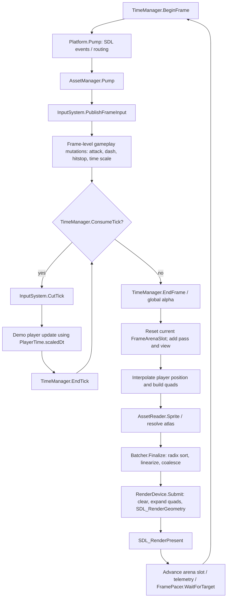
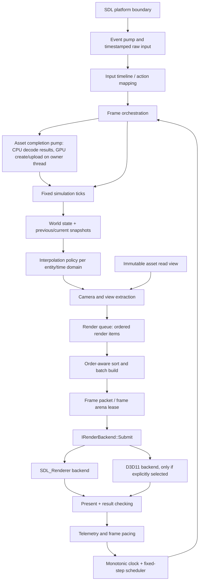

# EngineN Runtime Architecture Audit & Redesign

**Audit date:** 2026-10-11  
**Source reviewed:** `enginen_pipeline_bundle.cpp` (2,044 lines)  
**Target:** C++20, SDL3, 2D action platformer; optional/native Direct3D 11 backend if D3D11 is an actual platform requirement.

## Executive assessment

EngineN already has useful seams: a fixed-step accumulator (`TimeManager`), action-oriented input APIs (`InputSystem`), generational asset handles (`AssetHandle`), a render extraction representation (`QuadInstance`/`SortEntry`), a batch finalizer (`Batcher`), and an abstract render backend. Those are reasonable starting points. The problem is that several contracts do not line up: render metadata is richer than the backend executes, GPU texture generations are discarded before submission, some errors are ignored, and the demo mutates gameplay state outside fixed simulation ticks.

The highest-priority fixes are correctness fixes, not optimization experiments:

1. Validate `maxCatchupTicks`; zero or negative values make `ConsumeTick()` drop every available tick.
2. Prevent stale render interpolation during player hitstop. The demo continues consuming global fixed ticks while player `dt == 0`, but it does not refresh the player's previous transform; rendering can continue interpolating between two old positions.
3. Make alpha representation and blend state consistent. Colors are premultiplied by `Color::ToPremultipliedRGBA8()`, but the backend selects straight-alpha `SDL_BLENDMODE_BLEND`. In addition, `SDL_SetRenderDrawBlendMode()` does not select the blend mode for textured draws; texture blend state is separate.
4. Execute—or explicitly reject—render passes, views, blend modes, and pipelines that the packet describes. `Submit()` currently consumes only the first pass's clear color and otherwise draws one list using one generic geometry path.
5. Preserve complete texture identity through render extraction. The key stores only the texture slot, not its generation, so the backend cannot validate the slot-generation pair.
6. Check SDL rendering and VSync results rather than returning success after ignored failures.
7. Fix batch-capacity overflow handling and the shared attack/dash timer in the demo.

The report below distinguishes **confirmed findings** in the supplied text from **risks** dependent on omitted implementation files. No performance improvement is claimed without a baseline measurement.

---

## 1. Current Architecture Audit

### 1.1 Evidence boundary

The bundle contains definitions for `TimeManager`, `AssetTypes`, `AssetTable`, `AssetReader`, renderer types, `FrameArena`'s declaration, `Batcher`, `RenderDevice`, and the demo loop. It refers to but does not include the implementation of several dependencies, including `Platform`, `Window`, `InputSystem`, `FrameArenaSlot` methods, `FramePacket`/`DrawBatch` definitions, texture/atlas assets, and `AssetManager` methods. Therefore:

- Findings about code present in the bundle are labeled **Confirmed**.
- Findings based on a declared interface whose implementation is absent are labeled **Risk / unverified**.
- Missing features that the current backend visibly ignores are labeled **Confirmed capability gap**. This is not a claim that the omitted code cannot implement the feature elsewhere; it means this submission path does not execute it.
- The code shown is a sandbox runtime, not enough evidence to conclude that every engine subsystem or production game feature already exists.

### 1.2 Current call flow



Key source locations:

| Concern | Source symbols and lines | What the bundle shows |
|---|---|---|
| Tick accumulator and time domains | `TimeManager::BeginFrameManual`, `ConsumeTick`, `EndTick`, `EndFrame`; lines 302–363 | Wall-time accumulator expressed in nanoseconds × simulation Hz; fixed-step loop; catch-up cap; global interpolation alpha. |
| Time scaling and hitstop | `TimeChannel`, `HitstopEngine`, `UpdateDomainDeltas`; lines 205–243, 322–331 | Per-domain scaled `dt`; real-time countdowns; each domain uses a binary frozen/unfrozen modifier. |
| Frame pacing | `FramePacer::WaitForTarget`; lines 245–275 | Deadline-based pacing with a precise delay and up to a 1 ms busy-spin tail. |
| Asset identity and slot table | `AssetHandle`, `AssetTable`; lines 402–469, 495–679 | FNV-1a path ID, 20-bit slot index + 12-bit generation, open-addressed lookup, free list, fallback slot. |
| CPU-side asset lookup | `AssetReader::Resolve`, `Sprite`; lines 691–755 | Generation-aware lookup for asset handles and atlas-frame resolution, but a texture-only reader has no atlas table. |
| Render packet construction | `FrameArenaSlot`, `FrameArena`; lines 1064–1138 | Fixed maximums are declared; two slots are rotated by modulo. Slot method implementations are absent. |
| Ordering and batching | `SortKey`, `SortEntries`, `LinearizeInstances`, `CoalesceBatches`; lines 1006–1049, 1172–1348 | 64-bit keys, byte-wise radix sort, reorder into contiguous instance storage, adjacent batch coalescing. |
| Rendering and presentation | `RenderDevice::Init`, `Submit`, `Create`, `Upload`, `Destroy`, `SetVSync`; lines 1432–1635 | SDL renderer chosen with a null driver name, CPU quad expansion, SDL geometry submission, present. |
| Gameplay/input boundary | demo loop, lines 1844–2019; particularly 1901–1945 | Input actions mutate player state before fixed ticks; `CutTick()` is used during ticks; interpolation uses global alpha. |
| Shutdown sequence | lines 2038–2042 | Assets → render device → window → platform shutdown. This order is appropriate for GPU-backed assets as shown. |

### 1.3 Confirmed defects and high-confidence correctness issues

#### A. `maxCatchupTicks` is not normalized before it is used

**Evidence:** `TimeManager::Init()` clamps a local `catchupCap` for computing `m_maxFrameNs` (lines 282–283), but stores the caller's original value in `m_config`. `ConsumeTick()` compares directly against `m_config.maxCatchupTicks` (lines 337–340).

If `maxCatchupTicks <= 0`, then with `m_ticksThisFrame == 0`, the comparison `0 >= maxCatchupTicks` is true. The first call with at least one accumulated tick discards all complete ticks using `m_accNsHz %= kNsPerSec` and returns false. Normalize once in `Init()` and use the normalized value consistently; preferably return a configuration error for unsupported values rather than silently rewriting them.

#### B. Interpolation can animate a player through hitstop

**Evidence:** In the demo update (lines 1912–1942), `prevPosition` is updated only inside `if (dt > 0.0)`. During player hitstop, the player fixed tick still occurs, but `PlayerTime().GetScaledDt()` is zero, so the branch is skipped. `TimeManager` continues consuming real-time fixed ticks, and `m_alpha` continues to change (lines 333–363). Rendering then computes `Lerp(prevPosition, position, alpha)` from the two old player positions (lines 1957–1959).

Result: the player can visually move back and forth between stale snapshots while its simulation domain is frozen. Capture/refresh interpolation state consistently for every fixed tick, or have frozen entities publish a fixed render transform. Keep interpolation policy local to the time domain; do not change the global accumulator merely to hide this symptom.

#### C. Attack and dash share one countdown

**Evidence:** Attack assigns `player.actionTimer = 0.15` and dash assigns `0.20` (lines 1901–1909). A single update later decrements that timer and clears **both** `isAttacking` and `isDashing` when it expires (lines 1928–1933).

If attack starts during a dash, the new 0.15 s timer truncates the dash; if dash starts during an attack, it can truncate the attack. Use independent action state/timers or one explicit mutually-exclusive state machine if the gameplay design truly forbids overlap. Do not fix this by adding more booleans without specifying transition rules.

#### D. Premultiplied color data is paired with straight-alpha blending

**Evidence:** `Color::ToPremultipliedRGBA8()` multiplies RGB by alpha (lines 843–849), and `QuadInstance::SetColor()` stores that value (lines 997–999). `RenderDevice::Submit()` selects `SDL_BLENDMODE_BLEND` for the `Premultiplied` enum (lines 1572–1575). SDL defines `SDL_BLENDMODE_BLEND` as `srcRGB * srcA + dstRGB * (1-srcA)`, while `SDL_BLENDMODE_BLEND_PREMULTIPLIED` uses `srcRGB + dstRGB * (1-srcA)` [SDL blend-mode reference](https://wiki.libsdl.org/SDL3/SDL_BlendMode).

For already-premultiplied vertex tint data, the standard blend equation multiplies alpha into RGB again. This can produce dark edges/trails. Choose one convention and enforce it end-to-end: either store straight-alpha vertex colors/textures and use straight-alpha blending, or premultiply all relevant source colors/textures and use premultiplied blending. Add image-based tests for both textured and untextured quads.

#### E. Textured batches do not use the blend mode selected by the renderer draw-state call

**Evidence:** `RenderDevice::Submit()` calls `SDL_SetRenderDrawBlendMode()` per batch (lines 1565–1575), but textured quads are submitted through `SDL_RenderGeometry()` with a non-null texture (lines 1620–1632). SDL documents that renderer draw blend mode applies to drawing **without textures**; textured drawing uses texture blend mode [SDL_SetRenderDrawBlendMode](https://wiki.libsdl.org/SDL3/SDL_SetRenderDrawBlendMode), [SDL_SetTextureBlendMode](https://wiki.libsdl.org/SDL3/SDL_SetTextureBlendMode).

Therefore changing `batch.blendMode` this way does not implement per-batch textured blending. Set/validate texture blend state, or use a backend/material design where blend state is part of the material/pipeline. Since texture blend mode is attached to the texture object, account for a texture used in more than one blend mode rather than mutating it casually between commands.

#### F. Multiply and max blend modes are silently mapped to ordinary blend

**Evidence:** `BlendMode` declares `Multiply` and `Max` (lines 901–908). The switch in `Submit()` has branches for Additive and Opaque, then defaults to ordinary `SDL_BLENDMODE_BLEND` (lines 1565–1575). Thus `Multiply` and `Max` do not have their advertised semantics in this backend. SDL has a predefined multiply mode but not a direct generic “max” mode in the enum shown by its reference [SDL_BlendMode](https://wiki.libsdl.org/SDL3/SDL_BlendMode); max may need a custom blend mode or an explicit shader/backend pass. Unsupported modes should return an error or be represented as unsupported, never silently render differently.

#### G. The packet describes passes, views, and pipelines that `Submit()` does not execute

**Evidence:** `Batcher::Finalize()` copies `passes` and `viewSlots` into `FramePacket` (lines 1315–1347). `Submit()` uses only `packet.passes[0].clearColor` for one clear (lines 1551–1560), ignores `RenderPassDesc.enabled`, iterates every batch in a single loop, and never reads `packet.viewSlots`, `batch.passId`, `batch.viewSlot`, or `batch.pipelineId` (lines 1561–1634). `QuadInstance::kindFlags` and `param` are also not used in the backend (lines 966–999, 1580–1632).

This is a confirmed capability gap in the execution path. Multiple passes are not independent render passes; camera/view slots do not affect transforms or viewport; pipeline IDs do not change shaders; `QuadKind` values do not produce different geometry/shaders. Implement the subset actually needed now, and validate/reject unsupported values until the complete renderer exists.

#### H. SDL errors are discarded in critical renderer paths

**Evidence:** `Init()` ignores `SDL_SetRenderVSync()`'s result (line 1443); `Submit()` ignores results from `SDL_SetRenderDrawColor`, `SDL_RenderClear`, `SDL_SetRenderDrawBlendMode`, `SDL_RenderGeometry`, and `SDL_RenderPresent` (lines 1559–1634). These SDL3 calls return booleans, with failure information available from `SDL_GetError()`; see [SDL_SetRenderVSync](https://wiki.libsdl.org/SDL3/SDL_SetRenderVSync), [SDL_RenderGeometry](https://wiki.libsdl.org/SDL3/SDL_RenderGeometry), and [SDL_RenderPresent](https://wiki.libsdl.org/SDL3/SDL_RenderPresent).

`Submit()` can return a successful `Result` after a geometry or present failure. Check every meaningful return, preserve the failed operation/context, and make failure propagation testable. Initialization should report whether the requested VSync mode was accepted; SDL documents that support differs by renderer/driver.

#### I. Texture generations are discarded when creating sort keys

**Evidence:** `TextureHandle` contains both `slot` and `generation` (lines 883–889), and `RenderDevice::Upload/Destroy` validate both (lines 1505–1536). But the demo packs `heroSprite.texture.slot` only into `SortKey` (line 2007), and `SortEntry`/`DrawBatch` expose only a texture slot in the visible packet path (lines 1041–1047, 1275–1303). `Submit()` dereferences `m_textureSlots[slot]` without checking a generation (lines 1620–1624).

A packet cannot detect that a texture slot was freed and reused after extraction. Today the demo submits synchronously and has no unload between extraction and submission, so a visible failure is not demonstrated in this call site. The identity/lifetime contract is nevertheless insufficient for hot reload, deferred submission, or render-thread queues. Carry the complete handle or pin a resource version for the packet's lifetime.

#### J. `TextureHandle::White()` is not reserved by the render device

**Evidence:** `TextureHandle::White()` returns the fixed handle `{1, 1}` (lines 883–889). `RenderDevice::Init()` initializes every nonzero slot generation to `1` and places slots `1..255` on the free list (lines 1447–1455); the first `Create()` pops slot `1` (lines 1479–1503). No white texture is created or slot 1 reserved in the visible `RenderDevice` implementation.

Therefore the constant does not identify a guaranteed white texture: it may be null before first allocation and alias the first dynamically created texture afterward. The bundle does not show a call site using `TextureHandle::White()`, so an observed visual failure is not established. Either reserve and initialize a real white texture as part of backend initialization, or remove the constant and expose a validated white-resource handle from the device.

#### J. Batch overflow silently omits draw records

**Evidence:** `CoalesceBatches()` increments `currentOffset` for every sort entry, but only appends a batch if `batchCount < kMaxBatches` (lines 1293–1306). Once 4,096 batches are filled, further non-coalescible runs receive no draw record. `FrameStats` contains dropped instances but no dropped-batch count (lines 1323–1347).

Even if normal scenes rarely reach that limit, this is silent data loss. Return an explicit finalize failure or report exact rejected ranges/counters; never return a seemingly complete packet after dropping batches. Add a test with more than 4,096 distinct adjacent batch keys.

#### K. `AssetTable::ActiveCount()` miscounts permanently retired slots

**Evidence:** `Free()` sets a slot generation to zero and does not return it to the free list when its generation reaches `AssetHandle<T>::kGenMask` (lines 570–576). This is a defensible anti-wrap policy, but `ActiveCount()` computes `capacity - 1 - FreeCount()` (lines 598–600), which counts retired, unloaded slots as active forever.

Track active and retired slots explicitly or derive active count from states. Preserve the retirement policy only if its capacity trade-off is intentional and monitored. With 12 generation bits, each slot can be recycled only 4,095 times before retirement; dynamic hot reload can make that limit relevant in long sessions.

#### L. Potential allocation failure terminates functions that promise error results

**Evidence:** `RenderDevice::Init()` is `noexcept` but calls `vector::reserve` and `resize` (lines 1432–1450); `Submit()` is `noexcept` but calls `vector::resize` (lines 1547–1579); `AssetManager::Create()` is declared `noexcept` and returns `Result` (lines 784–788), while the table's `Init()` uses vector allocations (lines 503–519). Allocation can throw; an uncaught exception crossing a `noexcept` boundary terminates the process rather than returning an error.

Catch allocation exceptions inside the noexcept factory/init boundaries and convert them to `EngineError`, or remove `noexcept` where exception propagation is intended. A `Result` return type does not automatically make an implementation exception-safe.

### 1.4 Risks and design weaknesses

| Area | Evidence | Risk / limitation | Recommendation |
|---|---|---|---|
| Frame pacing | Busy-spin tail at lines 262–269 | Up to approximately 1 ms of core time may be burned per frame by the explicit spin; `SDL_DelayPrecise` may itself busy-wait when needed. CPU cost is unknown without measurement. | Keep VSync as the normal display-paced mode. For a software cap, use a measured coarse-sleep + bounded-spin policy, expose its CPU cost, and support disabling it on battery-sensitive systems. |
| Clock configuration | Lines 277–320 | `simulationHz` is accepted as any positive `int`; `maxFrameNs * simHz` can overflow for extreme caller-supplied values; `fixedDtNs` is truncated for rates that do not divide 1e9. `m_fixedDtNs` is not used by the accumulator algorithm. | Validate Hz and frame caps to supported ranges. Keep the rational accumulator as the scheduling authority and describe `fixedDtNs` as an approximate/reporting value unless using an exact rational representation. |
| Hitch policy | Lines 314–340 | `maxFrameNs` defaults to 250 ms while the default catch-up cap is eight ticks. At 120 Hz, eight ticks cover about 66.7 ms, so much of a clamped 250 ms backlog is discarded by the catch-up policy. This may be deliberate, but two independent caps obscure the policy. | Define one documented overload policy: maximum accepted frame delta, maximum simulated ticks per render frame, and whether excess whole ticks are dropped. Track dropped simulation time and hitch cause separately. |
| Determinism | Fixed timestep in lines 333–355; gameplay uses floating-point `Vec2` (lines 1914–1942) | Fixed dt improves consistency but does not by itself guarantee deterministic replay, lockstep, or rollback. Physics, iteration order, input assignment, random state, and floating point remain relevant. | Claim deterministic simulation only after repeatable replay tests across supported builds/platforms. |
| Time domains | `TimeChannel::CommitTick()` increments a Q16 phase (lines 220–224); `GetDomainAlpha()` lines 383–390 | Q16 phase and `GetDomainAlpha()` are easy to misuse: gameplay currently renders with global alpha, while zero-domain-`dt` updates are skipped. Channel semantics are not defined beyond scaled `dt`/hitstop. | Document whether domains advance every global tick with scaled `dt` or skip updates at low scale. Define interpolation per entity/domain accordingly; remove unused time helpers only after repository-wide usage analysis. |
| Input semantics | `PublishFrameInput()` at lines 1880–1900, `CutTick()` at 1910–1912, plus raw key watcher at lines 1829–1843 | Action state is mutated directly from `frameInput` before simulation ticks, while tick input is a separate path. Quick press-release events, no-tick frames, multi-tick catch-up, pause, and focus loss semantics cannot be validated because `InputSystem` implementation is omitted. | Make the event-to-tick assignment contract explicit and test it; keep frame-only actions separate from gameplay actions. |
| Asset hash identity | `HashPath()` lines 408–425 | Only backslash normalization is shown; casing, redundant separators, `.`/`..`, and hash collisions are not handled here. Different source paths could map to the same `AssetId`, intentionally or accidentally. | Canonicalize paths at a content boundary and store the canonical key in debug/build tools so collisions can be detected. Keep hash IDs as lookup accelerators, not proof of path equality. |
| Handle bounds | `AssetTable::Init()` lines 503–519; handle index is 20 bits (lines 442–468) | Capacity is not visibly checked against `AssetHandle<T>::kIndexMask + 1`; large values could truncate slot indices in `FromParts()`. `capacity * 2u` and `bit_ceil()` also deserve checked bounds. | Validate capacities before allocation and static/dynamic assert all table indices are representable. |
| Reader safety | `AssetReader` supports texture-only and texture+atlas constructors (lines 693–705); `GetTable<Atlas>()` dereferences `m_atlases` (lines 745–752) | Calling public `Resolve(AssetHandle<Atlas>)` on the texture-only constructor can dereference a null atlas pointer. `Sprite()` handles this case, but `Resolve()` itself does not. | Make unsupported resolution unrepresentable, return a fallback/error, or require both tables at construction. |
| GPU resource ownership | `RenderDevice` owns SDL texture pointers (lines 1391–1397); `AssetManager` stores a device pointer (lines 809–814) | Worker loading, pending upload, packet pinning, and whether `AssetManager::Pump()` creates/destroys SDL resources are unknown because implementation is absent. | Define a main/render-thread ownership rule and a resource-retirement contract before adding async loading or a render thread. |
| Memory behavior | `Batcher` allocates max-size sort and instance scratch arrays (lines 1311–1314); `RenderDevice` reserves 4,096 quads then resizes per batch (lines 1444–1446, 1577–1579) | The Batcher always allocates about 7 MiB for its two declared scratch arrays (`131,072 × 48 bytes` instances plus `65,536 × 16 bytes` sort entries), before arena storage. Renderer scratch can grow substantially for a large batch. This is a memory policy, not proof of a bottleneck. | Choose capacities from instrumented scene requirements. Count allocations and peak bytes after warm-up; avoid allocating for theoretical maxima without evidence. |
| Two frame slots | `FrameArena` rotates two slots (lines 1124–1138); main submits synchronously before `AdvanceSlot()` (lines 2017–2019) | The two slots do not currently create CPU/GPU overlap: the main thread finalizes and submits one packet before advancing. SDL command execution may be asynchronous internally, but the CPU packet is consumed through the SDL call path; no EngineN render queue or completion fence is shown. | One slot is enough for the current synchronous path. Retain multiple slots only when a demonstrated overlap design has a completion signal and explicit slot ownership. |
| Sorting | SortKey puts pass/layer/depth before blend/pipeline/texture (lines 1015–1039); radix sort lines 1172–1220 | A stable radix sort is sensible for many entries, but it does not fix semantic ordering. Commands at identical pass/layer/depth can be reordered by blend/pipeline/texture, and alpha compositing is order-dependent. | Encode explicit painter/order semantics for transparent work. Reorder only commands whose order independence is defined. Benchmark radix against simpler sorting at actual list sizes. |
| High-DPI/resizing | Demo creates a high-DPI, resizable window (lines 1793–1799) but uses fixed `config.windowWidth/Height` for viewport, background, and bounds (lines 1935–1939, 1954–1964) | No resize/output-size path is visible. A high-DPI or resized window can make simulation bounds and rendered dimensions inconsistent, depending on `Window` and renderer configuration. | Handle resize/display-scale changes; query renderer output size and choose a documented logical-coordinate policy. Update cameras, letterbox, and gameplay bounds independently. |
| Backend choice | `SDL_CreateRenderer(window.Native(), nullptr)` at line 1439 | Passing `nullptr` explicitly lets SDL select a renderer; it does not guarantee D3D11. SDL documents this behavior [SDL_CreateRenderer](https://wiki.libsdl.org/SDL3/SDL_CreateRenderer). The shown code does not create `ID3D11Device`, `ID3D11DeviceContext`, or a DXGI swap chain. | Decide whether portability through SDL_Renderer is the goal or D3D11 is a hard requirement. Do not design for D3D11-specific behavior before choosing/implementing that backend. |
| Startup/shutdown | `EnsureDemoTexturesExist()` and shutdown lines 1666–1744, 2038–2042 | Directory creation and file writes are not error-checked in the helper. Cleanup on early `return` depends on RAII behavior in omitted `Window`/`Platform` implementations. | Validate file I/O and use explicit RAII wrappers for all acquired SDL/platform objects. Keep the current asset-before-device shutdown order. |

### 1.5 Performance bottlenecks to measure, not assume

The current code suggests, but does not prove, several costs:

- `RenderDevice::Submit()` expands every quad into four `SDL_Vertex` values and six integer indices on the CPU for every batch (lines 1577–1619). At high quad counts this may dominate submission work, but benchmark it against the actual SDL renderer and target hardware.
- A sort-entry radix sort scans the list multiple times and may copy/relinearize quads (lines 1172–1261). For small scenes the sort can cost more than the draw calls it saves; for large scenes radix sort may be beneficial.
- Each batch changes renderer state and submits one `SDL_RenderGeometry()` call (lines 1561–1632). Actual backend batching and driver overhead depend on SDL's renderer and selected graphics driver.
- `FramePacer` spends CPU in its busy-spin tail (lines 262–269). Total loop FPS alone does not reveal whether the frame is CPU-bound, GPU-bound, VSync-bound, or sleeping.
- `m_vertexScratch`/`m_indexScratch` are resized by batch, which may allocate on growth but retain capacity after growth. The current implementation does not guarantee zero allocations from the first frame or for all workloads.

Instrument the subsystem spans and allocation counts before replacing data structures or introducing threads.

---

## 2. Target Architecture

### 2.1 Runtime lifecycle and data flow



**Important boundary:** gameplay code updates simulation state and publishes renderable state; it does not create SDL vertices, set GPU state, or call `RenderDevice` directly. Render extraction converts a read-only world snapshot to value-type render items. The batcher orders and groups them without changing gameplay state. The backend owns GPU API calls and presentation.

### 2.2 Ownership and lifetime rules

| Object/data | Owner | Validity/lifetime contract |
|---|---|---|
| SDL window, SDL renderer or D3D11 device/swap chain | Platform/render backend | Created/destroyed on the required owning thread. Rendering/present functions stay on the main thread for SDL_Renderer; native D3D11 immediate-context and DXGI calls follow the D3D11 threading rules. |
| Raw SDL events | Platform/event pump | Copied/converted into EngineN-owned events before the SDL event object is reused. |
| Tick input | Input timeline | Immutable for one simulation tick; transitions are consumed once, held state persists, and one press is not repeated across all catch-up ticks. |
| Simulation world | Simulation | Authoritative state changes only at fixed ticks, except explicitly frame-level controls (e.g. window mode or app pause). |
| Previous/current simulation snapshots | Simulation/render boundary | Written in a defined order; render extraction reads both without mutating them. Frozen domains do not interpolate stale movement. |
| Asset CPU data | Asset manager/worker | Workers may read and decode into CPU-owned staging data; completion payload carries a handle generation/job token. |
| GPU textures/buffers | Render backend or graphics-resource owner | Create/upload/destroy on the thread required by the backend. A resource cannot be destroyed/reused while a packet referencing that version remains in flight. |
| Render items and batches | Frame build / arena | Plain values and validated handles; no pointers to temporary gameplay objects. Packet spans remain valid until synchronous `Submit()` returns, or until an explicit lease/fence signals completion for asynchronous submission. |
| Frame arena slot | Frame scheduler | Reset only when no consumer can read it. Rotation by index alone is insufficient if asynchronous consumers exist. |

### 2.3 Subsystem boundaries

Keep responsibilities distinct; fewer files/classes are not themselves a quality metric.

- **`Platform` / `Window`:** SDL initialization, window creation, event polling, focus/resize/display changes, and platform capability reporting. Do not contain simulation timing policy.
- **`InputSystem`:** physical state, bindings, action transitions, timestamps/sequence IDs, and conversion to tick input. Keep raw debug shortcuts on the same router but distinguish frame commands from gameplay commands.
- **`TimeManager` / `FixedStepper`:** monotonic sample, accepted wall-time delta, fixed tick scheduling, pause/overload policy, interpolation alpha, and frame-pacing mode. Keep hitstop/time-scale domain semantics explicit rather than letting gameplay query several loosely coupled counters.
- **`Simulation`:** fixed-step state transitions, movement, combat, collision, AI, world/particle updates. Gameplay state changes occur here.
- **`AssetManager`:** canonical IDs, handle validation, state machine, CPU decode tasks, upload queue, fallback policy, and lifetime/reference tracking. It should not expose raw pointers whose validity extends beyond the reader/packet contract.
- **`RenderExtractor`:** maps world snapshot + asset view + camera(s) into ordered draw items. It performs view culling and selects render animation frames, but never advances authoritative gameplay.
- **`Batcher`:** validates render items, preserves required order, sorts reorderable classes, coalesces compatible adjacent items, emits stats/overflow errors. It does not own GPU objects.
- **`IRenderBackend`:** validates packet spans/handles, translates batch/material/pass/view declarations into graphics API calls, and reports submission failure.
- **`FrameTelemetry`:** CPU phase timings, tick counts, backlog/dropped time, allocation counts, draw statistics, backend/VSync state. Do not infer GPU time from CPU duration spent inside `Submit()` or `Present()`.

### 2.4 API contract table

| Boundary | Input | Output | Must not do |
|---|---|---|---|
| Event pump → input timeline | SDL events, event timestamps | action events and held-state changes | Mutate world entities directly |
| Scheduler → simulation | fixed tick index, fixed `dt`, one tick's input | authoritative world state | Use render-frame `dt` for collision/movement |
| Simulation → extractor | previous/current render snapshots, camera state | ordered render items | Advance AI/physics/attack timers |
| Asset manager → extractor | validated read view / texture IDs | stable asset metadata and resource refs | Return a GPU object that can be freed before packet consumption |
| Extractor → batcher | render items with order/material/view | packet with ranges/batches/stats | Silently drop or reinterpret unsupported features |
| Batcher → backend | borrowed/leased packet | success/failure + backend diagnostics | Change gameplay order unless the draw class permits it |
| Backend → presentation | validated GPU commands | present result and timings | Claim success after ignored SDL/DXGI failures |

---

## 3. Design Decisions and Trade-offs

### 3.1 Time loop, fixed timestep, and frame pacing

**Recommendation:** Keep a fixed simulation step initially, defaulting to 120 Hz for the precision-oriented platformer target, but make the rate a validated configuration and benchmark 60/120 Hz. Keep rendering uncoupled from the number of simulation ticks per frame.

**Why:** The accumulator already decouples simulation from rendering and supplies an interpolation alpha. A fixed tick simplifies collision tuning, attack windows, coyote time, dash duration, and reproducible test stepping. It is not automatically deterministic and it is not always necessary for every subsystem.

**Alternatives and trade-offs:**

- **Variable timestep:** fewer update calls and potentially lower per-second CPU overhead, but movement/collision response and frame-dependent numerical behavior become harder to tune during hitches. Do not switch the whole game to variable `dt` merely to simplify timing.
- **Fixed 60 Hz:** less simulation work and frequently adequate for 2D; a 120 Hz step can improve input/movement granularity but doubles update frequency. Choose from movement/collision requirements and profiling, not from a blanket “higher is better” rule.
- **Strict fixed-rate / deterministic replay:** a fixed `dt` is necessary for many approaches but insufficient. Input tick assignment, entity iteration, random seeds, collision tie-breaking, and floating-point platform behavior must also be controlled.
- **Accumulator with capped catch-up:** protects against the spiral of death, but dropping elapsed time changes game-time progression after a hitch. Make that policy visible through `droppedTimeNs`, `ticksDropped`, and a reason code; do not silently modulo away full ticks.

The classic accumulator discussion in [Fix Your Timestep](https://gafferongames.com/post/fix_your_timestep/) is useful background, not a substitute for deciding EngineN's overload policy.

**Recommended policy:**

1. Sample one monotonic clock per frame and preserve both raw and accepted delta.
2. Clamp pathological deltas only according to an explicit policy, such as focus loss/resume or a configurable maximum.
3. Execute at most `maxCatchupTicks` fixed updates per rendered frame.
4. If backlog remains beyond that cap, either preserve backlog (risking sustained catch-up/latency), drop whole ticks while preserving the fractional remainder (current effective policy), or enter a documented slow-motion/recovery mode. For a single-player action platformer, bounded drop with telemetry is usually a practical default; for replay/network lockstep, it may be unacceptable.
5. Normalize config once: `simulationHz` within an agreed range, `maxCatchupTicks >= 1`, and frame limits that cannot overflow accumulator arithmetic.
6. `Pause`/focus loss resets the wall-clock sample and follows an explicit policy for accumulator remainder, time-scale timers, and hitstop. Test each separately.

**Frame pacing:** VSync and a software FPS cap are separate controls. Do not enable both by default without a reason; their combination can add latency or produce unexpected cadence. SDL's `SDL_SetRenderVSync()` may fail when the requested mode is unsupported, so report/query the effective setting [SDL_SetRenderVSync](https://wiki.libsdl.org/SDL3/SDL_SetRenderVSync). Use `SDL_GetTicksNS()` or performance counters rather than millisecond timers [SDL_GetTicksNS](https://wiki.libsdl.org/SDL3/SDL_GetTicksNS). `SDL_DelayPrecise()` can still return late due to scheduler behavior and may busy-wait when needed [SDL_DelayPrecise](https://wiki.libsdl.org/SDL3/SDL_DelayPrecise).

The current 1 ms busy-spin tail should be retained only if measurements show it helps target frame pacing enough to justify CPU/power use. Compare:

- VSync only;
- software cap with delay-only;
- software cap with a bounded spin tail;
- uncapped diagnostic mode.

Record mean, p95, p99 frame period, missed deadlines, CPU time spent waiting, and power/CPU utilization. Do not use reported FPS alone.

### 3.2 Input sampling and tick assignment

**Recommendation:** Separate **physical event capture**, **frame-level actions**, and **tick-level gameplay actions**.

- Poll SDL events early in the outer loop. SDL documents `SDL_PollEvent()` as a main-loop event-processing path and recommends processing the queue each frame [SDL_PollEvent](https://wiki.libsdl.org/SDL3/SDL_PollEvent).
- Convert raw key/controller transitions into EngineN-owned events (action, pressed/released, timestamp/sequence).
- Maintain held state for continuous movement; queue edge transitions for one-time actions.
- At each simulation tick, consume exactly the events assigned to that tick. If multiple fixed ticks execute in one render frame, the press edge must not repeat for every tick.
- A press and release arriving between two simulation ticks must have a defined result; do not rely on the latest held state alone if short inputs must be preserved.
- On focus loss, clear or synthesize releases for held controls according to a tested policy.
- Apply `Attack`, `Dash`, `Jump`, and other gameplay actions inside fixed-tick logic, not as render-frame mutations. Window mode, debug overlays, and quit may remain frame-level commands.

For local play, an event queue with tick-stamped edges is sufficient; full input-delay, rollback, or deterministic-input networking infrastructure is not justified until required.

### 3.3 Simulation state, hitstop, and time scale

Keep the global fixed scheduler. Model hitstop as a modifier of selected simulation domains, not as a second frame scheduler. Start with a small explicit domain set only if gameplay requires it: world, player, enemy, UI/real-time. Avoid a general-purpose channel matrix until there are real consumers.

Define precisely:

- Does the domain's update function run when `dt == 0`, or is it skipped?
- Which timers use real time, world time, or actor time?
- Which effects freeze during hitstop (movement, animation state, particles, camera shake, AI, cooldowns)?
- Does a hitstop request take effect before the next fixed tick or only after a collision/hit event at a specified tick?

**Recommendation:** Simulation systems still receive one fixed tick per scheduler tick. Per-domain `dt` is fixed `dt × timeScale`, with zero during hitstop. Systems that must process state transitions at zero `dt` should still get called or receive a distinct `isFrozen` flag; do not bury important edge/event handling under `if (dt > 0)`. Timers should name their clock domain. Do not let render interpolation advance visual movement for an entity whose domain is frozen.

For a platformer, authoritative movement, collision, attack windows, hitboxes, and dash velocity belong to fixed simulation. Cosmetic particles and camera smoothing can be render-time or fixed-time only when their behavior is independent of combat correctness.

### 3.4 Interpolation and camera

Keep previous/current state snapshots and interpolate presentation state after simulation, not authoritative positions. For continuous transform state, `Lerp(previous, current, alpha)` is an appropriate baseline. It adds roughly one simulation-step of presentation latency compared with extrapolation, which is usually a good trade for visual stability in single-player platformers.

Recommended details:

- Every tick must establish a consistent previous/current relationship for every interpolated entity, including frozen domains and newly spawned/despawned entities.
- Spawned entities should initialize previous = current; teleports, scene loads, and hard camera cuts should invalidate the old interpolation interval.
- Use a domain-appropriate frozen policy. If no simulation state changes during hitstop, publish a stable render transform rather than lerping through the last active movement interval.
- Interpolate camera transforms coherently with world transforms; do not render the player with one alpha and the following camera with a stale snapshot.
- Keep collision and hit detection on authoritative current simulation state; never run gameplay collision against interpolated render positions.
- Clamp alpha for public interfaces but instrument accumulator invariants instead of relying on clamping to hide invalid scheduler state.

Extrapolation may reduce apparent latency but can overshoot at walls, landings, parries, and quick reversals. Do not introduce it globally for the core platformer before measuring latency and its correction artifacts.

### 3.5 Asset identities, loading, and GPU lifetime

**Keep generational handles**, but fix their contracts. Generational handles are justified because stale references are a real resource-lifetime failure mode; they are not a complete ownership system.

Recommended structure:

- `AssetId`: canonical, normalized path/content key; debug builds detect ID/hash collisions.
- `AssetHandle<T>`: slot + generation, with checked capacity. Use a wider handle if memory budget permits or if retirement due to generation wrap becomes operationally significant.
- Explicit state transition: `Unloaded → Loading → Ready | Failed`; no transition may be committed from an obsolete generation/job token.
- `AssetReader`: immutable, frame-local view that safely returns fallback metadata for invalid/loading/failed references.
- CPU workers: file IO, decompression, image decode, atlas parsing. GPU texture create/upload/destroy must follow backend threading requirements. SDL's geometry, VSync, and present APIs document main-thread constraints [SDL_RenderGeometry](https://wiki.libsdl.org/SDL3/SDL_RenderGeometry), [SDL_SetRenderVSync](https://wiki.libsdl.org/SDL3/SDL_SetRenderVSync), [SDL_RenderPresent](https://wiki.libsdl.org/SDL3/SDL_RenderPresent).
- `PumpGpuUploads()` runs at a deliberate frame boundary and processes a bounded number of uploads or a time budget, so a large asset completion burst does not create an unexplained frame spike.
- Frame packets carry full resource identity and lifetime pins/version references. Unload can remove an ID from future lookups immediately, but physical GPU destruction waits until no in-flight packet uses that resource version.

**Alternatives:**

- For this synchronous SDL backend, the simplest correct solution is to submit and consume the packet on the main thread, then allow immediate slot reuse after submit returns, so long as resource mutations are also serialized and the SDL backend contract is respected.
- With a render thread or deferred submission, use immutable resource versions or per-packet pin counts/fences. Merely attaching a generation is insufficient if the resource can be destroyed before the backend checks it.
- A `shared_ptr` per draw item is easy but may add refcount traffic and obscures ownership. Prefer a frame-level resource pin list or manager-controlled retire queue if profiling shows many draws.

Do not add an asynchronous loading thread until the synchronous path has correct states, tests, cancellation, and telemetry.

### 3.6 Memory and frame arenas

**Do not treat zero allocation as an axiom.** The useful requirement is predictable allocation behavior at a measured target workload, not “no allocation under any circumstances” at the expense of large permanent buffers and silent caps.

Recommended starting point:

- Use a reusable `FrameBuildBuffer` with reserved vectors and explicit high-water telemetry. The first warm-up allocation is acceptable; a target may require zero allocations per steady-state frame after warm-up.
- Reserve from expected scenes (tilemap visible quads, actors, particles, UI), not from an arbitrary theoretical maximum alone.
- Keep explicit overflow results and drop counters. On packet overflow, fail or draw a documented truncated fallback in debug builds; never silently return a partial success.
- Avoid copying the full instance array if sorting can reorder lightweight indices or if extraction can emit in final order. Compare index sorting plus gather against current quad relinearization using realistic scenes.
- Retain two frame slots only when frame construction overlaps another consumer. Slot reuse must be fenced/leased, not merely modulo-two.
- If future parallel extraction needs arenas, partition by worker or pass and join before batching. Do not make the current main-thread implementation pay for a speculative worker topology.

The current Batcher explicitly allocates maximum-sized sort and instance scratch arrays (lines 1311–1314), which is about 7 MiB before any arena storage. That may be acceptable on desktop, but it should be justified by scene budgets and profiled high-water marks.

### 3.7 Render extraction, order, sorting, and batching

Introduce a render item that names **what** to draw and **where/how it must be ordered**, separately from the GPU batch key.

```cpp
struct TextureRef {
    std::uint16_t slot{};
    std::uint32_t generation{};
};

enum class DrawOrderClass : std::uint8_t {
    OpaqueReorderable,
    AlphaOrdered,
    AdditiveReorderable,
    UiOrdered
};

struct RenderItem {
    TextureRef texture{};
    std::uint32_t materialId{};
    std::uint16_t viewId{};
    std::uint16_t layer{};
    std::int32_t depth{};
    std::uint64_t sequence{};   // stable insertion/order identity
    DrawOrderClass orderClass{};
    QuadInstance quad{};
};
```

This is representative, not a prescription that all fields must survive in every packed struct. In production, compress fields after correctness tests show which are needed.

**Ordering policy:**

- Opaque/reorderable objects can be sorted by pass, layer/depth grouping, material/pipeline, and texture to reduce state changes, subject to depth/painter requirements.
- Alpha-blended sprites must retain required painter order. Same depth does not mean interchangeable: changing material/texture/blend order can change the image. Preserve `sequence` or define deterministic order within a layer.
- Additive items are often more reorderable, but only when depth/pipeline semantics do not depend on their order.
- UI usually needs strict order. Tilemaps may be chunked and rendered as an opaque/background class when their content permits it.
- Do not batch across changes in view, scissor/clip, target, pipeline/material, texture **generation**, or blend mode.

**Radix sort:** The current LSD radix sort is a reasonable candidate for large, fixed-width keys. It has a monotonic fast path and skips non-varying bytes (lines 1172–1220). Do not discard it merely because it is custom; equally, do not assume it is faster. First fix sort semantics and overflow. Benchmark it against `std::sort` on a total key `(order class, pass, layer, depth/order sequence, material…)`, and measure 0, 32, 256, 4k, 32k, and max supported items. `std::stable_sort` may allocate; `std::sort` needs a total key if stable tie behavior is required. Retain radix only if it wins on target workload and can preserve the required ordering contract.

**Batching:** Adjacent compatible items should coalesce. The batcher may optimize draw count but must not alter the ordering promised by `DrawOrderClass`. `batchCount`, `instanceCount`, offsets, and capacities must be validated before the packet becomes visible to a backend.

### 3.8 SDL_Renderer versus native D3D11

The current `RenderDevice` is an SDL renderer backend. `SDL_CreateRenderer(window.Native(), nullptr)` asks SDL to choose a renderer; on Windows it is not a promise that the selected backend is Direct3D 11. The code has no native D3D11 device/context/swap-chain ownership, no explicit instance buffer, and no `DrawIndexedInstanced` call.

Two valid routes exist:

**Route A — SDL_Renderer as the supported backend now (recommended for incremental fixes).**

- Keep the current cross-platform path.
- Correct blend modes/material semantics, passes/views actually supported, resource generations, error checking, and resize/high-DPI handling.
- Explicitly constrain the supported pipeline set and reject unsupported `PipelineKind`/`QuadKind` values.
- Keep CPU quad expansion for low/medium sprite counts unless profiling demonstrates it is a bottleneck. SDL geometry is a valid abstraction, not automatically too slow.

**Route B — a native D3D11 backend when D3D11-specific control is required.**

- Implement `IRenderBackend` with explicit `ID3D11Device`, immediate context, swap chain, shader/input-layout/state objects, render targets, and dynamic buffers.
- Use an immutable unit quad plus a per-instance stream (transform/UV/color/material/flags) and `DrawIndexedInstanced` or equivalent GPU instancing. Upload the compact instance list per frame rather than expanding every quad into CPU vertices.
- Manage blend/raster/depth states and pass/view targets explicitly. Handle resize by recreating swap-chain buffers and viewport-dependent resources.
- Consider a DXGI frame-latency waitable object / max-frame-latency policy only if latency measurements warrant it. Microsoft's [SetMaximumFrameLatency](https://learn.microsoft.com/en-us/windows/win32/api/dxgi1_3/nf-dxgi1_3-idxgiswapchain2-setmaximumframelatency) applies only to swap chains created with the waitable-object flag.
- Treat the immediate context and presentation as thread-affine/serialized. Microsoft documents that only one thread at a time should use the immediate context and recommends using that same thread for DXGI operations, especially `Present()` [Direct3D 11 multithreading](https://learn.microsoft.com/en-us/windows/win32/direct3d11/overviews-direct3d-11-render-multi-thread-intro). Deferred contexts/command lists add complexity and should follow profiling, not precede it.

Avoid blending these routes into a vague hybrid. The portable renderer and a native D3D11 backend can share render items, batching policy, asset IDs, and a backend-neutral packet; they should not pretend to share all render-state assumptions.

### 3.9 Transparency, texture formats, and color

Set a single explicit policy:

- Define whether decoded texture RGB is straight-alpha or premultiplied-alpha.
- Define whether per-vertex tint colors use the same convention.
- Match the chosen blend equation; document the accepted blend modes for each backend.
- Treat opaque, alpha, additive, multiply, and max as distinct capabilities. If a backend lacks a mode, reject it or route it through an explicit fallback/pass.
- Add an image test that composites translucent colored quads and alpha-edged sprites over a contrasting background. Verify numerical output or compare against a reference image with a small, justified tolerance.

SDL texture blend state is attached to the texture, whereas draw blend state affects non-textured operations. That distinction must appear in the SDL backend implementation and tests, not only in the enum documentation.

### 3.10 Presentation, VSync, and shutdown

**Single-frame presentation contract:** clear/execute all required passes, then present once. SDL documents that the backbuffer should be considered invalid after `SDL_RenderPresent()` and recommends clearing before the next frame [SDL_RenderPresent](https://wiki.libsdl.org/SDL3/SDL_RenderPresent). The current code's one present per `Submit()` fits that rule, but its multi-pass packet contract is not implemented.

- `Present` errors and renderer/device removal must be visible in telemetry and logs.
- Track effective VSync mode and software cap separately. A zero software target does not by itself mean uncapped if VSync is enabled.
- In resize/high-DPI handling, maintain distinct logical game resolution, window size, and render output size.
- Shutdown order should remain: stop new asset jobs, wait for outstanding jobs, drain/cancel pending uploads, release asset references/GPU resources, destroy backend, destroy window, then quit SDL/platform. The shown demo order of assets → device → window → platform is directionally correct, but any future worker/job queue needs an explicit join/drain phase.

---

## 4. API and Code Examples

The examples below illustrate a consistent boundary. They are intentionally compact and should be adapted to EngineN's actual `Result`, math, event, and window types rather than pasted in as a full replacement.

### 4.1 Validated timing configuration and fixed scheduler

```cpp
struct TimeConfig {
    std::uint32_t simulationHz{120};
    std::uint32_t maxCatchupTicks{8};
    std::uint64_t maxAcceptedFrameNs{250'000'000};
};

struct FrameTiming {
    double rawDeltaSec{};
    double acceptedDeltaSec{};
    std::uint32_t ticksRun{};
    double interpolationAlpha{};
    std::uint64_t droppedSimulationNs{};
};

class FixedStepper {
public:
    [[nodiscard]] bool Configure(const TimeConfig& cfg) noexcept {
        if (cfg.simulationHz < 30 || cfg.simulationHz > 480 ||
            cfg.maxCatchupTicks == 0 || cfg.maxAcceptedFrameNs == 0) {
            return false;
        }
        m_cfg = cfg;
        m_step = 1.0 / static_cast<double>(cfg.simulationHz);
        m_accumulator = 0.0;
        return true;
    }

    void AddElapsed(double seconds) noexcept {
        if (!std::isfinite(seconds) || seconds <= 0.0) return;
        const double cap = static_cast<double>(m_cfg.maxAcceptedFrameNs) / 1e9;
        m_accumulator += std::min(seconds, cap);
    }

    [[nodiscard]] bool CanStep() const noexcept {
        return m_accumulator >= m_step && m_stepsThisFrame < m_cfg.maxCatchupTicks;
    }
    [[nodiscard]] double StepSeconds() const noexcept { return m_step; }
    void EndStep() noexcept {
        m_accumulator -= m_step;
        ++m_stepsThisFrame;
    }
    void BeginFrame() noexcept { m_stepsThisFrame = 0; }
    [[nodiscard]] double Alpha() const noexcept {
        return std::clamp(m_accumulator / m_step, 0.0, 1.0);
    }
    [[nodiscard]] bool HasBacklog() const noexcept {
        return m_accumulator >= m_step;
    }
    void DropWholeBacklogTicks() noexcept {
        // Explicit overload policy: preserve the fractional remainder.
        m_accumulator = std::fmod(m_accumulator, m_step);
    }

private:
    TimeConfig m_cfg{};
    double m_step{1.0 / 120.0};
    double m_accumulator{};
    std::uint32_t m_stepsThisFrame{};
};
```

This example intentionally separates backlog handling from `CanStep()`, so the caller can record exactly when/why it drops simulation time. For production, prefer integer/rational accumulator arithmetic if exact tick-boundary arithmetic across a long run is required; validate all multiplications/additions if retaining the current integer-nanosecond representation. The allowed range `30–480 Hz` is a suggested starting policy, not a universal engine requirement.

### 4.2 Tick input with one-shot transitions

```cpp
struct ActionTransition {
    ActionId action{};
    bool pressed{};
    std::uint64_t sequence{};
};

struct TickInput {
    ActionBits held{};
    std::span<const ActionTransition> transitions{}; // valid only for this tick
    Vec2 moveAxis{};

    [[nodiscard]] bool Pressed(ActionId id) const noexcept;
    [[nodiscard]] bool Held(ActionId id) const noexcept;
};

class InputTimeline {
public:
    void OnRawEvent(const SDL_Event& event, std::uint64_t eventTimeNs);
    void BeginFrame();
    [[nodiscard]] TickInput ConsumeForTick(std::uint64_t tickIndex);
    void OnFocusLost();
private:
    // Owned event queue, held-state snapshot, binding map, and scratch storage.
};
```

The implementation must answer how short press/release pairs are represented when no simulation tick occurs between them. It must also ensure transitions are returned once—not duplicated for all catch-up ticks—and invalidate input spans only after their tick has completed.

### 4.3 Fixed simulation and independent action state

```cpp
struct ActorRenderState {
    Vec2 previousPosition{};
    Vec2 currentPosition{};
    float previousRotation{};
    float currentRotation{};
    bool teleported{};
};

struct Actor {
    Vec2 position{};
    Vec2 velocity{};
    ActorRenderState render{};
    double attackTimeRemaining{};
    double dashTimeRemaining{};
    bool attacking{};
    bool dashing{};
};

void FixedUpdate(Actor& actor, const TickInput& input, double fixedDt,
                 double actorTimeScale, bool actorHitstop) {
    actor.render.previousPosition = actor.position;
    actor.render.previousRotation = actor.render.currentRotation;

    const double dt = actorHitstop ? 0.0 : fixedDt * actorTimeScale;
    if (input.Pressed(kAttackAction)) {
        actor.attacking = true;
        actor.attackTimeRemaining = 0.15;
    }
    if (input.Pressed(kDashAction)) {
        actor.dashing = true;
        actor.dashTimeRemaining = 0.20;
    }

    // Process zero-dt transition/event semantics deliberately.
    if (dt > 0.0) {
        UpdateMovement(actor, input.moveAxis, dt);
        actor.attackTimeRemaining = std::max(0.0, actor.attackTimeRemaining - dt);
        actor.dashTimeRemaining = std::max(0.0, actor.dashTimeRemaining - dt);
        actor.attacking = actor.attackTimeRemaining > 0.0;
        actor.dashing = actor.dashTimeRemaining > 0.0;
    } else {
        // A frozen actor renders a stable pose; do not interpolate through old movement.
        actor.render.previousPosition = actor.position;
        actor.render.currentPosition = actor.position;
        actor.render.teleported = true;
    }

    actor.render.currentPosition = actor.position;
    actor.render.currentRotation = actor.render.previousRotation;
}
```

This example demonstrates independent attack/dash timers and stable frozen presentation. Actual transitions—whether dash cancels attack, attack interrupts dash, or an attack can occur while dashing—must be decided as gameplay rules. The `teleported` name can be replaced by an interpolation-valid flag if the same mechanism covers freeze/spawn/camera cuts.

### 4.4 Render extraction and backend-neutral packet

```cpp
struct RenderPacketView {
    std::span<const QuadInstance> instances;
    std::span<const DrawBatch> batches;
    std::span<const ViewSlotDesc> views;
    std::span<const RenderPassDesc> passes;
    FrameStats stats{};
};

class RenderExtractor {
public:
    void Extract(const WorldRenderSnapshot& world,
                 const AssetReader& assets,
                 std::span<const CameraView> cameras,
                 RenderItemBuffer& out) const;
};

class IRenderBackend {
public:
    virtual ~IRenderBackend() = default;
    [[nodiscard]] virtual Result<void, EngineError>
    Submit(const RenderPacketView& packet) noexcept = 0;
    [[nodiscard]] virtual Result<void, EngineError> Present() noexcept = 0;
};
```

`RenderItemBuffer` and `CameraView` are illustrative types. The important rule is that extraction emits complete ordering/material/view/resource information before batching; it must not collapse a `TextureHandle` to a slot number. A packet made of spans is borrowed memory, not an owning object. For the initial SDL backend, consume it synchronously before the frame buffer is reset. If a future render thread queues packets, replace the borrowed lifetime with an explicit frame-slot lease or owning packet and resource pins.

### 4.5 Intended runtime call site

```cpp
while (runtime.Running()) {
    runtime.PumpPlatformEvents();          // owns SDL event polling
    const FrameTiming frame = runtime.BeginFrame();
    runtime.Input().PublishFrameSnapshot();
    runtime.Assets().PumpCompletions();    // GPU work on the backend owner thread

    runtime.Stepper().BeginFrame();
    runtime.Stepper().AddElapsed(frame.acceptedDeltaSec);
    while (runtime.Stepper().CanStep()) {
        const TickInput input = runtime.Input().ConsumeForTick(runtime.TickIndex());
        runtime.World().CapturePreviousState();
        runtime.Simulation().FixedUpdate(input, runtime.Stepper().StepSeconds());
        runtime.Stepper().EndStep();
        runtime.AdvanceTickIndex();
    }
    if (runtime.Stepper().HasBacklog()) runtime.RecordAndDropBacklog();

    const double alpha = runtime.Stepper().Alpha();
    runtime.RenderItems().Clear();
    runtime.Extractor().Extract(runtime.World().RenderSnapshot(alpha),
                                runtime.Assets().Reader(), runtime.Cameras(),
                                runtime.RenderItems());
    auto packet = runtime.Batcher().Finalize(runtime.RenderItems(), runtime.FrameArena());
    if (!packet) runtime.ReportRenderBuildFailure(packet.Error());
    else {
        auto submitted = runtime.Renderer().Submit(*packet);
        if (!submitted) runtime.ReportRenderFailure(submitted.Error());
        else runtime.Renderer().Present();
    }
    runtime.Telemetry().EndFrame();
    runtime.FramePacer().WaitIfEnabled();
}
```

The call site is a target contract, not drop-in code; concrete EngineN APIs differ. It makes the required stage order explicit and forces error handling into the owner. Asset uploads may be placed before simulation if they are unrelated, but the frame should have one documented commit point for newly-ready resources.

### 4.6 Resource lifetime and generation validation

At minimum, keep the complete identity in the packet:

```cpp
struct TextureRef {
    std::uint16_t slot{};
    std::uint32_t generation{};
};

[[nodiscard]] bool IsCurrent(TextureRef ref) const noexcept {
    return ref.slot < textures.size() &&
           textures[ref.slot].generation == ref.generation &&
           textures[ref.slot].resource != nullptr;
}
```

This check alone is valid only if resources cannot be freed between validation and use. In a synchronous owner-thread renderer that is straightforward: all GPU resource mutations and submit calls are serialized. With queued packets, retain a reference/pin to the resource version until command execution completes, then retire it. Avoid using an asset handle and a GPU handle interchangeably; one identifies logical content, the other identifies a device resource generation.

---

## 5. Testing and Performance Validation

### 5.1 Correctness test matrix

All time-related tests should use `BeginFrameManual()` or a clock abstraction so test cases do not depend on scheduler jitter. Run in Debug with assertions and in Release with sanitizers where supported.

| Test | Setup / stimulus | Required result |
|---|---|---|
| Config validation | `simulationHz = 0`, negative Hz, very high Hz, `maxCatchupTicks = 0/-1`, extreme `maxFrameNs` | Invalid config returns an error or is normalized exactly as documented; no division/multiplication overflow; no accidental permanent tick starvation. |
| Exact tick boundary | At 120 Hz, feed 8,333,333 ns, then enough remainder to cross one full accumulator tick | Tick count follows the scheduler's exact rational rule; no early tick or long-run systematic drift beyond documented integer precision. |
| Accumulator sub-tick | Feed 0, 1 ns, just below one tick, exactly one tick, and just above one tick | Correct zero/one tick counts and alpha in `[0, 1)` after normal frame completion. |
| Large hitch | Feed 250 ms, 1 s, and multi-second deltas at the default config | At most the configured number of ticks run; dropped time/backlog counter matches the explicit policy; no unbounded catch-up loop. |
| Pause/unpause | Pause for several seconds; resume | No giant resume delta. Check whether fractional accumulator and hitstop are retained/reset exactly as specified. |
| Refocus | Simulate focus loss and return after a large wall-time gap | No catch-up burst. Held inputs are released or revalidated under documented policy. |
| Frame pacing | Test 60, 120, 144, 240 FPS targets with VSync on/off where supported | Measured frame-period distribution; effective mode reported; no unexplained double throttle. Treat timing as a performance measurement, not a unit-test exact deadline. |
| Hitstop at movement | Move actor, trigger hitstop mid-frame, continue several global ticks | Actor pose is visually stable through freeze; movement/timers do not advance in the frozen domain; other domains follow their policy. |
| Independent actions | Trigger attack during dash and dash during attack | Outcomes match declared cancellation/overlap rules; one action timer never expires another action accidentally. |
| Input with no tick | Inject press then release between scheduler ticks | One-shot action is not lost when required by input policy; held state after release is false. |
| Input with many ticks | One render frame produces 2–8 ticks with one press edge | Press edge is consumed once; held movement is applied to each tick according to policy; no repeated attacks. |
| Focus loss input | Hold movement/attack, send focus-lost event | No stuck key or repeated edge after focus regain. |
| Interpolation | Move across ticks at 30/60/144/240 render Hz; freeze, teleport, spawn, despawn | Render transforms stay between valid snapshots, freeze remains static, spawn/teleport has no streak across the old transform. |
| Asset stale handle | Allocate → free → allocate same slot; query old generation | Old handle resolves to fallback/error, never to replacement asset. |
| Asset generation retirement | Recycle a slot through max generation or unit-test a reduced bit-width | Retired slots aren't counted active; free count and capacity exhaustion remain accurate. |
| Asset hash/path | Mixed slash, dot-segment, case policy, intentionally colliding test IDs | Canonical aliases follow policy; distinct-content collision is diagnosed rather than silently merged. |
| Texture generation in packet | Extract packet, free/reuse texture slot, then attempt submit | Synchronous contract rejects the stale packet or packet pin prevents reuse until consumption; it never draws a different texture by accident. |
| Reader without atlas table | Call atlas resolution from texture-only reader | Compile-time restriction or safe fallback/error; no null dereference. |
| Alpha compositing | Straight and premultiplied textures, alpha tint, additive trail, contrasting background | Pixel output matches a computed/reference blend result; no dark fringes or extra alpha multiplication. |
| Batch key ordering | Transparent overlapping items, same depth but different texture/blend/material | Output order remains the specified painter order; only explicitly reorderable classes are reordered. |
| Batch capacity | Generate 4,097+ non-coalescible batch runs and fill each major capacity | Finalize reports overflow/failure with exact counters; no unreported invisible geometry. |
| Invalid packet | Batch offset/count past end of instance span; invalid texture generation/view/pass | Backend rejects packet safely; Debug assertions identify the violated invariant; no out-of-bounds span access. |
| Multiple passes/views | Separate viewports, one disabled pass, UI pass, camera transform | Supported passes/views render independently and in declared order; unsupported ones fail validation instead of being ignored. |
| Renderer failure | Force invalid texture creation, upload failure, unsupported VSync, geometry failure where testable | Result reports error and operation; no false success state. |
| Resize/high DPI | Resize window, toggle fullscreen, test 100/150/200% scaling | Logical game view, viewport, camera, and bounds stay coherent; output size is queried/updated. |
| Shutdown | Exit with pending asset completion/upload and loaded textures | Jobs drain/cancel; assets release before device; each GPU object is destroyed at most once; no call uses a destroyed renderer/window. |

### 5.2 Performance test scene and protocol

Use a deterministic generated scene rather than the current four-frame hero sheet alone. Include, at minimum:

- 10k, 50k, and a configured upper-bound mix of tile/sprite quads;
- a mixture of opaque, alpha, additive, and UI-ordered items;
- varied textures/materials and deliberate adjacent-batch repetition;
- cameras/views and off-screen geometry for culling tests;
- moving actors, particles, and camera follow so interpolation/extraction are measured;
- asset upload bursts tested separately from steady-state rendering.

Run Release builds on documented reference hardware with fixed window resolution, power mode, graphics driver, renderer name, VSync state, frame cap, and scene seed. Warm the process and buffers before collecting measurements. Collect at least several minutes per mode and repeat runs; do not compare one noisy FPS sample.

### 5.3 Metrics to collect

Report distributions, not only averages:

- frame time p50/p95/p99 and maximum;
- fixed simulation cost per tick p50/p95/p99 and tick count per frame;
- input/event-pump cost, asset pump/upload cost, render extraction, culling, sorting, linearization, batch coalescing, backend submission, and present CPU duration;
- dropped wall/simulation time, backlog count, hitch classifications, and missed frame deadlines;
- render items, visible items, sort entries, batch count, state transitions, texture switches, view/pass counts, batch overflow/rejection count;
- allocations and allocated bytes per frame after warm-up; peak arena/scratch bytes and high-water capacity;
- selected SDL renderer driver / backend, effective VSync, output resolution, display scaling;
- if native D3D11 is added: GPU timestamp query results, dynamic-buffer upload bytes, draw count, GPU frame time, present queue/latency, and D3D11 debug-layer messages.

CPU time spent in `SDL_RenderPresent()` can include waiting for VSync or driver queueing; it is not itself a GPU execution timer. If a GPU-bound diagnosis is required, instrument the backend with GPU timing facilities.

### 5.4 Measurable acceptance criteria

Set and version an agreed target workload before optimization. Suggested initial gates:

1. **Correctness:** all tests in the matrix pass; no silent packet truncation; zero stale handles reach GPU access; no SDL/D3D call failure is recorded as success.
2. **Time:** long steady-run tick count agrees with elapsed accepted simulation time; intentional hitch tests set dropped-time telemetry; normal supported target workloads show zero dropped ticks for a 10-minute run.
3. **Input:** each edge transition is consumed once, and held-state recovery after focus loss matches spec. Add trace/replay tests for exact tick assignment.
4. **Allocation:** after warm-up, the declared target scene either has zero hot-path allocations or stays within a versioned allocation budget. Do not call the path allocation-free if capacity growth remains possible.
5. **Frame budget:** for a declared target (e.g. 60 FPS, 16.67 ms), p99 CPU work must fit within a specified margin—an initial target of at most 70% of the frame budget is reasonable, then adjust based on target hardware and whether CPU/GPU overlap exists. Report present wait separately.
6. **Rendering:** batch count and pixel output match the correctness reference before any optimization comparison. Every overflow is counted and fails the benchmark run.
7. **Performance claims:** accept an optimization only when repeated measurements show a meaningful p95/p99 improvement without correctness regression, elevated memory use beyond budget, or increased latency. Record baseline and after values in the same report.

These values are proposed acceptance gates, not claims about current performance.

---

## 6. Refactoring Roadmap

### Phase 0 — Establish a reproducible baseline

**Changes:** Add build/runtime diagnostics for the chosen SDL renderer name, window output size, effective VSync, configuration, packet counts, dropped time, and SDL error capture. Record the current workload and phase timings without changing behavior.

**Dependencies:** None.  
**Regression risk:** Low, except timing perturbation from excessive logging.  
**Completion criteria:** Reproducible Release benchmark configuration; timing spans for input/pump, simulation, extraction/batching, submit, present, and wait; no claim that present CPU duration equals GPU time.

### Phase 1 — Fix correctness defects before redesign

**Changes:**

1. Validate/normalize `TimeConfig`, especially `maxCatchupTicks`, simulation Hz, and accepted frame delta.
2. Introduce dropped-time/backlog telemetry and make hitch policy explicit.
3. Fix the player interpolation freeze path and split attack/dash timers (or add the intended action state machine).
4. Standardize alpha convention and implement blend modes actually supported by the SDL backend. Change textured texture blend state appropriately or reject unsupported combinations.
5. Preserve texture generation in render items/batches and validate it at submit; add resource pinning if lifetimes cross the call boundary.
6. Check and propagate SDL errors in init, texture setup, geometry submission, and presentation.
7. Make batch overflow an explicit failure/diagnostic instead of silent missing batches.
8. Fix `AssetTable::ActiveCount()` for retired slots and protect texture-only `AssetReader` atlas resolution.
9. Catch allocation failures inside `noexcept` factory/init functions that promise `Result` errors.

**Dependencies:** Phase 0 tests and diagnostics should begin first, but fixes may be applied one at a time.  
**Regression risk:** Medium. Correct alpha and explicit error propagation may change visuals/failure behavior; configuration validation may reject previously accepted but unsupported settings.  
**Completion criteria:** Correctness tests from sections 5.1 pass; no confirmed issue in section 1.3 remains unaddressed or documented as intentionally unsupported.

### Phase 2 — Define input and simulation contracts

**Changes:** Route gameplay edges through the tick input timeline; distinguish frame commands from gameplay; document one-shot/held semantics; make simulation state authoritative at fixed ticks; define zero-dt behavior for every time domain; establish previous/current snapshot rules for interpolation, spawn, teleport, freeze, and camera cuts.

**Dependencies:** Phase 1 time/hitstop tests.  
**Regression risk:** High for feel/timing because attack/dash initiation moves into fixed ticks and event assignment becomes explicit. Capture old behavior via test traces and manually tune movement windows after the contract is fixed.  
**Completion criteria:** Tests prove stable action windows and movement across render rates; a captured input sequence reproduces the same sequence of simulation commands under the supported build/configuration.

### Phase 3 — Make render packet semantics truthful

**Changes:** Define `RenderItem`, stable order identity, full resource/material/view references, pass behavior, supported `QuadKind`/`PipelineKind` set, and packet bounds invariants. Separate ordered alpha/UI items from reorderable opaque/additive items. Make `Batcher::Finalize()` return `Result` or a status structure, including overflow and rejected ranges. Add a backend capability query or reject unsupported features at extraction/finalization.

**Dependencies:** Phase 1 resource/blend fixes; Phase 2 snapshot contract.  
**Regression risk:** Medium to high if sort semantics change. Same-depth transparency and layer order must have screenshot/reference tests.  
**Completion criteria:** Multi-view/pass/order tests pass; no field in an accepted packet is silently ignored by the selected backend; batch offsets/counts are validated.

### Phase 4 — Tune memory and batching from workload data

**Changes:** Measure the current radix sort and linearization; compare total-key `std::sort`/radix alternatives; benchmark index sorting vs full-instance copies; set capacities from a scene budget; count per-frame allocations and high-water bytes. Remove `FrameArena`'s second slot if there is no overlap benefit, or define an explicit ownership/fence contract if parallelization is introduced.

**Dependencies:** Stable packet semantics and benchmark from Phases 0–3.  
**Regression risk:** Medium. Sorting changes can alter transparent order; capacity changes may expose workload spikes.  
**Completion criteria:** Recorded before/after p50/p95/p99 CPU cost, allocation count, batch count, and peak memory for each candidate; no ordering or image-test regression.

### Phase 5 — Complete SDL renderer backend or add native D3D11

**Option A (smallest step):** Keep SDL_Renderer. Implement the promised supported subset of viewports/passes/blend modes and geometry kinds, or narrow the public API so it only exposes working capabilities. Handle logical/output dimensions and resize. Check all SDL results.

**Option B (if D3D11 is a hard requirement):** Add `D3D11RenderBackend` behind the same packet API. Implement device/swap-chain lifecycle, instanced quad drawing, explicit blend/raster states, per-view pass execution, GPU resource retirement, resize, present errors, and optional frame-latency control. Keep all immediate-context/present work serialized. The SDL backend can remain the cross-platform fallback/test backend.

**Dependencies:** Stable render packet and asset resource identity.  
**Regression risk:** High for native backend due to shader, texture UV/origin, color-space, blend, resize, and presentation differences.  
**Completion criteria:** Same reference scenes and blend tests pass in both supported backends; performance claims use equivalent settings/resolution/scene; D3D11 debug layer has no unexplained warnings/errors if that backend is enabled.

### Phase 6 — Add asynchronous asset work only when justified

**Changes:** Move file IO/decode to workers; stage CPU data; queue GPU uploads for the owner thread; add job cancellation/generation tokens; pin or version GPU resources; join/drain jobs on shutdown. Apply upload budgets to avoid frame spikes.

**Dependencies:** Asset state machine and lifetime contract from Phases 1 and 3; performance proof that loading or decoding blocks the runtime.  
**Regression risk:** High due to races, stale completions, shutdown, and device lifetime.  
**Completion criteria:** Stress test repeated load/unload/hot reload while rendering; stale generations cannot publish; no GPU resource is destroyed while a packet uses it; shutdown drains/cancels deterministically; upload timing and asset readiness are visible.

### Phase 7 — Parallel extraction or render threading (optional)

**Do not schedule this phase by default.** Consider worker extraction only when CPU profiling shows extraction/visibility is a bottleneck and the world snapshot can be read safely. Consider a render thread only if the backend and submission model benefit, with explicit packet/resource fences.

D3D11 supports deferred contexts and command lists, but they bring synchronization and driver-dependent performance concerns. Microsoft notes the immediate context must not be used concurrently and DXGI calls—especially `Present()`—should run on the same thread [Direct3D 11 multithreading](https://learn.microsoft.com/en-us/windows/win32/direct3d11/overviews-direct3d-11-render-multi-thread-intro). Do not infer that adding a deferred context will speed a small 2D scene.

**Completion criteria:** Demonstrable p95/p99 gain on target workloads after accounting for synchronization, context creation/recording, memory footprint, latency, and shutdown complexity. Otherwise keep the simpler synchronous design.

---

## 7. Final Recommendations

1. **Fix demonstrated correctness problems first:** catch-up config, frozen interpolation, shared action timer, alpha/blend mismatch, missing pass/view/pipeline execution, stale texture identity, ignored errors, and silent batch overflow.
2. **Make contracts explicit:** tick input semantics, zero-`dt` updates, previous/current state rules, render order, packet lifetime, resource retirement, and supported backend features.
3. **Keep the architecture layered without speculative complexity:** timing schedules simulation; input maps events to ticks; simulation owns gameplay; extraction produces render items; batching preserves order and reduces compatible state changes; the backend owns GPU execution and presentation.
4. **Keep fixed timestep and generational handles, but validate their limits:** neither one is a guarantee of determinism or lifetime safety by itself. Keep two arenas, custom radix sorting, and zero-allocation goals only if profiling and consumer-lifetime requirements justify them.
5. **Treat SDL_Renderer as what it is:** a portable 2D API that may select a platform renderer. If native D3D11 control and GPU instancing are requirements, implement a true D3D11 backend behind the same render packet contract.
6. **Measure before optimizing:** log phase timings and tail latency, enforce correctness/reference images, and accept optimizations only when comparable target runs show actual improvement.

The recommended sequence is **correctness → explicit contracts → truthful render packets → benchmarked memory/batching → backend choice → optional asynchronous work**. This produces a codebase that can evolve toward a high-performance action platformer without paying complexity costs before EngineN has evidence that the complexity is needed.

## References

- SDL3 `SDL_CreateRenderer`: https://wiki.libsdl.org/SDL3/SDL_CreateRenderer
- SDL3 `SDL_GetTicksNS`: https://wiki.libsdl.org/SDL3/SDL_GetTicksNS
- SDL3 `SDL_DelayPrecise`: https://wiki.libsdl.org/SDL3/SDL_DelayPrecise
- SDL3 `SDL_PollEvent`: https://wiki.libsdl.org/SDL3/SDL_PollEvent
- SDL3 `SDL_RenderGeometry`: https://wiki.libsdl.org/SDL3/SDL_RenderGeometry
- SDL3 `SDL_SetRenderVSync`: https://wiki.libsdl.org/SDL3/SDL_SetRenderVSync
- SDL3 `SDL_RenderPresent`: https://wiki.libsdl.org/SDL3/SDL_RenderPresent
- SDL3 `SDL_BlendMode`: https://wiki.libsdl.org/SDL3/SDL_BlendMode
- SDL3 `SDL_SetRenderDrawBlendMode`: https://wiki.libsdl.org/SDL3/SDL_SetRenderDrawBlendMode
- SDL3 `SDL_SetTextureBlendMode`: https://wiki.libsdl.org/SDL3/SDL_SetTextureBlendMode
- Glenn Fiedler, “Fix Your Timestep!”: https://gafferongames.com/post/fix_your_timestep/
- Microsoft, Direct3D 11 multithreading: https://learn.microsoft.com/en-us/windows/win32/direct3d11/overviews-direct3d-11-render-multi-thread-intro
- Microsoft, `IDXGISwapChain2::SetMaximumFrameLatency`: https://learn.microsoft.com/en-us/windows/win32/api/dxgi1_3/nf-dxgi1_3-idxgiswapchain2-setmaximumframelatency
