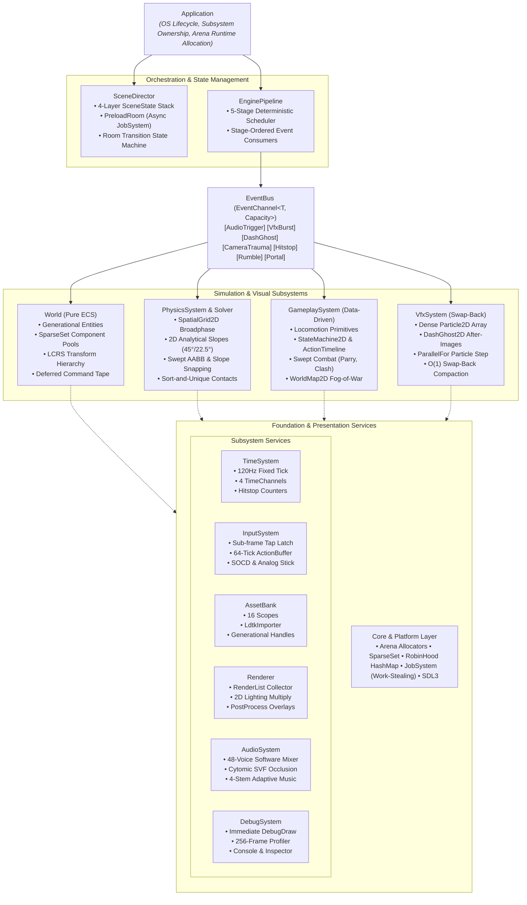
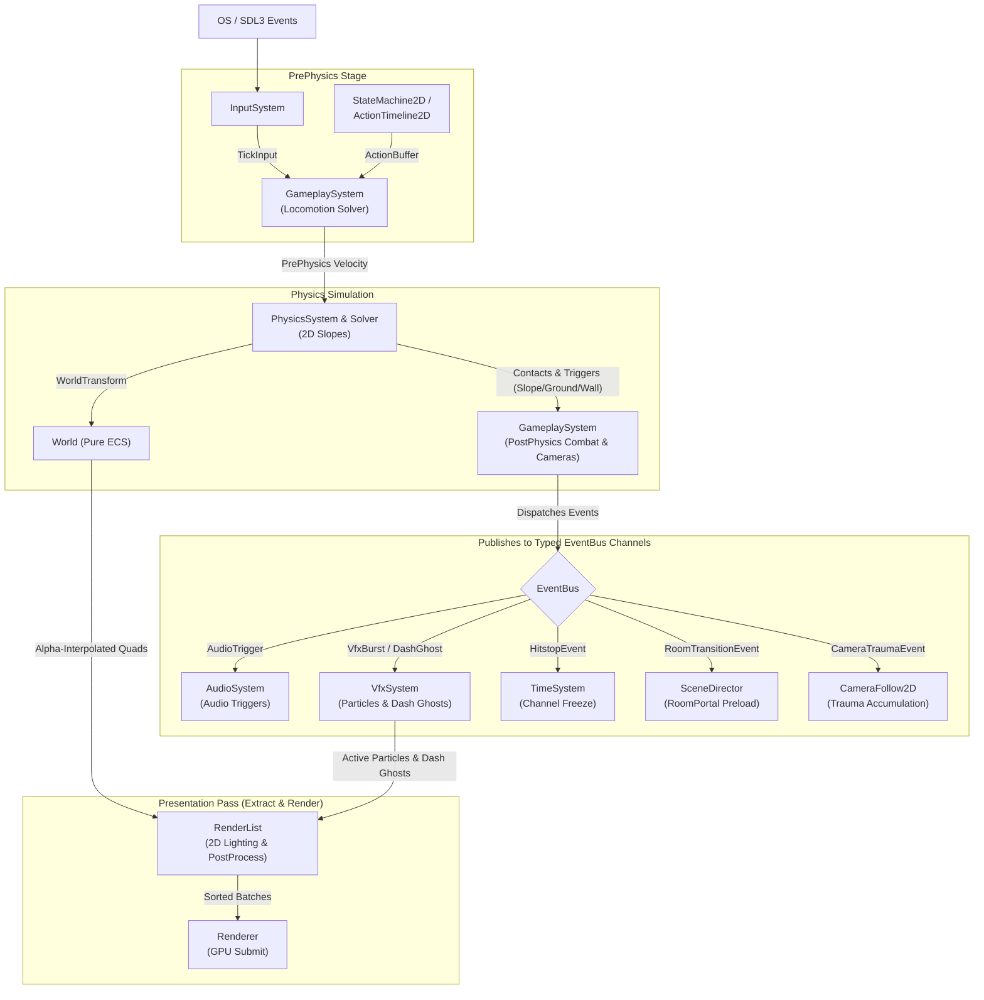

# Engine Architecture

## 1. Overview

**EngineN** is a deterministic, data-driven C++23 2D Metroidvania runtime engine. It is designed strictly as a reusable engine foundation rather than a hardcoded game: core systems process contiguous data structures configured through plain-old-data (POD) structs and opt-in Entity-Component-System (ECS) components.

Core architectural properties:

* **Zero Post-Init Heap Allocation**: Every subsystem pre-allocates its backing memory from explicit `Arena` blocks during `Init()`. Runtime simulation ticks and render frames execute with zero dynamic heap allocations (`new` / `malloc`).
* **Type-Safe Deferred EventBus**: Subsystems communicate across pipeline stages through a zero-allocation `EventBus` (`EventChannel<T, Capacity>` ring/span channels for `AudioTrigger`, `VfxBurstEvent`, `DashGhostEvent`, `CameraTraumaEvent`, `HitstopEvent`, `RumbleEvent`, and `RoomTransitionEvent`), eliminating any monolithic routing switch-case in `EnginePipeline`.
* **Strict Separation of Concerns**: `World` is a pure ECS data registry and transform hierarchy; gameplay rules, 2D heightmap slope physics, transient visual effects (`VfxSystem`), world-map fog-of-war (`WorldMap2D`), LDtk level importing (`LdtkImporter`), audio mixing, and frame orchestration (`EnginePipeline`) live in decoupled modules.
* **Deterministic Fixed-Tick Simulation**: Simulation advances at an exact 120 Hz step (`8,333,333 ns`) using harmonic 1440 Hz accumulation, while presentation interpolates between previous and current world transforms at variable VSync display rates.
* **Opt-In Game Feel & Data-Driven Tuning**: Game-specific visual behaviors (such as procedural squash-and-stretch, dash after-images, and sprite hit flashes) activate only on entities that attach the corresponding opt-in components (`SquashStretch2D`, `HitFlash2D`). All solver thresholds live in configuration structs (`PhysicsConfig`, `GameplayConfig`, `VfxConfig`, `PostProcessConfig`).

## 2. Architecture Diagram



## 3. Core Modules

| Module | Directory | Primary Responsibilities |
| ----- | ----- | ----- |
| **Core** | `engine/core/` | Fixed-width types, `Result<T, E>` error handling, FNV-1a `StringId`, 2D math and swept AABB primitives, linear `Arena` allocators, Robin Hood `HashMap`, binary serialization with CRC32, zero-allocation `EventBus` (`EventChannel<T, Capacity>`), and work-stealing `JobSystem` (`ParallelFor` and `DispatchAsync`/`WaitAsync`). |
| **Time** | `engine/time/` | Monotonic clock, 1440 Hz harmonic VSync snapping, 4 cascading `TimeChannel`s (`World`, `Player`, `Enemy`, `Camera`), per-channel hitstop freeze counters (`ConsumeEvents(EventBus&)`), and time-scale ramps. |
| **Platform** | `engine/platform/` | OS window lifecycle, high-DPI display scaling, path traversal guards, atomic `.tmp` save-file writer, and gamepad rumble (`ConsumeEvents(EventBus&)`). |
| **Input** | `engine/input/` | Sub-frame tap preservation (`down | pressed`), Simultaneous Opposite Cardinal Direction (SOCD) resolution, Schmitt trigger analog stick hysteresis, and a 64-tick `ActionBuffer` ring for input buffering. |
| **Assets** | `engine/assets/` | Generational resource handles (`TextureAssetHandle`, `SpriteHandle`, `AtlasHandle`, `AudioHandle`, `BlobHandle`), 16-scope reference-counted asset pinning (`persistentScope`, `roomScope`, `stagingScope`), standalone PNG/BMP decoders, and zero-allocation `LdtkImporter` (parsing LDtk JSON levels directly into Y-up `TileFlag` collision grids, entity descriptors, and cooked binary blobs). |
| **Renderer** | `engine/renderer/` | 2D batch renderer (`SDL_RenderGeometryRaw` with offscreen `SDL_TEXTUREACCESS_TARGET` and custom `SDL_ComposeCustomBlendMode`) and `RenderList` command collector. Encodes a 64-bit `SortKey` (`Pass | Layer | Depth | Blend | View | Texture | QuadIdx`) and supports 2D ambient lightmap `BlendMode::Multiply` darkness, additive `PointLight2D`, trauma vignettes, and hit-flash post-processing (`PostProcessConfig`). |
| **World (ECS)** | `engine/world/` | Pure ECS registry (`World`), paged `SparseSet<T>` component pools, Left-Child Right-Sibling (LCRS) topological `TransformSolver`, deferred structural `CommandBuffer` tape, and CRC32-verified binary `Prefab` and `WorldSnapshot` serialization (`WorldSerialization`). |
| **VFX** | `engine/vfx/` | Decoupled `VfxSystem` managing dense `Particle2D` and `DashGhost2D` arrays. Drains `VfxBurstEvent` and `DashGhostEvent` from `EventBus`, steps particles in parallel via `JobSystem::ParallelFor`, and compacts expired elements in $O(1)$ via Swap-Back. |
| **Physics** | `engine/physics/` | RLE-merged static/one-way tilemaps, analytical 2D slope heightmaps (`Slope45Up`, `Slope45Down`, `Slope22UpLo`, `Slope22UpHi`, `Slope22DownLo`, `Slope22DownHi`) with slope normal velocity projection (`ProjectVelocityOnSlope`) and downhill slope-adhesion snapping, 32x32 two-pass counting-sort `SpatialGrid2D` broadphase, kinematic moving platforms, ceiling/ledge corner correction, and Sort-and-Unique + Two-Pointer Merge contact events. |
| **Gameplay** | `engine/gameplay/` | Data-driven character locomotion (`CharacterController`), `StateMachine2D` and `ActionTimeline2D` evaluation, continuous `SweptWorldHitbox` combat resolution (`CombatResolver`), `RoomPortal2D` doorway trigger detection, `CameraFollow2D` spring/room confinement, `WorldMap2D` 32x32 fog-of-war & map marker grid, and 4096-bit world flag + spatial GUID mutation persistence (`CameraAndPersistence`). |
| **Audio** | `engine/audio/` | Lock-free Single-Producer Single-Consumer command ring, 48-voice software mixer (`AudioMixer`), raycast-driven Cytomic SVF low-pass occlusion filter, and 4-stem adaptive music crossfader. |
| **Debug** | `engine/debug/` | Immediate-mode `DebugDraw` gizmos, 256-frame `DebugProfiler` with percentile histograms, `DebugConsole` (commands, bounded CVars, autocomplete), and 64-tick `DebugInspector` entity flight recorder. |
| **Framework** | `engine/framework/` | `Application` (subsystem lifecycle and OS loop), `EnginePipeline` (5-stage tick and presentation scheduler), and `SceneDirector` (4-layer state stack, proactive background `PreloadRoom`, and room transitions). |

## 4. Execution Flow

`Application::Step(dtNs)` orchestrates each frame by advancing frame-level services, stepping 0..N fixed 120 Hz simulation ticks through `EnginePipeline::ExecuteSimTick`, and rendering one interpolated frame through `EnginePipeline::ExecuteRenderFrame`:

```
Application::Step(dtNs)
  1. Frame Setup
     - AssetBank::AdvanceFrame(frame)
     - DebugSystem::BeginFrame(fc) -> apply pause, single-step, or time-scale directives
     - TimeSystem::BeginFrame(dtNs)
     - SceneDirector::Tick(loadCtx)
       * PreloadRoom : Proactively stage and CRC-verify adjacent rooms on JobSystem
       * Out Phase   : DispatchAsync(PrepareRoomAssetsJob) if not already preloaded + advance wipe
       * Load Phase  : WaitAsync() + bind pre-verified collision/prefab blobs + ApplyRoomMutations
       * In Phase    : Reverse screen wipe
     - InputSystem::SetActionMask(scenes.InputMask())

  2. Fixed-Tick Simulation Loop [while TimeSystem::PollTick() yields a 120 Hz TickStep]
     - Stage 0: PipelinePhase::PrePhysics
       * World::BeginTick(step)                       (snapshot PrevWorldSnapshot2D)
       * SceneDirector::TickStates(ctx, step)         (active SceneState::onTick callbacks)
       * WorldSystems::StepVelocities(world, step)    (integrate Velocity2D)
       * GameplaySystem::StepPrePhysics(...)          (feed ActionBuffer, tick Health2D,
                                                       StateMachine2D, ActionTimeline2D, and
                                                       solve CharacterController2D velocity)
     - Stage 1: PipelinePhase::Physics
       * PhysicsSystem::Step(world, step)             (rebuild SpatialGrid2D, step kinematic
                                                       platforms, sweep dynamic bodies with
                                                       analytical 2D slope heightmap resolution,
                                                       and diff Begin/End contact events)
     - Stage 2: PipelinePhase::PostPhysics
       * GameplaySystem::StepPostPhysics(..., bus)    (sync ground/wall/slope contacts & SafeAnchor2D,
                                                       resolve swept combat hitboxes, publish
                                                       RoomTransitionEvent & typed cues to EventBus,
                                                       and step CameraFollow2D)
       * WorldSystems::StepVisualsAndLifetimes(...)   (step SpriteAnimator2D, Lifetime2D,
                                                       PointLight2D, HitFlash2D, SquashStretch2D)
       * Subsystem EventBus Consumers:
         - VfxSystem::ConsumeEvents(bus, world)       (drain VfxBurstEvent & DashGhostEvent)
         - TimeSystem::ConsumeEvents(bus)             (drain HitstopEvent)
         - Platform::ConsumeEvents(bus)               (drain RumbleEvent)
         - SceneDirector::ConsumeEvents(bus)          (drain RoomTransitionEvent)
         - EnginePipeline::StepAudio(ctx, step)       (drain AudioTrigger span into AudioSystem)
       * VfxSystem::Step(step, jobs)                  (JobSystem::ParallelFor particle step +
                                                       Swap-Back compaction of particles & ghosts)
       * World::EndTick(step)                         (flush deferred ECS command tape &
                                                       propagate LCRS transform hierarchy)

  3. Variable-Rate Presentation Pass [when window is not minimized/focus-paused]
     - Stage 3: PipelinePhase::Extract
       * RenderList::Reset(viewport)
       * WorldSystems::ExtractRender(...)             (interpolate transforms via RenderStep::alpha,
                                                       extract CameraRig2D, Sprite2D with opt-in
                                                       HitFlash2D, and additive PointLight2D)
       * VfxSystem::ExtractRender(assets, renderList) (append dense active ghosts & particles)
       * SceneDirector::DrawStates(ctx)               (active SceneState::onDraw callbacks)
     - Stage 4: PipelinePhase::Overlay
       * RenderList::EmitPostProcess()                (emit BlendMode::Multiply ambient darkness,
                                                       4-edge trauma vignette, and hit-flash quad)
       * SceneDirector::DrawWipe(renderList, vp)      (render Fade / HSlide / VSlide transition)
       * DebugSystem::Emit(frameCtx, renderList)      (render world gizmos, profiler, console HUD)
     - Submission
       * Renderer::Submit(renderList)                 (sort 64-bit SortKeys, build batches, submit)

  4. Audio Pump
     - AudioSystem::Pump(1)                           (mix 256-frame DSP blocks & submit to SDL3)
```

Custom game systems register into any of the 5 `PipelinePhase` stages via `EnginePipeline::Register(SystemDesc)` with a deterministic `i16 order` priority.

## 5. Data Flow

Subsystems do not hold circular references to one another; data flows unidirectionally across stage boundaries through explicit value records and typed `EventBus` channels:



* **Input to Simulation**: `Platform::Pump` feeds raw events into `InputSystem`. Each 120 Hz tick polls a `TickInput` snapshot and feeds `ActionBuffer`, which `CharacterController2D` and `StateMachine2D` consume during `PrePhysics`.
* **Physics to Gameplay**: `PhysicsSystem` evaluates analytical slope heightmaps (`SampleSlopeHeight`, `SlopeNormal`, `ProjectVelocityOnSlope`), updates `PhysicsBody2D::contacts` (`Ground`, `Ceiling`, `WallLeft`, `WallRight`, `OneWay`, `Slope`, `Crushed`), and populates `ContactEvent2D` spans (`BeginContact`, `EndContact`, `TriggerEnter`, `TriggerExit`) consumed by `SyncCharactersPostPhysics` and `StepRoomPortals`.
* **Decoupled Subsystem Events (`EventBus`)**: Rather than coupling `EnginePipeline` to gameplay internals with a manual `switch-case`, producers publish typed events into `EventBus` channels (`audio`, `vfxBursts`, `dashGhosts`, `cameraTrauma`, `hitstops`, `rumbles`, `roomTransitions`), and each subsystem drains its own channel during `PostPhysics`.
* **Simulation to Presentation (`RenderList`)**: `WorldSystems::ExtractRender` and `VfxSystem::ExtractRender` read `World` and `VfxSystem` state const-correctly, interpolate transforms using `RenderStep::alpha`, push world/light quads, and layer ambient multiply darkness + post-processing overlays in `RenderList`.

## 6. Memory & Resource Lifecycle

* **Subsystem Arena Ownership**:
  * `Application` allocates a single `Runtime` block from its root `Arena` during `Init()`.
  * `World`, `PhysicsSystem`, `GameplaySystem` (including `WorldMap2D`), `VfxSystem`, `AssetBank`, `AudioSystem`, and `DebugSystem` each own a dedicated `Arena` sized via their respective `*Config` structs.
  * Temporary per-tick, per-frame, or level-import allocations (`LdtkImporter::ParseLevelJson`) use `Arena` markers (`Mark()` / `Rollback()`).
* **ECS Entity & Component Lifecycle**:
  * Entities use 32-bit generational identifiers (`EntityId`: 16-bit index + 16-bit generation) with an intrusive freelist embedded in dead component-mask slots.
  * Component pools use a paged `SparseSet<T>` (64-entity pages mapping sparse entity indices to packed dense `T[]` and `EntityId[]` arrays).
  * Structural mutations during iteration (`DeferDestroy`, `DeferEmplace`, `DeferRemove`, `DeferSetParent`) are written to a flat byte command tape (`m_cmdTape`) and flushed deterministically at the end of the tick in `World::EndTick`.
* **Scoped Asset Lifecycle & Seamless Room Pre-Warming**:
  * `AssetBank` manages up to 16 reference-counted asset scopes (`0..15`). `SceneDirector` pins global assets in `persistentScope` and room-local assets in `roomScope`.
  * Adjacent rooms can be pre-warmed ahead of doorway contact via `SceneDirector::PreloadRoom`, which stages `stagingScope` and dispatches `PrepareRoomAssetsJob` on `JobSystem::DispatchAsync` to verify `TileMapHeader` and `CookedPrefabHeader` CRC32 checksums in the background.
  * When `TransitionToRoom` executes (either with a screen wipe or seamlessly with `WipeKind::None`), `TransitionPhase::Load` binds the pre-verified collision map and prefab, applies persistent `WorldMutation2D` state, swaps `roomScope` with `stagingScope`, and evicts unpinned assets from the old room scope.

## 7. Key Design Decisions

1. **Type-Safe Deferred `EventBus` over Pipeline Switch-Case Routing**:
   * *Decision*: Replace `EnginePipeline::RouteGameplayCues` and `CheckRoomPortals` with fixed-capacity `EventChannel<T, Capacity>` queues inside `EventBus` (`engine/core/EventBus.h`).
   * *Rationale*: Decouples `EnginePipeline` from `RoomPortal2D`, `CameraFollow2D`, and `CueKind` internals, allowing any engine or game system to publish and consume strongly-typed events with zero heap allocation.
2. **Analytical 2D Heightmap Slopes with Seam Suppression**:
   * *Decision*: Represent 45° and 22.5° rising/falling slopes directly in `TileFlag` (`Slope45Up`, `Slope45Down`, `Slope22UpLo`, `Slope22UpHi`, `Slope22DownLo`, `Slope22DownHi`), evaluate exact surface height at the actor's foot center X, project velocity along `SlopeNormal`, and suppress internal vertical seams on adjacent flat plateau tiles.
   * *Rationale*: Prevents AABB half-width overhangs from snagging on slope-to-flat transitions or launching into free-fall when running downhill at high speed, without the complexity of general convex polygon GJK/SAT solvers.
3. **Pragmatic `SDL_Renderer` Batching + `BlendMode::Multiply` Lighting over Raw `SDL_GPU` Shaders**:
   * *Decision*: Retain `RenderList`'s 64-bit `SortKey` quad batcher over `SDL_RenderGeometryRaw` and implement 2D ambient darkness (`BlendMode::Multiply`), additive `PointLight2D`, trauma vignettes, and hit flashes via `PostProcessConfig` and offscreen render targets.
   * *Rationale*: Delivers authentic 2D Metroidvania atmospheric lighting and post-processing while preserving zero-shader-compiler portability and deterministic headless testing.
4. **Dual-Path Level Pipeline: Zero-Allocation `LdtkImporter` + Cooked Binary Blobs**:
   * *Decision*: Provide `LdtkImporter::ParseLevelJson` for direct zero-allocation LDtk JSON ingestion (automatically flipping top-down LDtk rows to Y-up engine coordinates and mapping slope IntGrid values) alongside `LdtkImporter::CookTileMapBlob` for binary serialization.
   * *Rationale*: Combines rapid LDtk level iteration during development with fast, CRC-verified binary blob streaming in production builds.

## 8. Limitations & Future Work

* **Foot-Column Heightmap Slopes vs. Arbitrary Rotated Colliders**: Slope collision evaluates analytical tile heightmaps at the dynamic collider's foot column (`footX`). While ideal for 2D Metroidvania terrain (45° and 22.5° floor slopes), angled ceiling slopes or freely rotating polygonal rigid bodies are not supported.
* **Fixed-Capacity Arena & EventChannel Budgets**: Because all pools, arenas, and `EventChannel<T, Capacity>` rings pre-allocate fixed capacities, exceeding configured limits drops excess events or returns an error code (`Result<T, E>`) rather than growing dynamically.
* **Quad-Based 2D Lighting**: Ambient darkness (`BlendMode::Multiply`) and `PointLight2D` (`BlendMode::Additive`) operate on 2D geometry quads without per-pixel normal maps or GPU shadow-map raymarching.
* **Pairwise Combat Box Iteration**: `GameplaySystem::ResolveCombat` iterates over active `CombatBox2D` components directly; scenes with hundreds of simultaneous projectile hitboxes would benefit from routing `CombatBox2D` broadphase queries through `SpatialGrid2D`.