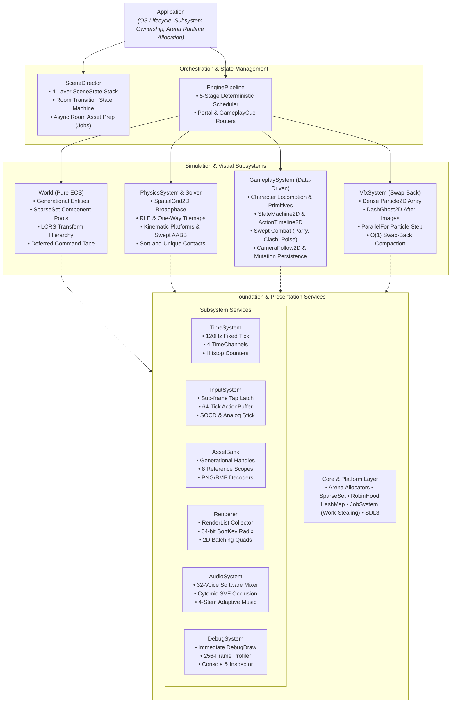
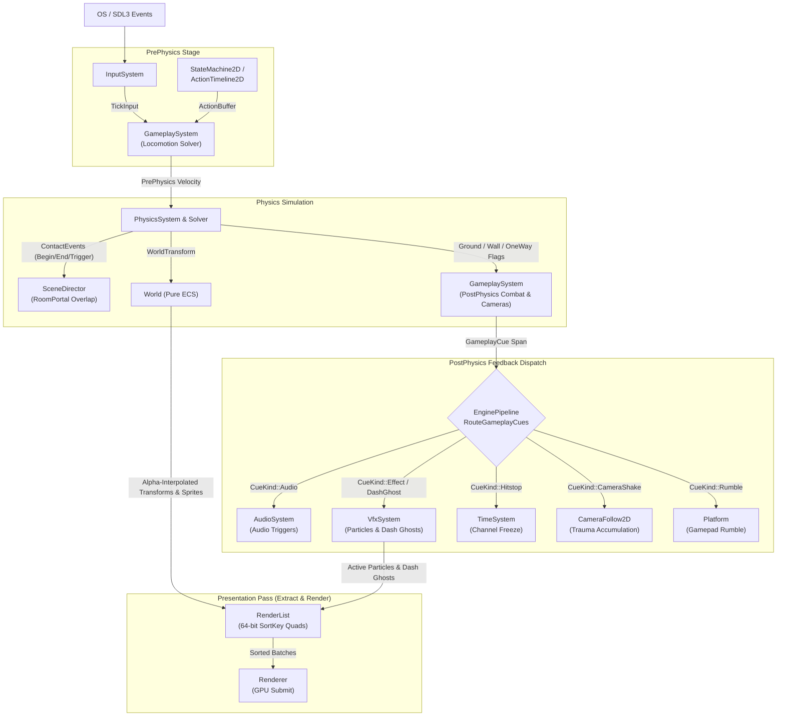

# Engine Architecture

## 1. Overview

**EngineN** is a deterministic, data-driven C++23 2D Metroidvania runtime engine. It is designed strictly as a reusable engine foundation rather than a hardcoded game: core systems process contiguous data structures configured through plain-old-data (POD) structs and opt-in Entity-Component-System (ECS) components.

Core architectural properties:

- **Zero Post-Init Heap Allocation**: Every subsystem pre-allocates its backing memory from explicit `Arena` blocks during `Init()`. Runtime simulation ticks and render frames execute with zero dynamic heap allocations (`new` / `malloc`).
- **Strict Separation of Concerns**: `World` is a pure ECS data registry and transform hierarchy; gameplay rules, physics solving, transient visual effects (`VfxSystem`), audio mixing, and frame orchestration (`EnginePipeline`) live in decoupled modules communicating through typed contexts and event cues.
- **Deterministic Fixed-Tick Simulation**: Simulation advances at an exact 120 Hz step (`8,333,333 ns`) using integer picosecond accumulation, while presentation interpolates between previous and current world transforms at variable VSync display rates.
- **Opt-In Game Feel & Data-Driven Tuning**: Game-specific visual behaviors (such as procedural squash-and-stretch, dash after-images, and sprite hit flashes) activate only on entities that attach the corresponding opt-in components (`SquashStretch2D`, `HitFlash2D`). All solver thresholds live in configuration structs (`PhysicsConfig`, `GameplayConfig`, `VfxConfig`).

## 2. Architecture Diagram



## 3. Core Modules

| Module | Directory | Primary Responsibilities |
| :--- | :--- | :--- |
| **Core** | `engine/core/` | Fixed-width types, `Result<T, E>` error handling, FNV-1a `StringId`, 2D math and swept AABB primitives, linear `Arena` allocators, Robin Hood `HashMap`, binary serialization with CRC32, and work-stealing `JobSystem` (`ParallelFor` and `DispatchAsync`/`WaitAsync`). |
| **Time** | `engine/time/` | Monotonic clock, integer picosecond accumulator with 1440 Hz harmonic VSync snapping, 4 cascading `TimeChannel`s (`World`, `Player`, `Enemy`, `Camera`), per-channel hitstop freeze counters, and time-scale ramps. |
| **Platform** | `engine/platform/` | OS window lifecycle, high-DPI `ViewportMapper`, path traversal guards (`SanitizeRelPath`), atomic `.tmp` save-file writer, and gamepad rumble. |
| **Input** | `engine/input/` | Sub-frame tap preservation (`down \| pressed`), Simultaneous Opposite Cardinal Direction (SOCD) resolution, Schmitt trigger analog stick hysteresis, and a 64-tick `ActionBuffer` ring for input buffering. |
| **Assets** | `engine/assets/` | Generational resource handles (`TextureHandle`, `SpriteHandle`, `AtlasHandle`, `AudioHandle`, `BlobHandle`), 8-scope reference-counted asset pinning (`persistentScope`, `roomScope`), and standalone PNG/BMP decoders. |
| **Renderer** | `engine/renderer/` | 2D batch renderer and `RenderList` command collector. Encodes a 64-bit `SortKey` (`View \| Layer \| Depth \| Blend \| Texture \| Sequence`) per quad for frustum culling, radix/comparison sorting, and state-change batching. |
| **World (ECS)** | `engine/world/` | Pure ECS registry (`World`), page-table `SparseSet<T>` component pools, Left-Child Right-Sibling (LCRS) topological `TransformSolver`, deferred structural `CommandBuffer` tape, and CRC32-verified binary `Prefab` and `WorldSnapshot` serialization (`WorldSerialization`). |
| **VFX** | `engine/vfx/` | Decoupled `VfxSystem` managing dense `Particle2D` and `DashGhost2D` arrays. Steps particles in parallel via `JobSystem::ParallelFor` and removes expired elements in $O(1)$ via Swap-Back compaction. |
| **Physics** | `engine/physics/` | RLE-compressed static/one-way tilemaps and 64x64 two-pass counting-sort `SpatialGrid2D` broadphase; kinematic moving platforms (rider carry, solid push, crush detection); swept AABB dynamic solver (`PhysicsSolver`) with ceiling corner correction, ledge hop/step-up, and high-speed slope adhesion; Sort-and-Unique + Two-Pointer Merge contact event generation. |
| **Gameplay** | `engine/gameplay/` | Data-driven character locomotion (`CharacterController`: coyote time, variable jump cut, apex hang time, wall slide/jump, dash, `SafeAnchor2D`), `StateMachine2D` and `ActionTimeline2D` evaluation, continuous `SweptWorldHitbox` combat resolution (`CombatResolver`: clash, parry, super-armor, poise, pogo bounce), `CameraFollow2D` spring/room confinement, and 4096-bit world flag + spatial GUID mutation persistence (`CameraAndPersistence`). |
| **Audio** | `engine/audio/` | Lock-free Single-Producer Single-Consumer (`AudioCmdQueue`) command ring, 32-voice software mixer (`AudioMixer`), raycast-driven Cytomic SVF low-pass occlusion filter, and 4-stem adaptive music crossfader. |
| **Debug** | `engine/debug/` | Immediate-mode `DebugDraw` gizmos, 256-frame `DebugProfiler` with percentile histograms, `DebugConsole` (commands, bounded CVars, autocomplete), and 64-tick `DebugInspector` entity flight recorder. |
| **Framework** | `engine/framework/` | `Application` (subsystem lifecycle and OS loop), `EnginePipeline` (5-stage tick and presentation scheduler, portal and cue routing), and `SceneDirector` (4-layer state stack and room transitions with background `JobSystem` asset preparation). |

## 4. Execution Flow

`Application::Step(dtNs)` orchestrates each frame by advancing frame-level services, stepping 0..N fixed 120 Hz simulation ticks through `EnginePipeline::ExecuteSimTick`, and rendering one interpolated frame through `EnginePipeline::ExecuteRenderFrame`:

```text
Application::Step(dtNs)
  1. Frame Setup
     - AssetBank::AdvanceFrame(frame)
     - DebugSystem::BeginFrame(fc) -> apply pause, single-step, or time-scale directives
     - TimeSystem::BeginFrame(dtNs)
     - SceneDirector::Tick(loadCtx)
       * Out Phase : DispatchAsync(PrepareRoomAssetsJob) on JobSystem + advance screen wipe
       * Load Phase: WaitAsync() + bind pre-verified collision/prefab blobs + ApplyRoomMutations
       * In Phase  : Reverse screen wipe
     - InputSystem::SetActionMask(scenes.InputMask())

  2. Fixed-Tick Simulation Loop [while TimeSystem::PollTick() yields a 120 Hz TickStep]
     - Stage 0: PipelinePhase::PrePhysics
       * World::BeginTick(step)                       (snapshot PrevWorldSnapshot2D)
       * SceneDirector::TickStates(ctx, step)         (active SceneState::onTick callbacks)
       * WorldSystems::StepVelocities(world, step)    (integrate Velocity2D)
       * GameplaySystem::StepPrePhysics(...)          (feed ActionBuffer, tick Health2D,
                                                       StateMachine2D, ActionTimeline2D, and
                                                       solve CharacterController2D velocity)
     - Stage 1: PipelinePhase::Physics
       * PhysicsSystem::Step(world, step)             (rebuild SpatialGrid2D, step kinematic
                                                       platforms, sweep dynamic bodies, and
                                                       diff Begin/End contact & trigger events)
     - Stage 2: PipelinePhase::PostPhysics
       * GameplaySystem::StepPostPhysics(...)         (sync ground/wall contacts & SafeAnchor2D,
                                                       resolve swept combat hitboxes, step cameras)
       * WorldSystems::StepVisualsAndLifetimes(...)   (step SpriteAnimator2D, Lifetime2D,
                                                       PointLight2D, HitFlash2D, SquashStretch2D)
       * EnginePipeline::CheckRoomPortals(ctx)        (trigger TransitionToRoom on portal overlap)
       * EnginePipeline::RouteGameplayCues(ctx, step) (route Audio, VfxSystem, Hitstop,
                                                       CameraShake, and Rumble cues)
       * VfxSystem::Step(step, jobs)                  (JobSystem::ParallelFor particle step +
                                                       Swap-Back compaction of particles & ghosts)
       * World::EndTick(step)                         (flush deferred ECS command tape &
                                                       propagate LCRS transform hierarchy)

  3. Variable-Rate Presentation Pass [when window is not minimized/focus-paused]
     - Stage 3: PipelinePhase::Extract
       * RenderList::Reset(viewport)
       * WorldSystems::ExtractRender(...)             (interpolate transforms via RenderStep::alpha,
                                                       extract CameraRig2D, Sprite2D with opt-in
                                                       HitFlash2D, and PointLight2D)
       * VfxSystem::ExtractRender(assets, renderList) (append dense active ghosts & particles)
       * SceneDirector::DrawStates(ctx)               (active SceneState::onDraw callbacks)
     - Stage 4: PipelinePhase::Overlay
       * SceneDirector::DrawWipe(renderList, vp)      (render Fade / HSlide / VSlide transition)
       * DebugSystem::Emit(frameCtx, renderList)      (render world gizmos, profiler, console HUD)
     - Submission
       * Renderer::Submit(renderList)                 (sort 64-bit SortKeys, build batches, submit)

  4. Audio Pump
     - AudioSystem::Pump(1)                           (mix 512-frame DSP blocks & submit to SDL3)
```

Custom game systems register into any of the 5 `PipelinePhase` stages via `EnginePipeline::Register(SystemDesc)` with a deterministic `i16 order` priority.

## 5. Data Flow

Subsystems do not hold circular references to one another; data flows unidirectionally across stage boundaries through explicit value records:



- **Input to Simulation**: `Platform::Pump` feeds raw events into `InputSystem`. Each 120 Hz tick polls a `TickInput` snapshot and feeds `ActionBuffer`, which `CharacterController2D` and `StateMachine2D` consume during `PrePhysics`.
- **Physics to Gameplay**: `PhysicsSystem` updates `PhysicsBody2D::contacts` (`Ground`, `Ceiling`, `WallLeft`, `WallRight`, `OneWay`, `Slope`, `Crushed`) and populates `ContactEvent2D` spans (`BeginContact`, `EndContact`, `TriggerEnter`, `TriggerExit`) consumed by `SyncCharactersPostPhysics` and `CheckRoomPortals`.
- **Gameplay to Feedback Systems (`GameplayCue`)**: Rather than calling audio, time, camera, or VFX APIs inside simulation loops, `GameplaySystem` appends 32-byte `GameplayCue` records to a per-tick ring. During `PostPhysics`, `EnginePipeline::RouteGameplayCues` drains the cues and dispatches them to `AudioSystem`, `VfxSystem`, `TimeSystem::Hitstop`, `CameraFollow2D::AddTrauma`, and `Platform::RumbleGamepad`.
- **Simulation to Presentation (`RenderList`)**: `WorldSystems::ExtractRender` and `VfxSystem::ExtractRender` read `World` and `VfxSystem` state const-correctly, interpolate transforms using `RenderStep::alpha`, and push `QuadCmd` records into `RenderList` for sorting and GPU submission.

## 6. Memory & Resource Lifecycle

- **Subsystem Arena Ownership**:
  - `Application` allocates a single `Runtime` block from its root `Arena` during `Init()`.
  - `World`, `PhysicsSystem`, `GameplaySystem`, `VfxSystem`, `AssetBank`, `AudioSystem`, and `DebugSystem` each own a dedicated `Arena` sized via their respective `*Config` structs.
  - Temporary per-tick or per-frame scratch allocations use `ScratchArena` (RAII scope marker that rewinds the arena offset in $O(1)$ on scope exit).
- **ECS Entity & Component Lifecycle**:
  - Entities use 32-bit generational identifiers (`EntityId`: 16-bit index + 16-bit generation) with an intrusive freelist embedded in dead component-mask slots.
  - Component pools use a paged `SparseSet<T>` (64-entity pages mapping sparse entity indices to packed dense `T[]` and `EntityId[]` arrays).
  - Structural mutations during iteration (`DeferDestroy`, `DeferEmplace`, `DeferRemove`, `DeferSetParent`) are written to a flat byte command tape (`m_cmdTape`) and flushed deterministically at the end of the tick in `World::EndTick`.
- **Scoped Asset Lifecycle & Background Room Streaming**:
  - `AssetBank` manages up to 8 reference-counted asset scopes (`0..7`). `SceneDirector` pins global assets in `persistentScope` and room-local assets in `roomScope`.
  - When transitioning rooms via `SceneDirector::TransitionToRoom`, `TransitionPhase::Out` opens a `stagingScope` and dispatches `PrepareRoomAssetsJob` on `JobSystem::DispatchAsync` to resolve blobs and verify `TileMapHeader` and `CookedPrefabHeader` CRC32 checksums on a worker thread while the screen wipe plays.
  - During `TransitionPhase::Load`, the main thread calls `JobSystem::WaitAsync()`, binds the pre-verified collision map and prefab, applies persistent `WorldMutation2D` state, swaps `roomScope` with `stagingScope`, and evicts unpinned assets from the old room scope.

## 7. Key Design Decisions

1. **5-Stage `EnginePipeline` Separated from `Application`**:
   - *Decision*: Decouple frame/tick scheduling into `EnginePipeline` with 5 canonical stages (`PrePhysics`, `Physics`, `PostPhysics`, `Extract`, `Overlay`) instead of embedding inline lambdas or excessive micro-phases in `Application.cpp`.
   - *Rationale*: Keeps `Application` focused strictly on OS/lifecycle management while giving engine and game systems a clear, deterministic insertion model (`PrePhysics -> Physics -> PostPhysics -> Extract -> Overlay`).
2. **Decoupled `VfxSystem` with Swap-Back Compaction**:
   - *Decision*: Keep `World` as a pure ECS container and manage high-frequency particles (`Particle2D`) and dash after-images (`DashGhost2D`) in a standalone `VfxSystem` using Swap-Back (`m_particles[i] = m_particles[--m_particleCount]`) compaction.
   - *Rationale*: Avoids polluting entity counts (`World::AliveCount()`) with short-lived particles and eliminates dead-slot branching during `ExtractRender`, keeping active arrays 100% dense for `JobSystem::ParallelFor` SIMD/cache efficiency.
3. **Opt-In Components & Config Structs over Hardcoded Game Mechanics**:
   - *Decision*: Expose visual polish (`SquashStretch2D`, `HitFlash2D`) as opt-in components and store all tuning constants in `PhysicsConfig` and `GameplayConfig`.
   - *Rationale*: Ensures EngineN functions as a general-purpose 2D Metroidvania engine where games opt into specific visual or movement behaviors and tune them via data rather than modifying engine source code.
4. **Sort-and-Unique + Two-Pointer Merge for Contact Events**:
   - *Decision*: Append candidate overlapping proxy pairs in $O(1)$ during spatial grid traversal, deduplicate once via `std::sort` + `std::unique`, and diff against the previous tick's sorted pairs using an $O(N + M)$ two-pointer merge.
   - *Rationale*: Eliminates $O(N^2)$ linear duplicate scans when large or numerous colliders span multiple grid cells.
5. **Pragmatic Work-Stealing `JobSystem` (`workerThreads = 0U`)**:
   - *Decision*: Default `AppConfig::workerThreads` to `0U` (auto-detecting `hardware_concurrency() - 1`) and restrict multi-threading to embarrassingly parallel workloads (`VfxSystem` particle integration via `ParallelFor`) and background I/O/CRC validation (`SceneDirector` room prep via `DispatchAsync`).
   - *Rationale*: Delivers multi-core scalability where it matters without introducing lock contention, nondeterministic race conditions, or complex task-graph overhead into the 120 Hz gameplay/physics solver.

## 8. Limitations & Future Work

- **Axis-Aligned Bounding Box (AABB) Narrowphase**: Dynamic entity colliders are currently axis-aligned boxes (`Collider2D`) with tile-level slope flags (`TileFlag::Slope`) and step-up/ground-snap solvers. Adding arbitrary angled polygon or capsule narrowphase primitives would improve fidelity for complex sloped terrain.
- **Fixed-Capacity Arena Budgets**: Because all pools and arenas pre-allocate fixed capacities at `Init()`, exceeding configured limits (`maxEntities`, `maxProxies`, `maxContactPairs`) returns an error code (`Result<T, E>`) rather than growing dynamically. Games with highly variable room sizes must size `WorldConfig` and `PhysicsConfig` for their peak room budget.
- **Single-Pass 2D Batch Renderer**: `Renderer` currently sorts and batches textured/colored 2D quads with 4 blend modes (`Alpha`, `Additive`, `Multiply`, `Opaque`) and additive `PointLight2D` overlays, but does not yet include multi-pass offscreen framebuffers, normal-mapped 2D lighting, or custom user shader pipelines.
- **Pairwise Combat Box Iteration**: `GameplaySystem::ResolveCombat` iterates over active `CombatBox2D` components directly. While fast for typical Metroidvania room counts (tens of active combatants), rooms with hundreds of simultaneous bullet/hitbox entities would benefit from routing `CombatBox2D` queries through `SpatialGrid2D`.
