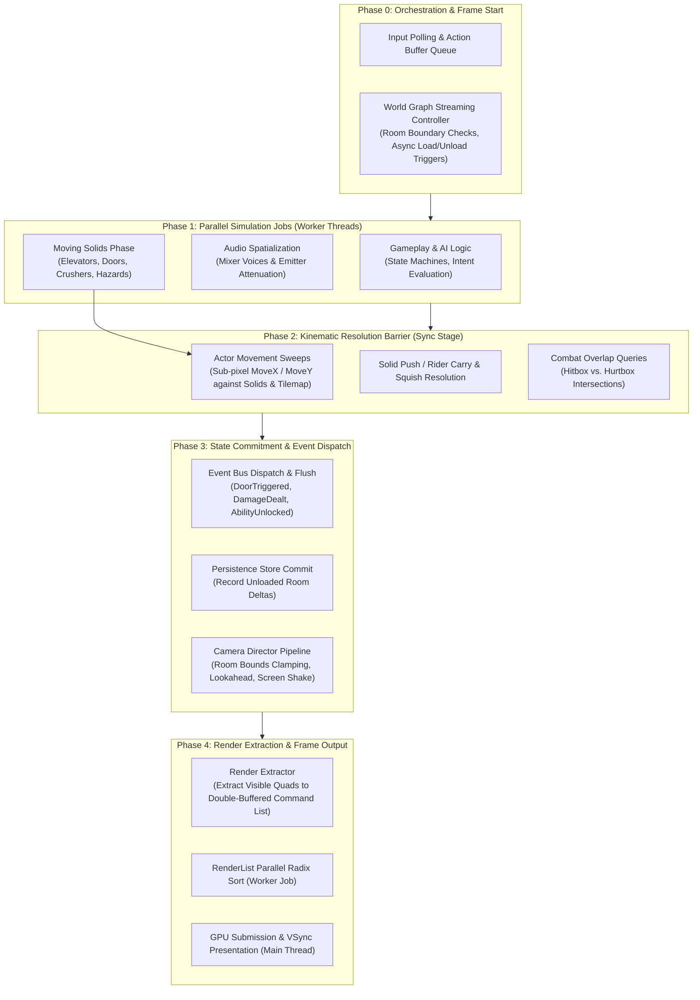

# METROIDVANIA GAME ENGINE ARCHITECTURE SPECIFICATION
> **Document Version:** 1.0.0  
> **Target Framework:** EngineN (C++23, Zero Runtime Allocations, Cache-Friendly ECS & DOD)  
> **Reference Paradigms:** *Celeste* (Kinematic Solid-Actor), *Hollow Knight* / *Ori* (World Graph & Seamless Streaming), *Metroid Dread* (Phased Simulation Pipeline & Persistence).

---

## 1. Executive Summary & Assessment of EngineN

### 1.1 Current Architecture Highlights
EngineN already possesses robust low-level engineering fundamentals:
- **C++23 Zero-Heap Allocations:** Usage of static arenas, fixed arrays, and handle pools.
- **Sparse Set ECS (`World`):** Dense packed component arrays with $O(1)$ lookup and linear cache iteration.
- **Batched 2D Renderer (`RenderList`):** 64-bit radix sort keys, instanced quad generation, pass/layer/view state bucketing.
- **Spatial Hash Partitioning (`SpatialGrid2D`):** Static grid bucketing for basic AABB collision queries.
- **Deterministic Fixed Step Tick (`Clock`):** Accumulator pattern supporting variable render interpolation.

### 1.2 Limitations for an Industrial-Grade Metroidvania Engine
Despite the solid baseline, EngineN currently resembles a simple 2D sandbox rather than an extensible Metroidvania engine:
1. **Monolithic Sequential Frame Loop:** Frame execution runs in a rigid single-threaded call sequence (`Poll -> Update -> Physics -> Gameplay -> Render`), lacking a phased task graph or barrier-synchronized parallel stages.
2. **Flat World without Spatial Partitioning of Levels:** Entities exist in a single flat ECS pool. A Metroidvania requires an interconnected **World Graph** consisting of hundreds of discrete rooms/sectors with dynamic streaming.
3. **No World State Persistence (Save/Flags Database):** Despawning or unloading an entity (e.g., when moving 2 rooms away) destroys its state. There is no decoupled global persistent store for opened doors, shattered walls, collected upgrades, or defeated bosses.
4. **Impulse/Grid Collision vs. Kinematic Platformer Standards:** Real-time dynamic impulse physics (e.g., Box2D style) causes corner-snagging, floating-point jitter on elevators, and sticky walls. Precision Metroidvanias require a deterministic **Kinematic Solid-Actor Model** with sub-pixel remainders, moving platform carry/push/crush mechanics, one-way ledges, and slopes.
5. **Coupled Subsystem Communication:** Direct dependencies between subsystems limit modularity. An open engine needs a **Double-Buffered Zero-Heap Event Bus**.

---

## 2. Industrial Phased Engine Execution Flow

Instead of calling systems sequentially across a single loop, an industrial engine operates in **Phased Stages** with explicit synchronization barriers and worker thread distribution.



---

## 3. The 5 Core Architectural Pillars

### Pillar 1: World Graph, Room Hierarchy & Streaming

Metroidvania maps are vast, continuous topologies partitioned into discrete logical spaces.

#### 1. Topology & Coordinate Model
- **World Space vs. Room Local Space:** The entire continent resides in a 32-bit fixed integer coordinate space. Each `Room` occupies a bounding box $[X, Y, W, H]$ where $W, H$ are multiples of standard screen dimensions (e.g., $320 \times 180$ or $640 \times 360$).
- **Room Graph:** Rooms connect through **Doorways** (Gateways / Portals). A doorway defines:
  - Source Room ID and target Room ID.
  - Exit trigger volume and entry spawn offset.
  - Transition behavior (`HardWipe`, `ElevatorFade`, `SeamlessScroll`).

#### 2. Dynamic Streaming Lifecycle
```
[Unloaded] ---> [Staged (Background IO/Parse)] ---> [Active (Simulating)] ---> [Sleeping (Cached)] ---> [Evicted]
```
- **Active Ring:** The engine keeps only the room containing the player and immediate adjacent rooms active in simulation memory.
- **Background Worker Streaming:** When the player approaches within $N$ meters of a boundary doorway, the `StreamingDirector` enqueues a background job to unpack tile chunks and pre-spawn static entities into a dormant staging pool.

---

### Pillar 2: World State Persistence (Global Flag Database)

In a Metroidvania, the world is mutable and stateful across hours of gameplay. Unloading a room from RAM must never destroy user progress.

#### 1. Global Entity GUID & State Deltas
Every persistent interactable in the map file is assigned a deterministic 32-bit `EntityGuid`:
$$\text{GUID} = \text{Hash}(\text{RoomId}, \text{TileCoordinate}, \text{EntityClass})$$

#### 2. The Persistence Database (`PersistenceDb`)
- An in-memory, zero-allocation flat bitset / packed array storing entity state records:
  ```cpp
  struct EntityStateDelta {
      u32 guid;
      u16 stateFlags; // e.g. Bit 0: Destroyed, Bit 1: Opened, Bit 2: Triggered
      u16 extraData;  // e.g. Remaining HP, Counter
  };
  ```
- **Lifecycle Hook:**
  - **On Room Unload:** The room scanner iterates entities with the `PersistentTag`, writing altered state into `PersistenceDb`. Entities are then recycled into the ECS pool.
  - **On Room Instantiate:** The spawning system queries `PersistenceDb(guid)`. If flagged `Destroyed`, the entity is skipped entirely; if `Opened`, its initial state machine is initialized to the completed state.

---

### Pillar 3: Kinematic Solid-Actor Collision Pipeline (*Celeste* Model)

Impulse-based physics engines fail platforming design because they solve momentum iteratively rather than authoritatively. The **Solid-Actor Kinematic Architecture** separates entities into two strictly governed classes:

#### 1. Core Platforming Invariants
1. **Solids Never Collide with Solids:** Moving platforms, doors, and crushing blocks ignore one another.
2. **Integer Positions with Sub-Pixel Remainders:** Coordinates are stored as integer pixel steps plus float remainders (`xRemainder`, `yRemainder`). Collisions never occur on fractional boundaries, eliminating floating-point seam penetration.
3. **Solids Move First:** Moving platforms process translations before any actor updates.
   - **Riders:** Actors standing on a Solid are automatically carried by the platform's exact translation vector.
   - **Pushing:** If a Solid sweeps through an Actor's bounding box, it pushes the Actor along its movement vector.
   - **Squish / Crush:** If an Actor is pushed into a static solid with zero viable escape offset, the engine invokes `OnActorSquished()` (instantly killing or damaging the character).
4. **Actors Move Second:** Actors call `MoveX(amount, onCollide)` and `MoveY(amount, onCollide)`:
   - Moves are processed 1 pixel at a time.
   - Supports **Slopes** (automatically shifting $Y$ up or down when encountering 45° / 22.5° incline tiles).
   - Supports **One-Way Platforms** (collision checks are bypassed unless the actor's feet were strictly above the platform surface in the previous frame and movement is downward).

---

### Pillar 4: Camera Framing & Room Bounding Director

The camera in a Metroidvania is not an entity follower; it is an authoritative **Director** governed by geometry bounds.

#### 1. Multi-Stage Camera Pipeline
1. **Target Tracking:** Follows the player focal point with configurable deadzones and directional lookahead (offsetting the lens in the direction the player is running or facing).
2. **Smoothing & Damping:** Dual-axis independent damping prevents abrupt vertical jitter when jumping over small obstacles.
3. **Room Boundary Clamping:** The view rectangle $[cx \pm \frac{vw}{2}, cy \pm \frac{vh}{2}]$ is strictly clamped within `CurrentRoom.Bounds`. Outside regions (empty space / unrendered world) are mathematically impossible to expose.
4. **Camera Volumes / Overrides:** Special trigger zones placed in rooms that dynamically modify parameters:
   - **Boss Arena Volume:** Zooms camera out by $1.3\times$ and locks both axes to the arena center.
   - **Narrow Tunnel Volume:** Locks the vertical axis $Y$ to the corridor center line.

---

### Pillar 5: Open & Decoupled Architecture (Double-Buffered Event Bus)

To keep the engine extensible ("open") without circular dependencies:

#### 1. Zero-Allocation Event Bus (`EventBus`)
- Uses fixed inline ring buffers with double-buffering:
  - **Write Buffer:** Systems emit events during Phase 1 & 2 without acquiring locks.
  - **Read Buffer:** At Phase 3 (Commit Barrier), the buffers flip, and registered listeners dispatch and handle events in deterministic order.
- **Standard Metroidvania Event Suite:**
  - `EvtRoomTransitionStarted { u16 fromRoom, u16 toRoom, u8 type }`
  - `EvtRoomTransitionCompleted { u16 newRoom }`
  - `EvtCombatHit { EntityId attacker, EntityId victim, i16 damage, u16 flags }`
  - `EvtWorldStateChanged { u32 guid, u16 newFlags }`
  - `EvtCheckpointActivated { u32 checkpointId, Vec2 spawnPos }`

---

## 4. Proposed C++23 Data Structures for EngineN

Below are concrete interfaces and memory layouts designed to integrate directly into `engine/`:

### 4.1 Kinematic Platformer (`engine/physics/KinematicTypes.h`)

```cpp
#pragma once
#include "core/Math.h"
#include "world/WorldTypes.h"

namespace en {

enum class SlopeType : u8 { None, Incline45L, Incline45R, Incline22L_0, Incline22L_1, Incline22R_0, Incline22R_1 };

struct KinematicActor {
    f32  remainderX{0.0f};
    f32  remainderY{0.0f};
    bool isGrounded{false};
    bool onOneWay{false};
    bool ignoreOneWay{false}; // Set true when pressing Down+Jump
    u8   wallContact{0};      // Bit 0: Left, Bit 1: Right
};

struct KinematicSolid {
    f32  remainderX{0.0f};
    f32  remainderY{0.0f};
    bool collidable{true};
    bool isOneWay{false};
};

} // namespace en
```

### 4.2 World Graph & Room (`engine/world/WorldGraph.h`)

```cpp
#pragma once
#include "core/Math.h"
#include "core/FixedString.h"

namespace en {

struct Doorway {
    u16  targetRoom{0xFFFFU};
    Rect triggerBounds{};
    Vec2 spawnTarget{};
    u8   transitionStyle{0}; // 0 = Screen Wipe, 1 = Seamless, 2 = Elevator
};

struct RoomDef {
    u16                      id{0};
    FixedString<32>          name{};
    Rect                     worldBounds{};
    std::array<Doorway, 8>   doors{};
    u8                       doorCount{0};
    u16                      tileChunkStart{0};
    u16                      tileChunkCount{0};
};

class WorldGraph {
public:
    [[nodiscard]] const RoomDef* FindRoom(u16 roomId) const noexcept;
    [[nodiscard]] const RoomDef* RoomAtPosition(Vec2 worldPos) const noexcept;
    // Fast query for camera boundary clamping
    [[nodiscard]] Rect RoomCameraClamp(u16 roomId, Viewport vp) const noexcept;
};

} // namespace en
```

### 4.3 Persistence Store (`engine/world/PersistenceDb.h`)

```cpp
#pragma once
#include "core/Types.h"
#include <array>

namespace en {

struct PersistentRecord {
    u32 guid{0};
    u32 flags{0};
};

class PersistenceDb {
public:
    static constexpr usize kMaxPersistentEntries = 4096;

    void SetFlag(u32 guid, u32 flagBit) noexcept;
    void ClearFlag(u32 guid, u32 flagBit) noexcept;
    [[nodiscard]] bool HasFlag(u32 guid, u32 flagBit) const noexcept;
    
    // Serializes state to binary blob for save files
    usize Serialize(std::span<u8> dest) const noexcept;
    bool  Deserialize(std::span<const u8> src) noexcept;

private:
    std::array<PersistentRecord, kMaxPersistentEntries> m_records{};
    usize m_count{0};
};

} // namespace en
```

---

## 5. Architectural Implementation Roadmap

| Milestone | Target Module | Scope & Deliverables |
| :--- | :--- | :--- |
| **M1: Kinematic Foundation** | `engine/physics/KinematicController.h/.cpp` | Implement Celeste-style integer AABB movement (`MoveX`, `MoveY`), Solid push/carry/squish mechanics, 45°/22.5° slopes, and one-way platform drop-throughs. |
| **M2: Room Graph & Camera Clamping** | `engine/world/WorldGraph.h`, `engine/renderer/CameraDirector.h` | Define Room spatial nodes, boundary clamp solver, doorway triggers, and transition states (`ScreenWipe`, `SeamlessScroll`). |
| **M3: World State Persistence** | `engine/world/PersistenceDb.h/.cpp` | Implement GUID generation, global mutation bitset, room load/unload synchronization, and compact binary save/load serialization. |
| **M4: Decoupled Event Pipeline** | `engine/core/EventBus.h` | Zero-allocation double-buffered event queue with Phase 3 commit barrier, decoupling room transitions, combat damage, and triggers. |
| **M5: Phased Pipeline Integration** | `engine/framework/Application.cpp` | Restructure the monolithic frame loop into Phase 0–Phase 4 execution with parallel worker job scheduling. |

---

*This specification establishes the blueprint for upgrading EngineN into an open, high-performance, production-grade 2D Metroidvania engine.*

