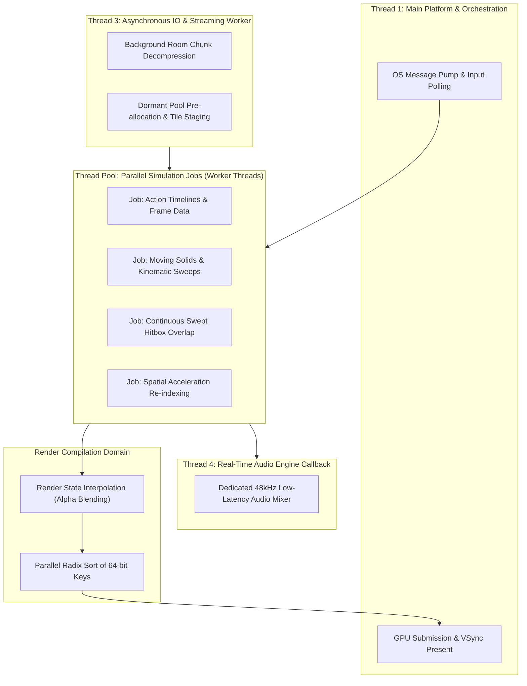

# METROIDVANIA ENGINE ARCHITECTURE SPECIFICATION
> **Target:** High-performance, data-driven, zero-allocation C++23 engine architecture tailored for exploration and combat-focused search-action (Metroidvania) games.  
> **Core Principle:** Multi-threaded, asynchronous engine domain architecture. Application/content-specific logic is strictly excluded.

---

## 1. Engine vs. Application Boundary

- **Engine Infrastructure Domain:** Multi-threaded job pool, asynchronous room streaming, real-time audio thread, decoupled render pipeline, kinematic solid-actor physics, action frame-data timelines, hitstop clock dilation, delta mutation journals, room-clamped camera director.
- **Application / Game Layer (Excluded):** Specific hero abilities, enemy AI scripts, numerical damage balancing, animation assets, quest logic, save slot UI.

---

## 2. Concurrent Multi-Threaded Engine Architecture

The engine is **not** a single monolithic sequential thread. It operates across **decoupled execution domains** communicating via lock-free ring buffers, double-buffered state snapshots, and job counter fences:

---

## 3. The 4 Concurrent Execution Domains

### Domain A: Main Platform & Orchestration Thread
- **Responsibilities:** Platform message pump (Win32 / SDL), raw hardware input sampling, presentation synchronization (VSync).
- **Decoupled Tick Execution:** Implements fixed-timestep accumulator pattern. Never blocks on simulation worker completion or disk IO.

### Domain B: Parallel Simulation Worker Pool (Job / Fiber System)
Runs the authoritative game simulation at fixed intervals ($60\text{ Hz}$ or $120\text{ Hz}$) distributed across $N$ worker threads:
1. **Stage 1 (Parallel Evaluation):** Worker threads concurrently evaluate Action Timelines, AI intent, moving solids, and particle velocities.
2. **Stage 2 (Kinematics & Swept Collision Barrier):** Worker threads process integer pixel sweeps (`MoveX`, `MoveY`), solid push/squish detection, and continuous swept hitbox intersections.
3. **Stage 3 (Commit Barrier):** Resolves damage/parry arbitration, commits mutation records to the `MutationJournal`, updates camera director, and publishes the frame snapshot.

### Domain C: Asynchronous IO & World Streaming Thread
- **Dedicated Background Worker:** Operates completely off the frame loop to prevent micro-stuttering during room transitions.
- **Three-Tier Streaming Lifecycle:**
  - `Active`: Rooms currently inside or adjacent to player; simulating ECS ticks.
  - `Staged`: Background worker thread IO / tile chunk parsing; entities pre-spawned into dormant memory pools.
  - `Evicted`: Serialized into mutation journal; memory returned to static arena.
- **Portals & Transitions:** Seamlessly pre-stages target rooms when the player approaches doorway triggers (`HardWipe` or `SeamlessScroll`).

### Domain D: Dedicated Real-Time Audio Thread
- **Independent High-Priority Callback:** Runs at 48kHz / 10ms hardware buffer periods.
- Reads double-buffered listener/emitter parameter snapshots published by the simulation domain.
- Never halts or drops audio frames during simulation hitstops, heavy garbage-free updates, or disk reads.

---

## 4. Core Subsystem Architectural Pillars

### Pillar 1: Kinematic Solid-Actor Platforming Engine
- **Solid vs. Actor Invariant:**
  - *Solids* (platforms, walls, moving elevators): Never collide with other solids. Process movement **first**.
  - *Actors* (player, enemies, projectiles): Move **second** via sub-pixel remainder sweeps (`MoveX`, `MoveY`).
- **Moving Solid Mechanics:**
  - *Rider Carrying:* Translates standing actors by solid movement delta $\Delta \vec{p}$.
  - *Pushing:* Moving solid sweeps bounding volume and pushes overlapping actors.
  - *Squish / Crush:* Triggers squish event if an actor is pinned against static geometry with zero escape offset.
- **Geometry Primitives:** Native 45°/22.5° slopes and one-way platform drop-throughs.

### Pillar 2: Action, Frame-Data & Combat Infrastructure
- **Track-Based Action Timeline:** Sampling of discrete frame windows:
  - *Phase Track:* `Startup` -> `Active` (hitbox on) -> `Recovery`.
  - *Cancel Windows:* Allowed interrupts (`DashCancel`, `JumpCancel`, `ParryCancel`).
- **Input Command Buffer:** Timestamped intent ring buffer (receives commands 3–6 frames ahead of recovery end).
- **Continuous Swept Hitbox:** Sweeps attack hulls between consecutive frames to eliminate high-speed tunneling.
- **Hit-Instance Registry:** Bitmask deduplication preventing multiple hits per target within a single attack cycle.
- **Time Dilation & Hitstop Clock:** Local entity time scaling and zero-drift micro-freezes (50–120ms) for impact feel without desynchronizing fixed-timestep physics.
- **Kinematic Impulses:** Non-mass-dependent velocity overrides with drag curves, surface bounce, and wall-splat events.

### Pillar 3: World Mutation Persistence
- **Deterministic Spatial GUID:** Reproducible entity ID derived from layout coordinates:
  $$\text{GUID} = \text{Hash}(\text{SectorId}, X_{\text{coord}}, Y_{\text{coord}}, \text{EntityTypeTag})$$
- **Sparse Mutation Journal:** Compact in-memory bitset delta store recording permanent changes (destroyed objects, unlocked doors, defeated bosses).
- **Streaming Sync:** Automatically writes deltas on room eviction and patches entities upon instantiation.

### Pillar 4: Camera Director
- **Convex Room Boundary Clamping:** Viewport $[cx \pm \frac{vw}{2}, cy \pm \frac{vh}{2}]$ is clamped strictly within `CurrentRoom.Bounds`.
- **Trauma Screen Shake:** Non-linear $\text{Trauma}^2$ impulse decay with directional vectors.
- **Multi-Target Framing:** Dynamic zoom and focus point convergence keeping both Player and Boss framed inside the active room.

---

## 5. Architectural Summary Matrix

| Subsystem Domain | Execution Model | Key Synchronization Mechanism | Primary Metric |
| :--- | :--- | :--- | :--- |
| **Main Orchestration** | Thread 1 (Main OS loop) | Atomic frame fences & accumulator | Zero latency input polling |
| **Simulation Jobs** | Worker Pool ($N$ Threads) | Task counter barriers & job graphs | Stable fixed-dt ticks |
| **Async Streaming** | Dedicated Worker Thread | Staging memory arena & IO ring buffer | Zero frame drops during transitions |
| **Real-Time Audio** | Dedicated Audio Callback | Double-buffered emitter snapshots | Glitch-free 48kHz audio buffer |
| **Render Extraction** | Parallel Job -> Main Present | 64-bit Radix Sort & State Interpolation | High-framerate variable VSync presentation |
| **Solid-Actor Physics** | Simulation Stage 2 | Sub-pixel integer remainder sweep | Deterministic zero-snag collision |
| **Action & Hit Testing** | Simulation Stage 1 & 2 | Continuous swept convex hulls | Zero tunneling at high velocities |
| **World Persistence** | Simulation Commit Stage | Spatial GUID bitset mutation journal | $O(1)$ delta lookup, compact RAM footprint |
