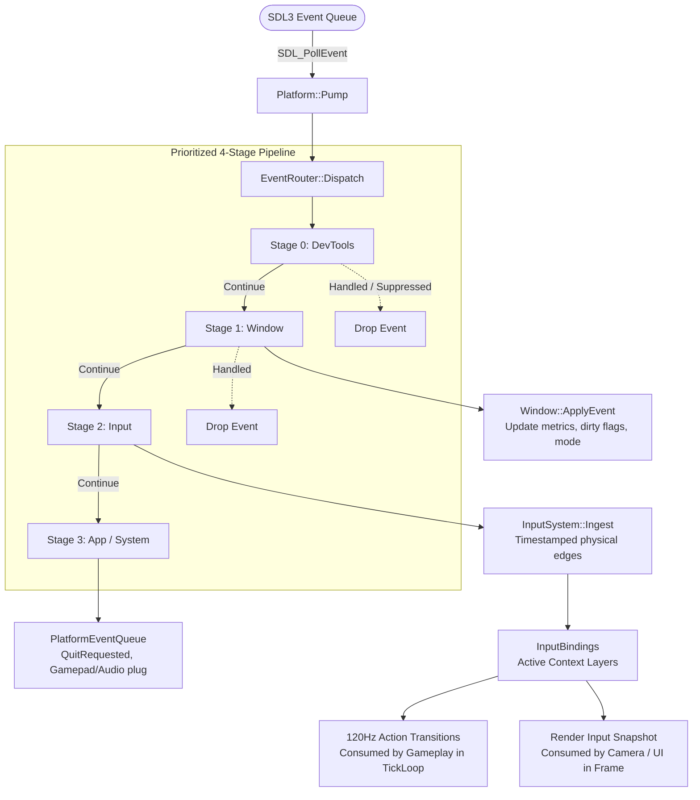

# EngineN — Platform & Input Architecture Context

> **Audience:** Future AI assistants & human contributors.  
> **Purpose:** Single-source-of-truth reference for the Platform and Input subsystems. Consult this document to understand lifecycle, dataflow, and boundaries without re-reading source code.

---

## 1. Architectural Philosophy & Golden Rules

1. **Single-Source Event Pump:**
   * `Platform::Pump(window, input)` is the **only** place in the engine allowed to call `SDL_PollEvent`.
   * Neither `Window`, `InputSystem`, nor gameplay code may ever poll or drain OS events directly.
2. **Deterministic 4-Stage Routing Pipeline (`EventRouter`):**
   * Events flow strictly through 4 priority stages:
     `Stage 0: DevTools` ➔ `Stage 1: Window` ➔ `Stage 2: Input` ➔ `Stage 3: App`
   * A stage returning `SinkVerdict::Handled` suppresses the event from downstream stages.
3. **Anti-Sticking Suppression Rule:**
   * When DevTools (ImGui / debug console) captures input, **Press/Continuous** events are suppressed, but **Release / Neutral** events **ALWAYS** pass through to guarantee player inputs never get permanently stuck held down.
4. **Zero Heap Allocation in Hot Path:**
   * Zero `malloc`, `new`, `std::vector`, or `std::string` during per-frame event processing.
   * All buffers use fixed inline capacity: `FixedVector<T, N>`, `FixedString<N>`, and delegate pointers `EventSinkRef`.
5. **Input ≠ Simulation State:**
   * Raw inputs are timestamped in integer nanoseconds (`u64 timestampNs`).
   * `InputSystem` evaluates physical device edges into logical actions (`ActionId`) and publishes 120Hz fixed-timestep tick batches (`ConsumeTick`) and visual frame snapshots (`PublishFrameSnapshot`).

---

## 2. System Data Flow

---

## 3. Module Breakdown & Responsibilities

### Platform Module (`src/platform/`)

| File / Component | Responsibility & Ownership |
| :--- | :--- |
| **`PlatformTypes.h / .cpp`** | Strong IDs (`WindowId`, `DisplayId`, `GamepadId`, `AudioDeviceId`), fixed containers (`FixedString`, `FixedVector`), `PlatformEvent`, error factory `MakePlatformError`. |
| **`Platform.h / .cpp`** | **Central coordinator.** Owns and initializes all subsystems (`Displays`, `Gamepads`, `AudioDevices`, `Paths`, `Clipboard`, `Specs`, `Router`). Executes single-source `Pump()`. |
| **`Window.h / .cpp`** | RAII wrapper over `SDL_Window`. State mirrored in `WindowState` (size, DPI scale, mode, focus). Tracks dirty bits via `WindowChange`. |
| **`Display.h / .cpp`** | `DisplayTopology`: Queries monitor topology, desktop modes, and refresh rates. Selects closest fullscreen mode (`FindClosestMode`). |
| **`Devices.h / .cpp`** | `GamepadRegistry` (tracks 8 player slots, rumble) + `AudioDeviceDirectory` (tracks audio playback/recording endpoints). |
| **`Services.h / .cpp`** | `PathService` (sandboxed paths), `Clipboard` (RAII string), `SystemSpecs` (hardware cores/RAM), `Dialogs` (crash message box). |
| **`EventRouting.h`** | `EventRouter` (4 stages), `EventSinkRef` (delegate function pointer), `DevToolsSink` (anti-sticking capture rule). |

### Input Module (`src/platform/input/`)

| File / Component | Responsibility & Ownership |
| :--- | :--- |
| **`InputTypes.h`** | Definitions of physical keys (`KeyCode`, `MouseButton`, `GamepadButton`, `GamepadAxis`), logical `ActionId`, `AxisId`, `InputState`. |
| **`InputBindings.h`** | Multi-context binding tables (e.g. Gameplay, Menu, Cutscene) supporting prioritized layering and chording. |
| **`ActionBuffer.h`** | Sub-tick ring buffer recording timestamped action transitions for forgiveness mechanics (jump buffer, coyote time). |
| **`InputSystem.h / .cpp`** | Core input coordinator: receives raw SDL events from `Stage 2`, resolves digital/analog axes via `TakeNewer`, feeds 120Hz fixed ticks (`ConsumeTick`) and frame interpolation snapshots. |

---

## 4. Key Boundaries & Invariants

* **Window Mode Requests:** Switching modes (`Windowed`, `BorderlessFullscreen`, `ExclusiveFullscreen`) goes through `Window::SetMode(request, displays)`. The renderer consumes updated pixel dimensions via `window.State().metrics.pixelSize`.
* **Audio Readiness:** `AudioDeviceDirectory` acts as a passive hardware inventory. Audio playback initialization is deliberately separated to prevent headless CI/test environment crashes.
* **No OS Dialogs in Gameplay:** File dialogs and native popups are strictly relegated to crash handlers (`Dialogs::ShowFatal`) or future editor tools. Game runtime never opens modal OS dialogs.
* **Thread Model:** All Platform and Input code runs deterministically on the **Main Thread**. No background worker threads or lock contention.
