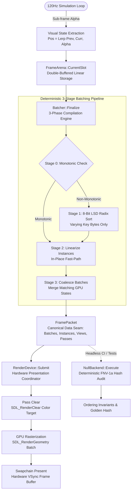

# EngineN — Renderer Architecture Context

> **Audience:** Future AI assistants & human contributors.  
> **Purpose:** Single-source-of-truth reference for the 2D Presentation and Renderer subsystem. Consult this document to understand lifecycle, dataflow, and boundaries without re-reading source code.

---

## 1. Architectural Philosophy & Golden Rules

1. **Single-Source Hardware Seam:**
   * `RenderDevice::Submit(packet)` is the **only** place in the engine allowed to execute drawing commands and call `SDL_RenderPresent`.
   * Neither `FrameArena`, `Batcher`, nor gameplay code may ever touch SDL rendering or GPU contexts directly.
2. **Deterministic 3-Stage Batching Pipeline (`Batcher`):**
   * Raw draw submissions flow strictly through 3 compilation stages:
     `Stage 0: Monotonic Check` ➔ `Stage 1: Radix Sort` ➔ `Stage 2: Linearize` ➔ `Stage 3: Coalesce`
   * Monotonically ordered submissions bypass Stage 1 and Stage 2 scratch copies completely via an $O(N)$ fast-path.
3. **Visual Order Priority Rule (High-Bits Invariant):**
   * Visual layering strictly takes precedence over GPU state grouping:
     `Pass (4b) > Layer (8b) > Depth (16b) > Blend (3b) > Pipeline (12b) > Texture (16b) > Spare (5b)`
   * State changes (`Blend`, `Pipeline`, `Texture`) are only grouped when visual order is identical, preventing visual flickering and z-fighting.
4. **Zero Heap Allocation in Hot Path:**
   * Zero `malloc`, `new`, `std::vector`, or `std::string` reallocations during per-frame rendering.
   * All buffers use boot-time pre-allocated static slots (`FrameArenaSlot`: 131,072 instances, 65,536 sort entries, 4,096 batches) and scratch arrays (`m_sortScratch`, `m_instanceScratch`, `m_vertexScratch`).
   * When capacity is exceeded, excess draws are dropped cleanly with logged telemetry rather than dynamically reallocated.
5. **Gameplay ≠ Presentation State:**
   * Simulation runs at a strict **120Hz fixed timestep**.
   * The presentation subsystem receives **pre-interpolated visual transforms** (`Pos = Lerp(prev, curr, alpha)`), never raw simulation ticks or physics velocities.

---

## 2. System Data Flow

---

## 3. Module Breakdown & Responsibilities

### Presentation Core & Storage (`src/renderer/`)

| File / Component | Responsibility & Ownership |
| :--- | :--- |
| **`RendererTypes.h`** | Canonical foundational types: float `Color` (with premultiplied/straight conversions), `Colors` palette constants, `FRect` (AABB clipping), `TextureHandle` (generational safety slot), `RenderPass`, `BlendMode`, `PresentMode`. |
| **`QuadInstance.h`** | Canonical 48-byte layout (`alignas(16)`): center position, size, pre-calculated `rotCosSin` (zero runtime trigonometry), unorm16 UV rect, packed premultiplied color, `QuadKind`, and flags (`FlipX`, `FlipY`). |
| **`SortKey.h`** | 64-bit packed sort key packing and bitfield queries. Defines the 16-byte aligned `SortEntry` linking key, instance offset, count, and view slot. |
| **`FramePacket.h`** | The clean boundary seam between CPU recording and GPU rendering. Houses `DrawBatch`, `ViewSlotDesc` (camera uniforms), `RenderPassDesc` (clear color), and `FramePacket` (`std::span` views). |
| **`FrameArena.h / .cpp`** | Double-buffered memory arena (`FrameArenaSlot[2]`). Provides atomic `PushQuad(quad, key, viewSlot)` and batch `PushQuads` methods with zero per-frame allocation and capacity drop safeguards. |

### Compilation & Execution Backend (`src/renderer/`)

| File / Component | Responsibility & Ownership |
| :--- | :--- |
| **`Batcher.h / .cpp`** | High-throughput sorter & coalescer. Performs 8-bit LSD Radix Sort across dynamically varying key bytes with monotonic bypass, linearizes instance memory, and merges compatible runs into contiguous `DrawBatch`es. |
| **`RenderBackend.h`** | Pure virtual interface defining `Result<void, EngineError> Execute(const FramePacket& packet)`. Enables seamless polymorphic swapping between hardware and test backends. |
| **`RenderDevice.h / .cpp`** | **Primary hardware presentation coordinator.** Wraps SDL3's GPU-accelerated `SDL_Renderer`. Translates `FramePacket` batches into `SDL_RenderGeometry` draw calls, manages VSync, clears passes, and presents the swapchain. |
| **`NullBackend.h / .cpp`** | Deterministic headless backend for CI and automated tests (`TestRenderer`). Audits ordering invariants and computes a 64-bit FNV-1a packet hash without requiring an OS window or GPU context. |

---

## 4. Key Boundaries & Invariants

* **Visual Ordering vs. State Coalescing:** High bits guarantee visual layering correctness. Two adjacent entries collapse into a single `DrawBatch` if and only if all GPU states match:
  $$\text{passId}_A = \text{passId}_B \quad\land\quad \text{viewSlot}_A = \text{viewSlot}_B \quad\land\quad \text{blendMode}_A = \text{blendMode}_B \quad\land\quad \text{pipelineId}_A = \text{pipelineId}_B \quad\land\quad \text{textureSlot}_A = \text{textureSlot}_B$$
* **Capacity Drop Policy:** When `FrameArenaSlot` capacity is reached, excess draws return `~0u` and are dropped with counter telemetry (`DroppedInstances`). Memory is never dynamically resized during gameplay.
* **Premultiplied Alpha Contract:** All color arithmetic and quad layouts use **Premultiplied Alpha**. Straight alpha colors must be converted via `Color::ToPremultipliedRGBA8()` before entering the arena.
* **Double-Buffered Overlap:** `FrameArena` manages 2 distinct slots (`SlotIndex() % 2`). Slot 0 records frame $N$ while slot 1 is consumed by the backend. Advancing happens strictly via `arena.AdvanceSlot()` at frame boundaries.
* **Thread Model:** All presentation recording, sorting, and submission code runs deterministically on the **Main Thread**. No background worker threads or lock contention.
